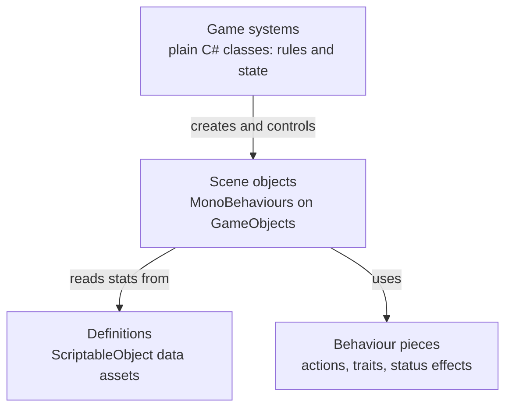
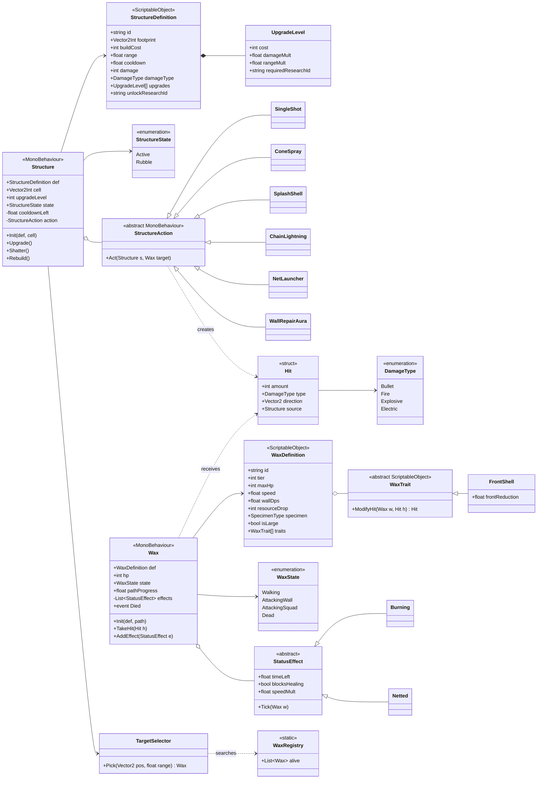
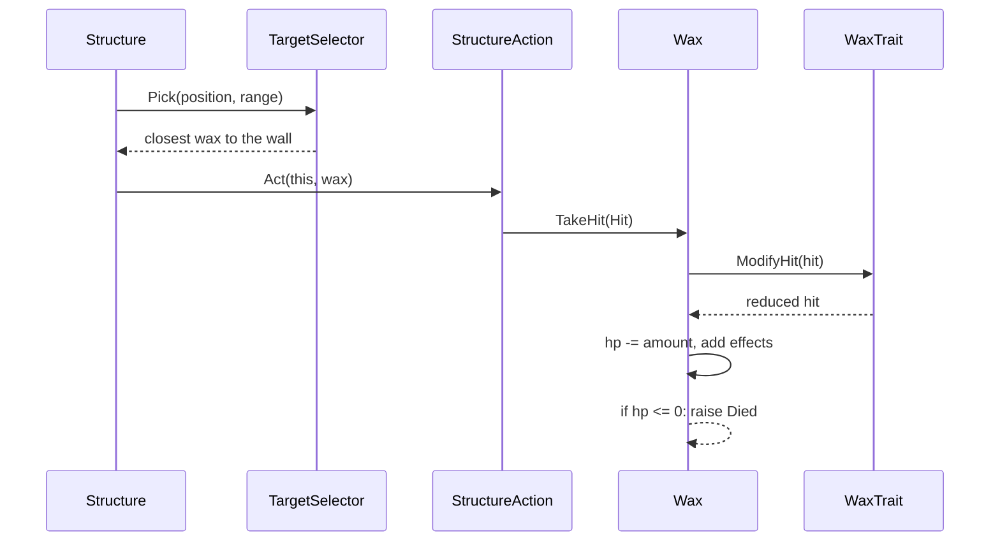
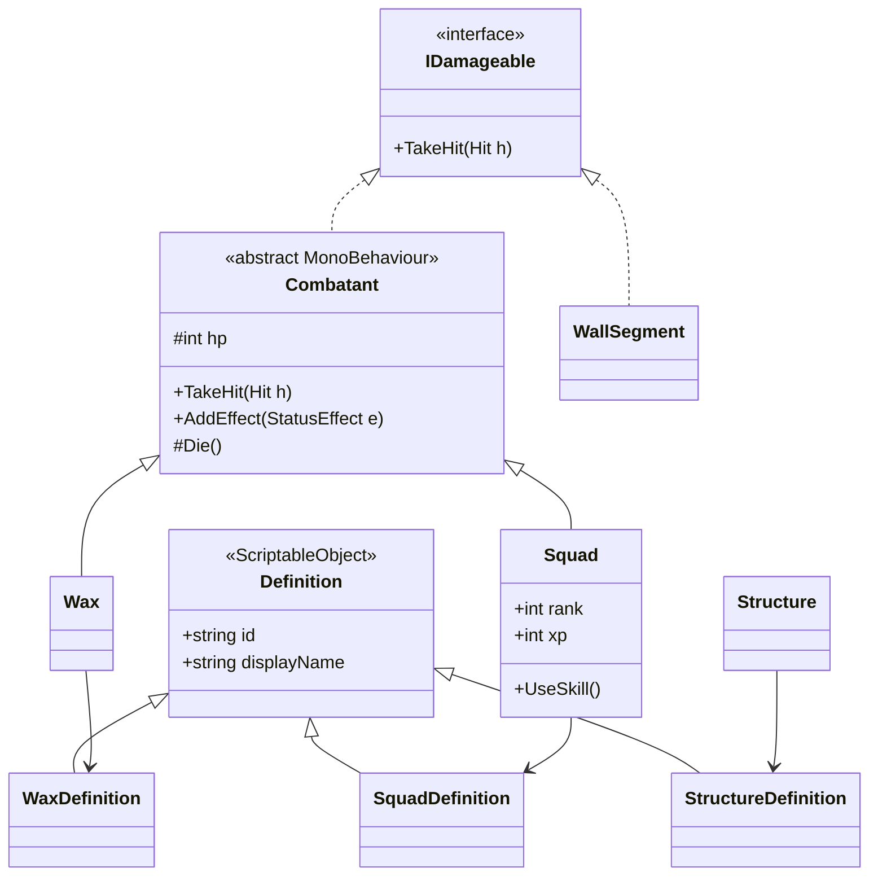
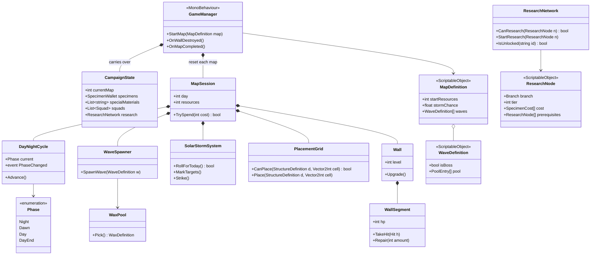

# Guardian of Dawn – Class Design (MVP)

Class design for the 50% MVP in GDD v2 §14.2: maps 1–2, 6 structures, tier 1–2 wax plus Sáp vụn and Sáp vỏ cua, Lính trấn thủ and Thợ săn squads, research tiers 1–2, basic solar storms. Engine: Unity 2D (GDD §12.1).

## 1. Overview: four layers

| Layer | What it is | Examples |
|---|---|---|
| Game systems | Plain C# (`new`), or one manager MonoBehaviour | `DayNightCycle`, `WaveSpawner`, `ResearchNetwork` |
| Scene objects | Components on GameObjects in the scene, created with `Instantiate` | `Structure`, `Wax`, `Squad`, `WallSegment` |
| Definitions | Data assets edited in the Inspector, shared by every copy | `MachineGun.asset`, `TigerWax.asset`, `Map1.asset` |
| Behaviour pieces | Small swappable classes that vary behaviour | `SingleShot`, `FrontShell`, `Burning` |

## 2. Design decisions

| # | Decision | Reason |
|---|---|---|
| D1 | Data-driven: stats live in ScriptableObject definitions, not in subclasses | GDD tables map straight to assets; new units are mostly new data |
| D2 | One `Structure` class for every tower; its attack is a `StructureAction` component on the tower prefab (e.g. `MachineGun.prefab` = `Structure` + `SingleShot`) | Normal Unity composition; visible and editable in the Inspector |
| D3 | `Structure` is not damageable and has no HP | GDD §4.7: structures are never attacked; only storms destroy them |
| D4 | Damage is a `Hit` record (amount, type, direction, source), not a plain number | Counters depend on *how* a wax is hit (front shell vs. mortar from above, fire blocks healing) |
| D5 | Special wax behaviour is a `WaxTrait`; plain wax is data only | Sáp vụn and tiger wax need no code; later variants plug in without changing `Wax` |
| D6 | Bosses are `WaxDefinition`s with `isLarge = true`, not a separate class | Sáp Nguyên Thủy is "tier 1, but huge"; `isLarge` makes nets slow instead of pin |
| D7 | `CampaignState` (kept between maps) is separate from `MapSession` (rebuilt each map) | Matches the carry-over table in GDD §4.8; losing a map = discard the session |

## 3. Wax and Structure

### Structure

- One class for all 6 MVP towers. Prefab = `Structure` + one `StructureAction` component:

| Tower | Action | Damage type |
|---|---|---|
| Súng máy | `SingleShot` | Bullet |
| Súng phun lửa | `ConeSpray` (adds `Burning`) | Fire |
| Súng cối | `SplashShell` | Explosive |
| Tháp gia cố | `WallRepairAura` (no target) | – |
| Tháp điện chuỗi | `ChainLightning` (3–5 bounces, less damage per bounce) | Electric |
| Tháp phóng lưới | `NetLauncher` (adds `Netted`) | – |

- Each frame: cooldown runs out → `TargetSelector` picks the wax in range closest to the wall → `action.Act(this, target)`.
- `Shatter()` (solar storm): state → `Rubble`, `upgradeLevel` → 0. `Rebuild()` costs 50% of `buildCost`.
- `Upgrade()` checks the next `UpgradeLevel`'s cost and research requirement.

### Wax

| Wax | How it's built |
|---|---|
| Bậc 1 – tiêu chuẩn | Data only |
| Bậc 2 – hổ | Data only (high speed, low HP) |
| Sáp vụn | Data only (tiny HP); the wave spawns it in groups of 10–20 |
| Sáp vỏ cua | Data + `FrontShell` trait (cuts `Bullet` hits from the front) |
| Bosses (Sáp Nguyên Thủy, map 2 boss) | Data only: large HP, `isLarge = true` |

- States: `Walking` along the map path → `AttackingWall` / `AttackingSquad` → `Dead`.
- On death it raises `Died`; listeners give resources and specimens and count down the wave.

### How a hit flows

### Later maps plug in without changing `Wax` or `Structure`

- New traits: Sáp gương reflects single-target `Bullet` hits; Sáp bào tử splits on death unless `Burning`; Dị Thể Sáp hồi phục heals nearby wax (blocked by `blocksHealing`).
- New actions: `FreezeAura` (Tháp làm lạnh), `SolventPool`, `HeatLure`, `PiercingShot`; Cột thu sáng intercepts storm strikes.
- New state: `Overheated` for Giáp phản quang.

## 4. Combat classes overview

`Wax` and `Squad` share `Combatant` because both have HP and both get hit. `Structure` is deliberately outside this tree (D3). `IDamageable` is what wax attack: squads and wall segments.

## 5. Game systems

One day: `DayNightCycle` raises `PhaseChanged` → at Dawn `SolarStormSystem.RollForToday()`; during Day `WaveSpawner` spawns from `WaxPool` and storms `MarkTargets()` 10 s before `Strike()`; at Night `PlacementGrid` allows building. Wall falls → `GameManager` discards the `MapSession` and starts a new one from the same `CampaignState`.

## 6. UML legend

| Arrow | Meaning | Example |
|---|---|---|
| `<\|--` solid, hollow triangle | Inheritance ("is-a") | `Wax` is a `Combatant` |
| `<\|..` dashed, hollow triangle | Implements an interface | `WallSegment` implements `IDamageable` |
| `*--` filled diamond | Composition: owns it, same lifetime | `MapSession` owns `Wall` |
| `o--` hollow diamond | Aggregation: has it, can be swapped | `Structure` has a `StructureAction` |
| `-->` plain arrow | Association: uses / reads | `Wax` reads `WaxDefinition` |
| `..>` dashed arrow | Dependency: creates or receives briefly | `StructureAction` creates a `Hit` |
