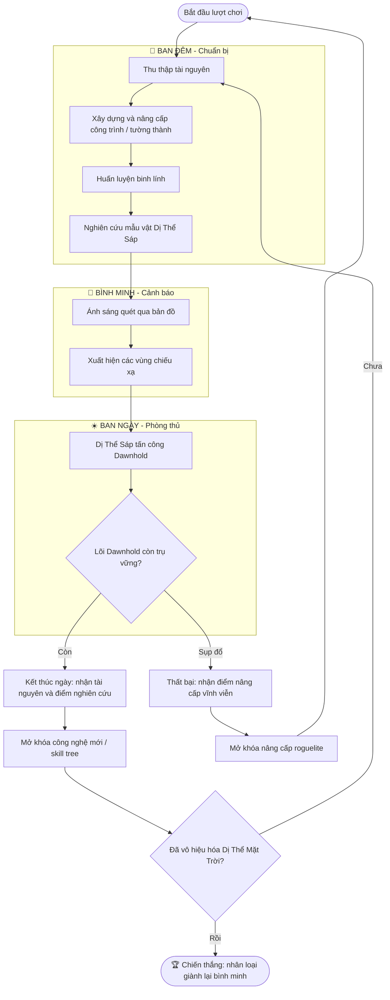

## 1. High Concept

***Hằng tinh đã phản bội. Bóng tối là tuyến phòng thủ cuối cùng.*** 

Khi mặt trời dị biến, thứ ánh sáng đã nuôi sống nhân loại đã trở thành thứ vũ khí chống lại loài người, trong vòng 24h kể từ khi mặt trời biến đổi, đã có 6.8 tỷ thương vong đã được ghi nhận. Sự kiện này được gán tên “Khi ngày tàn”. Mọi sinh vật sống tiếp xúc với ánh sáng của mặt trời sẽ nhanh chóng hóa lỏng thành dị thể sáp, những tàn dư của sự sống, bị thu hút bởi hơi ấm của sự sống.

Bạn là chỉ huy trưởng của Dawnhold, một trong những vùng an toàn còn sót lại của nhân loại, nhiệm vụ của bạn là giữ vững phòng tuyến, nghiên cứu và vô hiệu hóa dị thể mặt trời nhằm đưa nhân loại trở lại với ánh sáng.

***Liệu nhân loại có thể giành lại bình minh, hay chính bình minh sẽ xóa sổ nhân loại?***
## 2. Game Description

Với cương vị Chỉ huy trưởng, bạn phải bảo vệ Dawnhold trước các đợt tấn công của Dị Thể Sáp mỗi khi bình minh lên. Khi đêm xuống, bạn có thời gian để:

- Xây dựng và nâng cấp công trình phòng thủ.
- Huấn luyện binh lính.
- Nghiên cứu các Dị Thể Sáp để khám phá bí mật của Dị Thể Mặt Trời và tìm con đường sống còn cho nhân loại.

Mỗi ngày trôi qua, ánh sáng mạnh hơn và các đợt tấn công khắc nghiệt hơn. Bạn phải học cách sống chung với bóng tối.
## 3. Core Gameplay Loop

1. **Ban đêm (Chuẩn bị):** Thu thập tài nguyên, xây dựng và nâng cấp công trình, huấn luyện binh lính, nghiên cứu mẫu vật.
2. **Bình minh (Cảnh báo):** Ánh sáng bắt đầu quét qua bản đồ và các vùng chiếu xạ xuất hiện.
3. **Ban ngày (Phòng thủ):** Chống lại các đợt tấn công của Dị Thể Sáp.
4. **Kết thúc ngày:** Nhận tài nguyên và điểm nghiên cứu, mở khóa công nghệ mới.
5. **Thất bại hoặc chiến thắng:** Thất bại vẫn nhận điểm nâng cấp vĩnh viễn để khởi đầu mạnh hơn ở lượt chơi sau.

## 4. Key Features

-  Hệ thống ngày và đêm: bảo vệ thành vào buổi sáng, xây dựng và nâng cấp thành vào buổi đêm
- Cơ chế ánh sáng và bóng tối: khi 1 khu vực bị ánh sáng chiếu đến, công trình sẽ không hoạt động, binh lính sẽ bị mất máu theo thời gian
- Xây dựng và mở rộng vùng an toàn: nghiên cứu càng nhiều, bạn sẽ có thêm công cụ và tài nguyên để chống lại ánh sáng
- Hệ thống skill tree cho từng công trình, tường thành và binh lính
- Hệ thống nâng cấp vĩnh viễn sau khi phòng thủ thất bại (dạng roguelite)
## 5. Genre, Spin, and Flavor

- **Genre:** Strategy / Tower Defense
- **Spin:** Roguelite, với tiến trình nâng cấp vĩnh viễn giữa các lượt chơi
- **Flavor:** Sci-fi hậu tận thế, kinh dị sinh tồn, bầu không khí u ám nhưng giàu hy vọng
## 6. Player Goals and Choices

### Mục tiêu chính

-   Sống sót khỏi những đợt tấn công của dị thể sáp.
-   Nghiên cứu và vô hiệu hóa dị thể mặt trời
-   Dẫn dắt nhân loại thoát khỏi tận thế.
### **Lựa chọn quan trọng**

- Vị trí đặt công trình: tận dụng địa hình để phòng thủ.
- Loại công trình và binh lính cần xây dựng, huấn luyện.
- Hướng nâng cấp trong skill tree.
- Phân bổ tài nguyên giữa phòng thủ, nghiên cứu và mở rộng.
- Ưu tiên nghiên cứu để mở khóa công nghệ chống ánh sáng.
## 7. Maintaining Player Interest

- Kẻ địch mạnh hơn và đa dạng hơn theo từng ngày, kèm theo các trận đánh trùm.
- Công trình, tường thành và binh lính mới mở khóa dần qua nghiên cứu.
- Khu vực chiếu sáng thay đổi theo ngày.
- Câu chuyện được hé lộ dần qua các mẫu vật nghiên cứu.
- Mỗi lần thất bại đều giúp bạn mạnh hơn, nên người chơi luôn muốn thử lại.
## 8. Target Platform and Audience

- **Nền tảng:** PC
- **Đối tượng:** Người chơi yêu thích lập kế hoạch chiến lược, tower defense, nâng cấp đơn vị và vượt qua những thử thách ngày càng khó.
