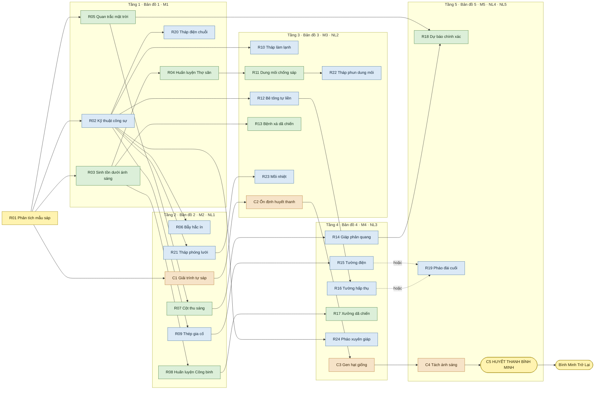

# Guardian of Dawn – Game Design Document (v2)

*Phiên bản 2 – hướng chiến dịch cứu chữa. Khác bản gốc: mục tiêu là chữa Dị Thể Sáp trở lại thành người (cột mốc cốt truyện, không phải cơ chế trong trận); chiến dịch 5 bản đồ có cốt truyện; ánh sáng không còn ảnh hưởng tới công trình hay binh lính, nhưng bão mặt trời hiếm gặp phá hủy 1–2 công trình ngẫu nhiên; binh lính mở khóa qua nghiên cứu; 3 loại binh lính (Lính trấn thủ, Thợ săn, Công binh); bỏ Lính mang bóng, máy tạo bóng tối, độ sáp hóa, roguelite, thiết lập độ khó và các kết thúc phụ – chỉ còn một kết thúc.*

Unified editable master template  |  Worked examples throughout

A practical specification for game vision, player experience, mechanics, worlds, content, user experience, production decisions and validation.

| | |
|---|---|
| **GAME TITLE** | Guardian of Dawn |
| **PREPARED BY** |   |
| **DOCUMENT VERSION** |   |
| **LAST UPDATED** |   |

## How to use this document

This is one coherent, fillable GDD. Each numbered item contains a writing prompt and an illustrative example. Replace the example text with your game’s approved or proposed information, then remove the prompt if producing an external-facing GDD. Retain meaningful IDs and links to related source files.

- Write player-observable rules: inputs, preconditions, states, effects, feedback, limits and error/recovery behavior.
- Separate committed scope from hypotheses; mark unfinished decisions as Proposed rather than claiming uncertain values as facts.
- Use this document for gameplay and experience decisions. Use a technical design document for algorithms, code architecture and infrastructure.
- Keep only applicable sections, but state “Not applicable” when an important capability (such as multiplayer) is intentionally absent.
- Treat this as a living specification. Update sample figures when prototype/playtest evidence changes the decision.
- Editorial note: No single universal GDD format exists. The consolidation preserves the key design topics of the supplied outlines and adds explicitly identified modern practices (scope control, accessibility, validation, traceability, release planning). Sections may be reorganized to match the actual genre and studio.
- Reading notes  •  P0/P1/P2 indicate priority; “optional” sections may be excluded after an explicit scope decision. This unified template is a recommended structure, not an official universal GDD standard.

## 0. Document Control & How to Use This Template

> *Start here. Replace each EXAMPLE paragraph with your own game content, preserving the section headings that apply. Write “Not applicable — because …” for genuinely irrelevant topics; remove optional chapters when justified. Keep the GDD updated as playtests change decisions.*

### 0.1 Project identity and ownership

> *WHAT TO DOCUMENT  Record the game title, short tagline, document owner, team, document status, version and last update.*

Tên game: Guardian of Dawn. Tagline: “Hằng tinh đã phản bội. Bóng tối là tuyến phòng thủ cuối cùng.”

### 0.2 Document purpose and intended readers

> *WHAT TO DOCUMENT  State what decisions this document defines and who should rely on it. Distinguish GDD from implementation plans.*

### 0.3 Scope labels, assumptions and decisions

> *WHAT TO DOCUMENT  Define scope and status labels so readers can tell approved design from ideas and unverified hypotheses.*

### 0.4 Revision and decision history

> *WHAT TO DOCUMENT  Summarize meaningful changes with date, editor and reason, not every grammatical correction.*

*Example revision log*

### 0.5 Source of truth and cross-references

> *WHAT TO DOCUMENT  Specify where assets, technical specs, tasks and diagrams live. Do not duplicate authoritative definitions.*

## 1. Game Overview & High Concept

### 1.1 One-sentence high concept

> *WHAT TO DOCUMENT  Define genre, viewpoint, player role, primary activity and distinctive hook in one or two sentences.*

Guardian of Dawn là game Strategy / Tower Defense theo chiến dịch, trong đó người chơi vào vai Chỉ huy trưởng của Dawnhold, dẫn đoàn viễn chinh qua 5 vùng đất, dựng phòng tuyến vào ban đêm, chống lại Dị Thể Sáp mỗi khi bình minh lên, và thu thập 5 nguyên liệu đặc biệt để chữa Dị Thể Sáp trở lại thành người.

### 1.2 Design vision and player fantasy

> *WHAT TO DOCUMENT  Describe the emotional experience, not merely the feature set.*

Khi mặt trời dị biến, thứ ánh sáng đã nuôi sống nhân loại trở thành vũ khí chống lại loài người. Mọi sinh vật sống tiếp xúc với ánh sáng mặt trời nhanh chóng hóa lỏng thành Dị Thể Sáp – những tàn dư của sự sống, bị thu hút bởi hơi ấm của sự sống.

Người chơi là Chỉ huy trưởng của Dawnhold. Nghiên cứu mẫu vật cho thấy Dị Thể Sáp vẫn còn mang dấu vết của con người – chúng có thể được cứu. Người chơi dẫn đoàn viễn chinh rời Dawnhold, giữ vững từng tiền đồn tạm thời đủ lâu để lấy được nguyên liệu chữa trị ở mỗi vùng đất. Mỗi bản đồ hoàn thành là một bước tiến tới ngày những người đã mất được đưa trở về.

Câu hỏi trung tâm: “Liệu nhân loại có thể cứu được những người đã mất vào ánh sáng?”

### 1.3 Design pillars and non-goals

> *WHAT TO DOCUMENT  Give two to four decision-making principles and explicit things the project will not try to do.*

### 1.4 Genre, perspective and player role

> *WHAT TO DOCUMENT  Identify primary genre, secondary influences, avatar and relationship between player and world.*

Thể loại chính: Strategy / Tower Defense. Spin: chiến dịch 5 bản đồ có cốt truyện; nghiên cứu được giữ xuyên suốt chiến dịch. Vai trò người chơi: Chỉ huy trưởng của Dawnhold – quyết định xây dựng, nâng cấp, huấn luyện và nghiên cứu; trong ban ngày, công trình tự động chiến đấu; người chơi di chuyển Thợ săn và Công binh, và tự canh thời điểm kích hoạt kỹ năng của binh lính. Đồ họa: 2D (góc camera cần nghiên cứu thêm).

### 1.5 Target platforms and play context

> *WHAT TO DOCUMENT  Specify primary/secondary platforms and input devices; note what is validated versus aspirational.*

Nền tảng: PC. Engine: Unity.

### 1.6 Game modes and game length

> *WHAT TO DOCUMENT  Describe single-player/co-op/competitive modes and likely session/campaign lengths as design targets.*

Chế độ chơi: single-player.

Chiến dịch gồm 5 bản đồ chơi theo thứ tự. Mỗi bản đồ có số ngày cố định (8–15 ngày, mỗi ngày một đợt); tổng cộng 57 ngày. Thua một bản đồ thì chơi lại bản đồ đó từ đầu. Chiến dịch kết thúc khi hoàn thành bản đồ 5 và điều chế Huyết thanh Bình Minh. Không có thiết lập độ khó: độ khó chỉ tăng theo thứ tự bản đồ.

### 1.7 Visual and tonal summary

> *WHAT TO DOCUMENT  Use a short description of the art, audio and emotional tone.*

Đồ họa 2D, phong cách lấy cảm hứng từ SCP. Flavor: Sci-fi hậu tận thế, kinh dị sinh tồn; bầu không khí u ám nhưng giàu hy vọng.

### 1.8 Unique selling proposition (USP)

> *WHAT TO DOCUMENT  Explain a concrete differentiation that players can observe; avoid claiming no competitors exist.*

Bão mặt trời: ánh sáng không còn là mối nguy hằng ngày, mà là một rủi ro hiếm gặp nhưng nặng nề – mỗi cơn bão phá hủy 1–2 công trình ngẫu nhiên, kèm toàn bộ cấp nâng cấp của chúng. Người chơi phải cân nhắc giữa dồn tài nguyên vào vài công trình mạnh hay rải ra nhiều công trình, và đầu tư vào phòng ngừa (Cột thu sáng, Giáp phản quang) hay vào hỏa lực. Cốt truyện là hành trình chữa Dị Thể Sáp: mỗi bản đồ hoàn thành mang về một nguyên liệu và một cột mốc chữa trị.

## 2. Audience, Market & Product Position

### 2.1 Primary and secondary audiences

> *WHAT TO DOCUMENT  Describe motivations, experience level, access needs and platform habits without unsupported demographic stereotypes.*

Người chơi yêu thích lập kế hoạch chiến lược, tower defense, nâng cấp đơn vị và vượt qua những thử thách ngày càng khó.

### 2.2 Comparable games and differentiation

> *WHAT TO DOCUMENT  Use two or three relevant games to explain mechanics or positioning; distinguish inspiration from copied content.*

### 2.3 Player promise and success criteria

> *WHAT TO DOCUMENT  State what a good play session delivers and what observable behavior would validate it.*

### 2.4 Business objective and distribution hypothesis

> *WHAT TO DOCUMENT  Distinguish product design from validated market plans and make preliminary assumptions explicit.*

### 2.5 Content suitability and rating intent

> *WHAT TO DOCUMENT  Document sensitive content and intended rating targets; rating decisions belong to rating bodies.*

## 3. Player Experience, Goals & Game Flow

### 3.1 Player objective and victory/failure states

> *WHAT TO DOCUMENT  State a measurable objective and all relevant completion, retry and loss rules.*

Mục tiêu ngắn hạn: giữ tường thành của tiền đồn hiện tại, sống sót qua mọi ngày của bản đồ.

Mục tiêu trung hạn: hoàn thành bản đồ – đánh bại Dị Thể Sáp nguồn (trùm) vào ngày cuối và nhận nguyên liệu đặc biệt của bản đồ đó.

Mục tiêu dài hạn: thu thập đủ 5 nguyên liệu, phát triển mạng nghiên cứu và điều chế Huyết thanh Bình Minh để chữa Dị Thể Sáp trở lại thành người.

Hoàn thành một ngày: mỗi ngày có một đợt tấn công; tiêu diệt toàn bộ Dị Thể Sáp của đợt đó.

Chiến thắng – “Bình Minh Trở Lại”: kết thúc duy nhất của game. Đạt được khi hoàn thành bản đồ 5 và nghiên cứu xong Huyết thanh Bình Minh.

Thất bại – “Tiền đồn thất thủ”: khi tường thành bị phá hủy, bản đồ hiện tại thất bại. Người chơi chơi lại bản đồ đó từ ngày 1, với nghiên cứu, đội lính và nguyên liệu như lúc bắt đầu bản đồ. Không có game over vĩnh viễn.

### 3.2 Core gameplay loop

> *WHAT TO DOCUMENT  Express repeated player actions, system responses and rewards in a short cycle.*

1. Ban đêm (Chuẩn bị): dùng tài nguyên để xây dựng/nâng cấp công trình và tường thành, huấn luyện binh lính; dùng mẫu vật thu thập được để nghiên cứu công nghệ, công trình và kỹ thuật mới.

2. Bình minh (Cảnh báo): hệ thống phát cảnh báo bắt đầu phòng thủ. Nếu hôm nay có bão mặt trời, cảnh báo bão được phát.

3. Ban ngày (Phòng thủ): công trình và binh lính tự động chống lại Dị Thể Sáp; người chơi di chuyển Thợ săn và Công binh, và kích hoạt kỹ năng chủ động của binh lính đúng thời điểm. Tiêu diệt Dị Thể Sáp nhận tài nguyên và mẫu vật nghiên cứu; tiêu diệt toàn bộ để hoàn thành ngày.

4. Kết thúc ngày → quay lại ban đêm và lặp lại chu kỳ. Sau ngày cuối của bản đồ (trùm) → nhận nguyên liệu, xem chương truyện, chuyển sang bản đồ tiếp theo.

### 3.3 Secondary and long-term loops

> *WHAT TO DOCUMENT  Explain supportive loops and how they differ from the main play cycle.*

Mạng nghiên cứu (xuyên suốt chiến dịch): một mạng nghiên cứu chung, không tuyến tính, gồm ba nhánh – Phòng thủ (công trình, tường thành), Sinh tồn (binh lính, bão mặt trời) và Chữa trị (dùng nguyên liệu đặc biệt; các cột mốc cốt truyện dẫn đến Huyết thanh Bình Minh). Mạng có 5 tầng, mỗi tầng ứng với một bản đồ.

Nút nghiên cứu được mở khóa theo loại mẫu vật đã thu thập: mỗi loại Dị Thể Sáp rơi ra loại mẫu vật riêng, và mỗi bản đồ giới thiệu một loại Dị Thể Sáp mới, nên tầng nghiên cứu mới mở ra theo tiến trình chiến dịch. Câu chuyện được hé lộ dần qua các mẫu vật nghiên cứu.

Chiến dịch (giữa các bản đồ): nghiên cứu, đội lính (kèm cấp bậc) và nguyên liệu được mang sang bản đồ tiếp theo. Công trình, tường thành và tài nguyên bắt đầu lại ở mỗi bản đồ mới (tiền đồn mới). Xem mục 5.1.

Chi tiết các nút, yêu cầu mẫu vật và sơ đồ: xem mục 4.9 – Mạng nghiên cứu (chi tiết).

### 3.4 Minute-to-minute play flow

> *WHAT TO DOCUMENT  Describe the actual order of input, feedback and resulting state changes from the player viewpoint.*

### 3.5 Game-state and screen flow

> *WHAT TO DOCUMENT  List the major states and transitions, including pause, death and restart behavior.*

### 3.6 Difficulty curve and onboarding

> *WHAT TO DOCUMENT  Describe what gets harder and which new idea is introduced at each point.*

Độ khó tăng theo bản đồ (không có thiết lập độ khó riêng): mỗi bản đồ dài hơn, có nhiều hướng tấn công hơn, bão mặt trời thường xuyên hơn và một bậc Dị Thể Sáp mới. Trong một bản đồ, đợt tấn công mạnh dần mỗi ngày và ngày cuối là trận đánh trùm.

Mỗi bản đồ giới thiệu một ý tưởng mới:

| Bản đồ | Ý tưởng mới |
|---|---|
| 1 – Ngoại ô | Lõi tower defense; mở khóa binh lính qua nghiên cứu; một cơn bão mặt trời hướng dẫn; biến thể Sáp vụn (bầy đông) và Tháp điện chuỗi |
| 2 – Cầu cảng | Dị Thể Sáp hổ (tốc độ); 2 hướng tấn công; bão mặt trời ngẫu nhiên; Công binh; biến thể Sáp vỏ cua (giáp phía trước) và Tháp phóng lưới |
| 3 – Phố cổ đổ nát | Dị Thể Sáp hồi phục; đất xây hẹp; biến thể Sáp bào tử (vỡ ra khi chết); Tháp phun dung môi và Mồi nhiệt |
| 4 – Đồng bằng trắng | Dị Thể Sáp thấu kính (hội tụ ánh sáng lên công trình); 3 hướng tấn công; biến thể Sáp gương (phản đạn); Pháo xuyên giáp |
| 5 – Đài thiên văn | Dị Thể Sáp tối thượng; biến thể Sáp kích động (tăng tốc đồng loại); mọi mối nguy cùng lúc |

Chi tiết từng bản đồ: mục 5.3.

### 3.7 Feedback and reward cadence

> *WHAT TO DOCUMENT  Specify information provided after actions and why players will continue.*

Xây dựng: công trình hiển thị trên UI kèm âm thanh và báo hiệu. Chiến đấu: tiêu diệt Dị Thể Sáp nhận tài nguyên và mẫu vật. Nghiên cứu: công trình, tường thành và binh lính mới được mở khóa dần; câu chuyện được hé lộ qua mẫu vật. Hoàn thành bản đồ: nhận nguyên liệu đặc biệt, đạt một cột mốc chữa trị (cảnh truyện) và mở bản đồ tiếp theo – người chơi thấy rõ mình tiến gần tới việc cứu nhân loại.

## 4. Gameplay Mechanics & Game Rules

> *This is the most implementation-sensitive design chapter: express exact observable behavior, numerical rules, boundary cases and expected feedback. Keep code structure, rendering algorithms and networking protocols in technical specifications.*

### 4.1 Rule taxonomy and glossary

> *WHAT TO DOCUMENT  Define critical nouns, units, states and invariants that are used across the document.*

Dawnhold: một trong những vùng an toàn còn sót lại của nhân loại; nơi đoàn viễn chinh xuất phát.

Tiền đồn: căn cứ tạm thời đoàn viễn chinh dựng ở mỗi bản đồ; người chơi bảo vệ tường thành của tiền đồn.

Dị Thể Mặt Trời: mặt trời đã dị biến – nguồn gốc của thảm họa.

“Thảm họa: Khi Ngày Tàn”: tên sự kiện mặt trời biến đổi; 6,8 tỷ thương vong được ghi nhận trong vòng 24 giờ.

Dị Thể Sáp: sinh vật sống bị ánh sáng mặt trời hóa lỏng; kẻ địch chính, bị thu hút bởi hơi ấm của sự sống.

Bão mặt trời: sự kiện hiếm; tia sáng cực mạnh đánh xuống 1–2 công trình ngẫu nhiên và phá hủy chúng. Là cách duy nhất ánh sáng ảnh hưởng tới trận đánh.

Mẫu vật: thu được khi tiêu diệt Dị Thể Sáp; mỗi loại Dị Thể Sáp rơi ra loại mẫu vật riêng. Dùng để mở khóa và thực hiện nghiên cứu.

Nguyên liệu đặc biệt: 5 nguyên liệu chữa trị, mỗi bản đồ cho đúng một nguyên liệu khi hoàn thành. Dùng cho nhánh Chữa trị – mỗi nguyên liệu mở một cột mốc chữa trị.

Mạng nghiên cứu: hệ thống nghiên cứu chung gồm ba nhánh – Phòng thủ, Sinh tồn và Chữa trị; 5 tầng ứng với 5 bản đồ.

Huyết thanh Bình Minh: nghiên cứu cuối cùng, cần cả 5 nguyên liệu; hoàn thành → kết thúc Bình Minh Trở Lại.

Tường thành: tuyến phòng thủ chính của tiền đồn; nâng cấp tường thành mở rộng khu vực đặt công trình. Tường thành bị phá hủy = thua bản đồ.

Tiền đồn thất thủ: màn hình thất bại khi tường thành bị phá hủy; người chơi chơi lại bản đồ từ ngày 1.

Tài nguyên: thu được khi tiêu diệt Dị Thể Sáp; dùng để xây dựng, nâng cấp, huấn luyện và sửa chữa. Không mang sang bản đồ sau.

Bậc tiến hóa: 5 bậc Dị Thể Sáp; mỗi bản đồ giới thiệu một bậc mới (bản đồ N → bậc N).

Biến thể: phiên bản đột biến của một bậc đã có, mỗi bản đồ thêm một biến thể (tổng 5). Biến thể rơi cùng loại mẫu vật với bậc gốc.

Bể Dị Thể Sáp: tỷ lệ ẩn của từng loại Dị Thể Sáp, quyết định thành phần mỗi đợt; mở khóa dần khả năng xem qua nhánh Chữa trị (loại → tỷ lệ ước lượng → tỷ lệ chính xác).

Đợt (wave): mỗi ngày có đúng một đợt tấn công của Dị Thể Sáp; đợt N = ngày N của bản đồ hiện tại.

Dị Thể Sáp nguồn: trùm của mỗi bản đồ, xuất hiện vào ngày cuối; là phiên bản lớn của bậc mới trên bản đồ đó và giữ nguyên liệu đặc biệt.

Đội lính (squad): đơn vị binh lính gồm nhiều thành viên; 3 loại (Lính trấn thủ, Thợ săn, Công binh); tối đa 3 đội; chỉ có sau khi nghiên cứu Sinh tồn dưới ánh sáng. Sau đó binh lính không bị ánh sáng ảnh hưởng.

Cấp bậc: kinh nghiệm riêng của từng đội, nhận qua số lượng Dị Thể Sáp tiêu diệt (Công binh: theo lượng sửa chữa/xây lại); mất khi toàn bộ đội chết trong một đợt; được mang sang bản đồ sau.

### 4.2 Movement and traversal (MEC-01)

> *WHAT TO DOCUMENT  Specify movement speed, collision, terrain effects, permitted actions and edge behavior.*

### 4.3 Interaction, objects and inventory (MEC-02)

> *WHAT TO DOCUMENT  Define eligible objects, interaction range, inventory limits and how invalid interactions respond.*

Xây dựng công trình/binh lính – Điều kiện: ban đêm, đủ tài nguyên. Kết quả: công trình được xây dựng để bảo vệ Dawnhold.

Huấn luyện binh lính – Điều kiện: ban đêm.

Nâng cấp công trình/binh lính/tường thành – Điều kiện: ban đêm, đủ tài nguyên; nhánh nâng cấp tương ứng đã được mở khóa qua nghiên cứu. Kết quả: công trình/binh lính tăng chỉ số và mở khóa kỹ năng mới; tường thành tăng chỉ số và mở rộng khu vực được đặt công trình.

Xây lại công trình bị bão phá hủy – Điều kiện: ban đêm (hoặc ban ngày bằng Công binh). Kết quả: công trình bị phá hủy để lại đống đổ nát; xây lại ở đúng vị trí đó tốn 50% chi phí ban đầu (cấp nâng cấp bị mất).

Sửa chữa tường thành – Điều kiện: ban đêm, đủ tài nguyên.

Sử dụng kỹ năng – Điều kiện: đã mở khóa nghiên cứu nhất định. Kết quả: tùy loại kỹ năng – tăng chỉ số công trình/binh lính, làm suy yếu/gây sát thương lên Dị Thể Sáp, …

Nghiên cứu – Điều kiện: ban đêm, có thời gian chờ, đã thu thập đủ loại mẫu vật yêu cầu. Kết quả: mở khóa nhánh nâng cấp công trình/binh lính/tường thành/kỹ năng; nút Chữa trị cần thêm nguyên liệu đặc biệt; Huyết thanh Bình Minh dẫn đến kết thúc.

Di chuyển binh lính – Điều kiện: ban ngày; Thợ săn và Công binh (Lính trấn thủ cố định trên tường thành). Kết quả: đổi vị trí/bán kính hoạt động của đội.

Kích hoạt kỹ năng binh lính – Điều kiện: ban ngày, kỹ năng sẵn sàng. Kết quả: Giữ vững / Hạ sát / Dựng khẩn cấp; người chơi phải tự canh thời điểm.

Hồi máu và bổ sung đội lính – Điều kiện: ban đêm, đủ tài nguyên. Kết quả: đội được hồi máu, bổ sung thành viên và giữ cấp bậc.

### 4.4 Light, darkness and irradiated zones (MEC-03)

> *WHAT TO DOCUMENT  Define input, resource costs, replenishment, start/stop conditions and feedback.*

Ánh sáng chỉ ảnh hưởng tới trận đánh qua **bão mặt trời** (và hội tụ của Dị Thể Sáp thấu kính). Ánh sáng ban ngày bình thường không ảnh hưởng tới công trình hay binh lính: binh lính chỉ được ra trận sau nghiên cứu Sinh tồn dưới ánh sáng, và từ đó miễn nhiễm với ánh sáng.

**Bão mặt trời**

- Mỗi ngày có một xác suất nhỏ xảy ra bão mặt trời (theo bản đồ, mục 5.3); tối đa 1 cơn mỗi ngày, và sau một cơn bão có 2 ngày không thể có bão.
- Bình minh: nếu hôm nay có bão, cảnh báo "Bão mặt trời" được phát (chưa biết công trình nào bị đánh).
- Giữa ngày: 1–2 công trình được chọn ngẫu nhiên và đánh dấu 10 giây trước khi tia bão đánh xuống (tỷ lệ đề xuất: 60% một công trình, 40% hai công trình). Công trình không thể di chuyển.
- Khi bão đánh xuống: công trình bị đánh trúng bị phá hủy (để lại đống đổ nát) và mất toàn bộ cấp nâng cấp. Bão không đánh vào tường thành hay binh lính.
- Xây lại: ban đêm, tốn 50% chi phí ban đầu; hoặc ngay trong ngày bằng Công binh.
- Phòng ngừa (nghiên cứu): Quan trắc mặt trời (báo trước xác suất bão của ngày mai), Cột thu sáng (tia bão nhắm vào công trình trong bán kính của cột sẽ bị hút vào cột), Giáp phản quang (công trình bị đánh không bị phá hủy mà quá nhiệt tới đêm), Dự báo chính xác (biết trước công trình nào sẽ bị đánh từ đêm hôm trước, để kịp đặt Cột thu sáng). Xem mục 4.9.

**Dị Thể Sáp thấu kính (bậc 4)** – (Đề xuất) Hội tụ: cơ thể dạng nước khúc xạ ánh sáng; nếu nó đứng cạnh cùng một công trình đủ 5 giây, nó hội tụ ánh sáng thành một tia bão nhỏ, phá hủy công trình đó (Cột thu sáng và Giáp phản quang có tác dụng như với bão). Tháp làm lạnh đóng băng nó và ngắt quá trình hội tụ.

*Example mechanic rule table*

### 4.5 Building placement rules and edge cases (MEC-04)

> *WHAT TO DOCUMENT  Give preconditions, deterministic effects, timers, reset behavior and failure recovery.*

Mục đích: xây dựng công trình phòng thủ. Người chơi quyết định xây mới hay nâng cấp công trình/binh lính, hoặc sửa chữa tường thành; tận dụng địa hình khi chọn vị trí đặt.

Điều kiện kích hoạt: đang là ban đêm và người chơi có đủ tài nguyên.

Đầu vào: danh sách công trình, vị trí đặt, số lượng tài nguyên cần và số lượng tài nguyên hiện có.

Quy định: công trình/binh lính phải đặt ở vị trí đủ rộng (bằng hoặc lớn hơn kích thước của công trình/binh lính) và không vượt quá giới hạn số lượng công trình/binh lính. Mỗi loại công trình có kích thước, loại và số lượng tài nguyên cần thiết khác nhau. Nâng cấp công trình cần mở khóa nghiên cứu nhất định.

Phản hồi: công trình được xây dựng và hiển thị trên UI, kèm âm thanh và báo hiệu.

Điều kiện thất bại: không đủ tài nguyên hoặc vị trí đặt công trình/binh lính không phù hợp.

Giới hạn binh lính: tối đa 3 đội lính cùng lúc (sau khi đã mở khóa binh lính qua nghiên cứu). Lính trấn thủ được giao cố định cho một đoạn tường thành.

Vị trí công trình: công trình được xây ở phía trước tường thành (trong khu vực mà tường thành mở rộng), không xây phía sau tường. Dị Thể Sáp đi qua khu vực công trình trước khi tới tường thành. Dị Thể Sáp không tấn công công trình, nhưng có tấn công các đội lính. Công trình chỉ có thể bị phá hủy bởi ánh sáng: bão mặt trời và (đề xuất) hội tụ của Dị Thể Sáp thấu kính.

### 4.6 Hazards, opponents and combat/conflict (MEC-05)

> *WHAT TO DOCUMENT  Describe how threats detect, challenge and damage the player; include non-combat alternatives if appropriate.*

Dị Thể Sáp tấn công tiền đồn mỗi khi bình minh lên; chúng bị thu hút bởi hơi ấm của sự sống. Trong ban ngày, công trình và binh lính tự động chống lại Dị Thể Sáp; người chơi có thể di chuyển Thợ săn và Công binh, và kích hoạt kỹ năng chủ động của binh lính đúng thời điểm.

Khi Dị Thể Sáp đến được tường thành, chúng gây sát thương liên tục lên tường. Đợt tấn công mạnh dần theo từng ngày trong bản đồ; ngày cuối của mỗi bản đồ là trận đánh trùm (Dị Thể Sáp nguồn).

Tiêu diệt Dị Thể Sáp nhận tài nguyên và mẫu vật nghiên cứu. Việc chữa Dị Thể Sáp không diễn ra trong trận: đó là các cột mốc cốt truyện của nhánh Chữa trị (mục 4.9, 7.5).

Tiến hóa Dị Thể Sáp: có 10 loại Dị Thể Sáp: 5 bậc tiến hóa và 5 biến thể. Mỗi bản đồ giới thiệu một bậc mới: bản đồ N có Dị Thể Sáp từ bậc 1 tới bậc N. Bậc mới tham gia bể từ ngày 3 của bản đồ (bản đồ 1: bậc 1 từ ngày 1), để người chơi kịp thu mẫu vật mới trong chính bản đồ đó. Bậc cũ không biến mất mà giảm tỷ lệ. Lịch giới thiệu là cố định, không phản ứng theo chiến thuật của người chơi.

Bể Dị Thể Sáp (wax pool): tỷ lệ phần trăm của từng loại Dị Thể Sáp, quyết định loại nào xuất hiện trong mỗi đợt. Bể bị ẩn với người chơi; có thể mở khóa dần khả năng xem bể qua nhánh Chữa trị (loại → tỷ lệ ước lượng → tỷ lệ chính xác).

Mỗi loại Dị Thể Sáp rơi ra loại mẫu vật riêng; mẫu vật bậc N chỉ có từ bản đồ N.

Bậc 1 – Dị Thể Sáp tiêu chuẩn (bản đồ 1): loại cơ bản.

Bậc 2 – Dị Thể Sáp hổ (bản đồ 2): Dị Thể Sáp hợp nhất với hổ đã bị sáp hóa; tập trung vào tính cơ động – tốc độ di chuyển cao nhất trong các loại Dị Thể Sáp nhưng máu thấp, lao qua vùng phủ của công trình trước khi bị tiêu diệt.

Bậc 3 – Dị Thể Sáp hồi phục (bản đồ 3): Dị Thể Sáp hợp nhất với cây cối; hồi máu cho các Dị Thể Sáp khác trong một vùng xung quanh nó. Điểm yếu: phải đứng yên trong khi hồi máu, và mỗi lần hồi máu chỉ kéo dài trong một khoảng thời gian ngắn, giới hạn.

Bậc 4 – Dị Thể Sáp thấu kính (bản đồ 4): liên quan đến nước; cơ thể dạng nước khúc xạ ánh sáng mặt trời. (Đề xuất) Hội tụ: đứng cạnh một công trình đủ 5 giây sẽ phá hủy công trình đó (mục 4.4) – loại Dị Thể Sáp duy nhất đe dọa trực tiếp công trình.

Bậc 5 – Dị Thể Sáp tối thượng (bản đồ 5): hợp nhất từ nhiều Dị Thể Sáp tiêu chuẩn; máu cao, tự hồi phục, nhưng tốc độ di chuyển chậm.

Biến thể (mỗi bản đồ một biến thể, tham gia bể từ khoảng giữa bản đồ – sau khi bậc mới của bản đồ đó đã xuất hiện; bản đồ 1 từ ngày 4). Biến thể rơi cùng loại mẫu vật với bậc gốc:

| Biến thể | Bản đồ | Gốc | Đặc điểm | Khắc chế | Yếu với nó |
|---|---|---|---|---|---|
| Sáp vụn | 1 | Bậc 1 | Rất nhỏ, máu rất thấp, đi theo bầy 10–20 con | Súng phun lửa, súng cối, Tháp điện chuỗi | Súng máy (lãng phí đạn từng con), Pháo xuyên giáp |
| Sáp vỏ cua | 2 | Bậc 1 | Mai cứng phía trước: giảm mạnh sát thương đánh trực diện; chậm | Súng cối (bắn từ trên), Pháo xuyên giáp, Tháp phun dung môi (làm tan mai) | Súng máy, Lính trấn thủ |
| Sáp bào tử | 3 | Bậc 3 | Khi chết vỡ thành 3 Sáp vụn – trừ khi chết lúc đang cháy hoặc dính dung môi | Súng phun lửa, Tháp phun dung môi | Súng cối, Pháo xuyên giáp |
| Sáp gương | 4 | Bậc 4 | Da tinh thể muối phản lại một phần đạn đơn mục tiêu; không phản lửa, điện, sát thương lan | Tháp điện chuỗi, súng phun lửa, súng cối | Súng máy, Thợ săn |
| Sáp kích động | 5 | Bậc 2 | Gào lên định kỳ, tăng tốc độ di chuyển cho Dị Thể Sáp xung quanh; luôn đi giữa bầy | Thợ săn (ưu tiên mục tiêu), Tháp phóng lưới, Pháo xuyên giáp | Súng phun lửa (tầm ngắn, khó với tới) |

Công trình (11 loại) – tự động chiến đấu, không bị ánh sáng ban ngày ảnh hưởng, nhưng có thể bị bão mặt trời phá hủy:

- Súng máy: bắn nhanh một mục tiêu, không trượt. Khắc chế: bậc 1, bậc 2. Yếu: bậc 5. Có sẵn từ đầu.
- Súng phun lửa: phun hình nón tầm ngắn; Dị Thể Sáp đang cháy không thể hồi máu/tự hồi phục. Khắc chế: bậc 1, bậc 3, bậc 5. Yếu: bậc 2. Có sẵn từ đầu.
- Súng cối: bắn tầm xa, sát thương lan. Khắc chế: bậc 1, bậc 3 (đứng yên khi hồi máu). Yếu: bậc 2. Có sẵn từ đầu.
- Tháp gia cố: sửa chữa các đoạn tường thành gần đó trong ban ngày và giảm sát thương tường thành phải chịu; không gây sát thương. Khắc chế: bậc 1, bậc 5. Có sẵn từ đầu.
- Tháp làm lạnh: làm chậm Dị Thể Sáp; đóng băng hoàn toàn Dị Thể Sáp thấu kính và ngắt hội tụ của nó; không gây sát thương. Khắc chế: bậc 2, bậc 4. Mở khóa qua nghiên cứu.
- Cột thu sáng: hỗ trợ, không gây sát thương. Nếu tia bão (hoặc hội tụ) nhắm vào một công trình trong bán kính của cột, tia bị hút vào cột – chỉ cột bị phá hủy. Rẻ, nhỏ, nhưng chiếm một ô xây. Mở khóa qua nghiên cứu.
- Tháp điện chuỗi: tia điện nảy qua 3–5 Dị Thể Sáp đứng gần nhau, sát thương giảm sau mỗi lần nảy; không bị Sáp gương phản. Khắc chế: bậc 1, Sáp vụn, Sáp gương. Yếu: bậc 5, mục tiêu đi lẻ. Mở khóa qua nghiên cứu (tầng 1).
- Tháp phóng lưới: bắn lưới trói chặt một Dị Thể Sáp trong vài giây (mục tiêu lớn – bậc 5, trùm – chỉ bị làm chậm); không gây sát thương. Khắc chế: bậc 2, Sáp kích động. Mở khóa qua nghiên cứu (tầng 2).
- Tháp phun dung môi: phun một vũng dung môi lên đường đi; Dị Thể Sáp đi qua mất máu theo thời gian, không thể hồi máu và bị làm tan giáp. Khắc chế: bậc 3, bậc 5, Sáp bào tử, Sáp vỏ cua. Yếu: bậc 2 (đi qua quá nhanh). Mở khóa qua nghiên cứu (tầng 3).
- Mồi nhiệt: tỏa hơi ấm giả như sự sống; Dị Thể Sáp trong bán kính đổi hướng đi về phía mồi trước khi tới tường, kéo chúng vào vùng hỏa lực. Không gây sát thương và không bị tấn công; sau vài giây hoạt động phải nguội lại. Khắc chế: bậc 2 (kéo lệch đường lao), bậc 5 (giữ xa tường). Mở khóa qua nghiên cứu (tầng 3).
- Pháo xuyên giáp: bắn rất chậm, đạn xuyên thẳng hàng, sát thương theo % máu tối đa. Khắc chế: bậc 5, Sáp vỏ cua, trùm. Yếu: Sáp vụn, bầy đông. Mở khóa qua nghiên cứu (tầng 4 – trước bậc 5 ở bản đồ 5).

Binh lính (3 loại, tối đa 3 đội) – chỉ có sau khi nghiên cứu Sinh tồn dưới ánh sáng; không bị ánh sáng ảnh hưởng. Mỗi loại có kỹ năng chủ động do người chơi kích hoạt:

- Lính trấn thủ: cố định trên đoạn tường thành được giao, bắn Dị Thể Sáp đến gần đoạn tường đó; đoạn tường có Lính trấn thủ chịu ít sát thương hơn. Không thể di chuyển. Kỹ năng – Giữ vững: đoạn tường đó không nhận sát thương trong vài giây. Khắc chế: bậc 1, bậc 5. Mở khóa cùng nghiên cứu Sinh tồn dưới ánh sáng.
- Thợ săn (DPS): chủ động săn mọi Dị Thể Sáp trong bán kính được giao – rời vị trí, truy đuổi và tấn công; sát thương đơn mục tiêu cao nhất trong các binh lính; vũ khí tẩm dung môi khiến mục tiêu không thể hồi máu/tự hồi phục; ưu tiên Dị Thể Sáp hổ, hồi phục và thấu kính. Có thể di chuyển. Kỹ năng – Hạ sát: một đòn sát thương lớn, gây thêm sát thương lên Dị Thể Sáp đang hồi máu/tự hồi phục. Khắc chế: bậc 2, bậc 3, bậc 4, bậc 5. Mở khóa qua nghiên cứu.
- Công binh (hỗ trợ): sửa chữa đoạn tường thành gần mình trong ban ngày và có thể xây lại công trình bị bão phá hủy ngay trong ngày (chậm, vẫn tốn 50% chi phí); bắn súng phụ yếu. Có thể di chuyển, nhưng dễ bị Dị Thể Sáp tấn công khi đứng phía trước tường. Kỹ năng – Dựng khẩn cấp: xây lại tức thì một công trình bị phá hủy (cấp 0, không tốn tài nguyên). Khắc chế: gián tiếp – giảm thiệt hại từ bão, hội tụ và bậc 5 (giữ tường). Mở khóa qua nghiên cứu.

Bảng khắc chế:

| Dị Thể Sáp | Công trình | Binh lính |
|---|---|---|
| Bậc 1 – tiêu chuẩn | Súng máy, súng phun lửa, súng cối, tháp gia cố, Tháp điện chuỗi | Lính trấn thủ |
| Sáp vụn | Súng phun lửa, súng cối, Tháp điện chuỗi | – |
| Sáp vỏ cua | Súng cối, Pháo xuyên giáp, Tháp phun dung môi | – |
| Bậc 2 – hổ | Súng máy, tháp làm lạnh, Tháp phóng lưới, Mồi nhiệt | Thợ săn |
| Sáp kích động | Tháp phóng lưới, Pháo xuyên giáp | Thợ săn |
| Bậc 3 – hồi phục | Súng phun lửa, súng cối, Tháp phun dung môi | Thợ săn |
| Sáp bào tử | Súng phun lửa, Tháp phun dung môi | – |
| Bậc 4 – thấu kính | Tháp làm lạnh, Cột thu sáng | Thợ săn, Công binh |
| Sáp gương | Tháp điện chuỗi, súng phun lửa, súng cối | – |
| Bậc 5 – tối thượng | Súng phun lửa, tháp gia cố, Tháp phun dung môi, Mồi nhiệt, Pháo xuyên giáp | Lính trấn thủ, Thợ săn, Công binh |
| Bão mặt trời | Cột thu sáng | Công binh |

Mỗi Dị Thể Sáp có ít nhất 2 cách khắc chế, và mỗi công trình khắc chế ít nhất 2 loại – không có lựa chọn duy nhất đúng.

### 4.7 Health, respawn and checkpoints (MEC-06)

> *WHAT TO DOCUMENT  Set health values, damage response, save state and restart positioning.*

Tường thành là “máu” của tiền đồn: chịu sát thương liên tục khi Dị Thể Sáp tiếp cận và có thể được sửa chữa vào ban đêm. Khi tường thành bị phá hủy → Tiền đồn thất thủ, chơi lại bản đồ từ ngày 1.

Checkpoint: game tự lưu ở đầu mỗi bản đồ (nghiên cứu, đội lính, nguyên liệu). Chơi lại bản đồ sẽ khôi phục trạng thái này.

Binh lính chỉ mất máu do Dị Thể Sáp tấn công; ánh sáng và bão không gây sát thương cho binh lính.

Mục tiêu của Dị Thể Sáp: tường thành và các đội lính. Công trình không bị tấn công và không có máu; công trình chỉ có hai trạng thái – còn nguyên hoặc bị phá hủy (bởi bão/hội tụ). Với Giáp phản quang, có thêm trạng thái "quá nhiệt": ngừng hoạt động tới đêm.

### 4.8 Economy, currencies and progression costs (MEC-07)

> *WHAT TO DOCUMENT  Describe earned/spent resources and balancing, or explicitly state why there is no economy.*

Mọi tài nguyên đều đến từ Dị Thể Sáp: tiêu diệt chúng trong ban ngày nhận tài nguyên (dùng để xây dựng, nâng cấp, huấn luyện, sửa chữa) và mẫu vật (dùng để nghiên cứu). Ngoài ra, mỗi bản đồ bắt đầu với một lượng tài nguyên khởi đầu cố định.

Mỗi loại Dị Thể Sáp rơi ra loại mẫu vật riêng; nút nghiên cứu yêu cầu những loại mẫu vật nhất định.

Ba loại tiền tệ:

| Tiền tệ | Nguồn | Dùng cho | Mang sang bản đồ sau? |
|---|---|---|---|
| Tài nguyên | Tiêu diệt Dị Thể Sáp; lượng khởi đầu mỗi bản đồ | Xây dựng, skill tree đơn vị, sửa chữa, hồi máu đội | Không |
| Mẫu vật (M1–M5) | Tiêu diệt Dị Thể Sáp | Mạng nghiên cứu | Có |
| Nguyên liệu đặc biệt (5) | Hoàn thành bản đồ | Nhánh Chữa trị | Có |

Đánh đổi chính: dồn tài nguyên nâng cấp vài công trình mạnh (mất nhiều nếu bão đánh trúng) hay rải ra nhiều công trình rẻ; và chi cho phòng ngừa bão (Cột thu sáng, Công binh) thay vì hỏa lực.

Mỗi loại công trình cần loại và số lượng tài nguyên khác nhau. Người chơi phân bổ tài nguyên giữa phòng thủ, nghiên cứu và mở rộng.

### 4.9 Player abilities, upgrades and balancing (MEC-08)

> *WHAT TO DOCUMENT  Give rules for acquiring abilities, their effects and interactions with earlier puzzles.*

Skill tree đơn vị: mỗi công trình, tường thành và binh lính có skill tree riêng, mua bằng tài nguyên. Nâng cấp làm tăng chỉ số và mở khóa kỹ năng mới; nâng cấp tường thành mở rộng khu vực đặt công trình. Skill tree thuộc về từng công trình cụ thể, nên khi công trình bị bão phá hủy, các cấp nâng cấp của nó cũng mất – đầu tư nhiều vào một công trình là đặt cược vào việc nó không nằm trên đường bão.

Liên kết với mạng nghiên cứu: nghiên cứu mở khóa các nhánh trong skill tree đơn vị. Nghiên cứu được giữ suốt chiến dịch; skill tree (cấp nâng cấp đã mua) thì bắt đầu lại ở mỗi bản đồ cùng với công trình.

Mở khóa đơn vị: có sẵn từ đầu – súng máy, súng phun lửa, súng cối, tháp gia cố. Không có binh lính lúc bắt đầu chiến dịch: Lính trấn thủ mở khóa cùng nghiên cứu Sinh tồn dưới ánh sáng (R03), Thợ săn qua R04, Công binh qua R08. Bảy công trình còn lại mở khóa qua nghiên cứu: Tháp điện chuỗi (R20), Cột thu sáng (R07), Tháp phóng lưới (R21), Tháp làm lạnh (R10), Tháp phun dung môi (R22), Mồi nhiệt (R23), Pháo xuyên giáp (R24).

Cấp bậc đội lính: mỗi đội có kinh nghiệm riêng, nhận XP khi tiêu diệt Dị Thể Sáp (càng nhiều kill, càng nhiều XP); 3 cấp bậc, mỗi cấp tăng nhẹ máu và sát thương; ở cấp 3 kỹ năng chủ động mạnh hơn. Ngoại lệ – Công binh: nhận XP theo lượng tường đã sửa và số công trình đã xây lại.

Đội lính có thể mất thành viên trong đợt tấn công nhưng giữ nguyên cấp bậc nếu còn ít nhất một người sống sót. Vào ban đêm, người chơi dùng tài nguyên để hồi máu và bổ sung thành viên cho đội. Nếu toàn bộ đội chết trong một đợt, cấp bậc bị mất. Đội lính và cấp bậc được mang sang bản đồ sau – một đội cựu binh là tài sản của cả chiến dịch.

#### Nâng cấp tường thành

Mỗi bản đồ là một tiền đồn mới nên tường thành bắt đầu lại từ cấp 0; các cấp đã nghiên cứu vẫn được giữ, chỉ cần trả tài nguyên để nâng. Tường thành được nâng cấp như một khối (toàn bộ tường cùng cấp); sửa chữa vẫn theo từng đoạn. Mỗi cấp mở rộng khu vực đặt công trình phía trước tường. Từ cấp 2, người chơi chọn phiên bản Chống chịu hoặc Hồi phục và phải giữ nhánh đó ở cấp 3 trong bản đồ hiện tại (bản đồ sau có thể chọn lại).

| Cấp | Phiên bản Chống chịu | Phiên bản Hồi phục | Yêu cầu |
|---|---|---|---|
| 0 – Rào phế liệu | Tường khởi đầu: máu thấp, khu vực đặt công trình nhỏ | – | – |
| 1 – Tường bê tông | Tăng máu, mở rộng khu vực đặt công trình (chưa chia nhánh) | – | R02 |
| 2 | Thép gia cố: tăng máu, giảm sát thương nhận từ mọi đòn đánh | Bê tông tự liền: tăng máu, tự hồi phục chậm trong ban ngày | Chống chịu: R09. Hồi phục: R12 |
| 3 | Tường điện: Dị Thể Sáp tấn công tường thành bị phản sát thương | Tường hấp thụ: hấp thụ Dị Thể Sáp chết gần đó để tự hồi máu | Chống chịu: R15. Hồi phục: R16 |

#### Mạng nghiên cứu (chi tiết)

*Mọi con số (thời gian nghiên cứu, xác suất, số mẫu vật) là điểm khởi đầu để cân bằng, chưa qua playtest.*

##### 1. Quy tắc chung

- **Mẫu vật:** mỗi bậc Dị Thể Sáp rơi ra một loại mẫu vật riêng; bậc N xuất hiện từ bản đồ N.

| Mẫu vật | Nguồn | Có từ |
|---|---|---|
| M1 | Bậc 1 – Dị Thể Sáp tiêu chuẩn | Bản đồ 1 |
| M2 | Bậc 2 – Dị Thể Sáp hổ | Bản đồ 2 |
| M3 | Bậc 3 – Dị Thể Sáp hồi phục | Bản đồ 3 |
| M4 | Bậc 4 – Dị Thể Sáp thấu kính | Bản đồ 4 |
| M5 | Bậc 5 – Dị Thể Sáp tối thượng | Bản đồ 5 |

- **Nguyên liệu đặc biệt:** nhận khi hoàn thành bản đồ (đánh bại Dị Thể Sáp nguồn), nên nguyên liệu của bản đồ N chỉ dùng được từ bản đồ N+1.

| Nguyên liệu | Bản đồ | Ý nghĩa trong cốt truyện |
|---|---|---|
| NL1 – Sáp nguyên sơ | 1 – Ngoại ô | Mẫu sáp từ người đầu tiên bị biến đổi, vẫn còn nguyên ADN người |
| NL2 – Nước vực sâu | 2 – Cầu cảng | Nước dưới đáy cảng chưa từng bị ánh sáng dị biến chạm tới |
| NL3 – Hạt giống kho lạnh | 3 – Phố cổ đổ nát | Hạt giống trong kho lưu trữ từ trước thảm họa – sự sống "sạch" |
| NL4 – Lõi khúc xạ | 4 – Đồng bằng trắng | Lõi của Dị Thể Sáp thấu kính nguồn; tách được ánh sáng dị biến khỏi sáp |
| NL5 – Tim sáp | 5 – Đài thiên văn | Trái tim của Dị Thể Sáp tối thượng nguồn, hợp nhất từ hàng nghìn người |

- **Mạng theo tầng:** 5 tầng ứng với 5 bản đồ. Các nút khắc chế xuất hiện **trước** bản đồ mà loại Dị Thể Sáp tương ứng tới (Thợ săn ở tầng 1 trước hổ ở bản đồ 2; Tháp làm lạnh ở tầng 3 trước thấu kính ở bản đồ 4; Cột thu sáng và Công binh ở tầng 2 khi bão bắt đầu ngẫu nhiên).
- **Nút ẩn kiểu SCP:** nút của một tầng hiển thị là **[REDACTED]** cho đến khi người chơi thu được mẫu vật đầu tiên của bậc đó.
- **Một nút một lúc:** mỗi lúc chỉ nghiên cứu một nút; mỗi nút mất 1–3 đêm. Chiến dịch có đủ đêm để nghiên cứu gần hết mạng, nên lựa chọn quan trọng là **thứ tự**: nút nào cần trước bản đồ tiếp theo.
- **Ba nhánh:** Phòng thủ (công trình, tường thành) · Sinh tồn (binh lính, bão mặt trời) · Chữa trị (cần nguyên liệu đặc biệt; mỗi nút là một **cột mốc cốt truyện** của quá trình chữa trị, kèm khả năng xem bể Dị Thể Sáp; không có công cụ chữa trong trận).
- **Mã R20–R24** là các nút công trình được thêm sau; chúng nằm trong tầng tương ứng ở bảng dưới, không theo thứ tự số.

##### 2. Danh sách nút

###### Tầng 1 – Bản đồ 1 (M1)

| ID | Nút | Nhánh | Yêu cầu | Mở khóa / Hiệu ứng |
|---|---|---|---|---|
| R01 | Phân tích mẫu sáp (Wax analysis) | Gốc | M1 | Mở mạng nghiên cứu; hồ sơ SCP đầu tiên: Dị Thể Sáp vẫn còn ADN người – chúng có thể được cứu |
| R02 | Kỹ thuật công sự (Fortification) | Phòng thủ | R01, M1 | Tường cấp 1; nhánh nâng cấp đầu tiên trong skill tree công trình |
| R03 | Sinh tồn dưới ánh sáng (Light survival) | Sinh tồn | R01, M1 | Đồ bảo hộ giúp binh lính ra trận dưới ánh mặt trời mà không bị ảnh hưởng – mở khóa đội lính và Lính trấn thủ |
| R04 | Huấn luyện Thợ săn (Hunter training) | Sinh tồn | R03, M1 | Mở khóa Thợ săn – sẵn sàng trước Dị Thể Sáp hổ (bản đồ 2) |
| R05 | Quan trắc mặt trời (Solar observation) | Sinh tồn | R01, M1 | Ban đêm hiển thị xác suất bão của ngày mai |
| R20 | Tháp điện chuỗi (Chain tesla) | Phòng thủ | R02, M1 | Mở khóa Tháp điện chuỗi – sẵn sàng cho Sáp vụn (bản đồ 1, từ ngày 4) |

###### Tầng 2 – Bản đồ 2 (M2, NL1)

| ID | Nút | Nhánh | Yêu cầu | Mở khóa / Hiệu ứng |
|---|---|---|---|---|
| R06 | Bẫy hắc ín (Tar traps) | Phòng thủ | R02, M2 | Nhánh "đặt bẫy" trong skill tree Lính trấn thủ – làm chậm, khắc chế Dị Thể Sáp hổ |
| R07 | Cột thu sáng (Sun rod) | Sinh tồn | R05, M2 | Mở khóa công trình Cột thu sáng |
| R08 | Huấn luyện Công binh (Engineer training) | Sinh tồn | R03, M2 | Mở khóa Công binh – sẵn sàng khi bão bắt đầu ngẫu nhiên (bản đồ 2) |
| R09 | Thép gia cố (Steel reinforcement) | Phòng thủ | R02, M2 | Tường cấp 2 – phiên bản Chống chịu |
| R21 | Tháp phóng lưới (Net launcher) | Phòng thủ | R02, M2 | Mở khóa Tháp phóng lưới – khắc chế Dị Thể Sáp hổ |
| C1 | Giải trình tự sáp (Wax sequencing) | Chữa trị | R01, NL1 | **Cột mốc 1:** xác nhận ADN người trong sáp có thể khôi phục (cảnh truyện, hồ sơ). Xem bể Dị Thể Sáp – bước 1: biết các loại sẽ xuất hiện trong đợt tới |

###### Tầng 3 – Bản đồ 3 (M3, NL2)

| ID | Nút | Nhánh | Yêu cầu | Mở khóa / Hiệu ứng |
|---|---|---|---|---|
| R10 | Tháp làm lạnh (Cryo tower) | Phòng thủ | R02, M2 + M3 | Mở khóa Tháp làm lạnh – sẵn sàng trước Dị Thể Sáp thấu kính (bản đồ 4) |
| R11 | Dung môi chống sáp (Anti-wax solvent) | Sinh tồn | R04, M3 | Dung môi của Thợ săn và lửa của Súng phun lửa ngăn hồi máu lâu hơn |
| R12 | Bê tông tự liền (Self-healing concrete) | Phòng thủ | R02, M3 | Tường cấp 2 – phiên bản Hồi phục |
| R13 | Bệnh xá dã chiến (Field infirmary) | Sinh tồn | R03, M3 | Hồi máu và bổ sung đội lính vào ban đêm tốn ít tài nguyên hơn |
| R22 | Tháp phun dung môi (Solvent sprayer) | Phòng thủ | R11, M3 | Mở khóa Tháp phun dung môi – khắc chế Dị Thể Sáp hồi phục và Sáp bào tử |
| R23 | Mồi nhiệt (Heat decoy) | Phòng thủ | R21, M3 | Mở khóa Mồi nhiệt |
| C2 | Ổn định huyết thanh (Serum stabilization) | Chữa trị | C1, NL2 | **Cột mốc 2:** huyết thanh đầu tiên giữ được ổn định trong nước vực sâu. Xem bể – bước 2: tỷ lệ ước lượng |

###### Tầng 4 – Bản đồ 4 (M4, NL3)

| ID | Nút | Nhánh | Yêu cầu | Mở khóa / Hiệu ứng |
|---|---|---|---|---|
| R14 | Giáp phản quang (Reflective plating) | Phòng thủ | R07, M4 | Công trình bị bão hoặc hội tụ đánh trúng không bị phá hủy mà "quá nhiệt" – ngừng hoạt động tới đêm, giữ nguyên cấp nâng cấp |
| R15 | Tường điện (Electrified wall) | Phòng thủ | R09, M4 | Tường cấp 3 – phiên bản Chống chịu |
| R16 | Tường hấp thụ (Absorbing wall) | Phòng thủ | R12, M4 | Tường cấp 3 – phiên bản Hồi phục |
| R17 | Xưởng dã chiến (Field workshop) | Sinh tồn | R08, M4 | Xây lại công trình bị phá hủy chỉ tốn 25% chi phí; Công binh xây lại nhanh hơn |
| R24 | Pháo xuyên giáp (Piercing cannon) | Phòng thủ | R02, M3 + M4 | Mở khóa Pháo xuyên giáp – sẵn sàng trước Dị Thể Sáp tối thượng (bản đồ 5) |
| C3 | Gen hạt giống (Seed genome) | Chữa trị | C2, NL3 | **Cột mốc 3:** tái tạo mô người sạch từ hạt giống. Xem bể – bước 3: tỷ lệ chính xác |

###### Tầng 5 – Bản đồ 5 (M5, NL4, NL5)

| ID | Nút | Nhánh | Yêu cầu | Mở khóa / Hiệu ứng |
|---|---|---|---|---|
| R18 | Dự báo chính xác (Storm prediction) | Sinh tồn | R05 + R14, M5 | Ban đêm biết trước công trình nào sẽ bị bão đánh vào ngày mai |
| R19 | Pháo đài cuối (Last bastion) | Phòng thủ | R15 **hoặc** R16, M5 | Tăng mạnh máu tường; Tháp gia cố sửa chữa nhanh hơn |
| C4 | Tách ánh sáng (Light separation) | Chữa trị | C3, NL4, M5 | **Cột mốc 4:** lần đầu chữa thành công một Dị Thể Sáp bị bắt giữ – người đầu tiên trở về (cảnh truyện) |
| C5 | **Huyết thanh Bình Minh (Dawn serum)** | Cuối | C4, NL5, M1–M5 | Nghiên cứu trong đêm cuối sau khi hoàn thành bản đồ 5 → kết thúc **Bình Minh Trở Lại** |

##### 3. Sơ đồ

*Màu: xanh dương = Phòng thủ · xanh lá = Sinh tồn · cam = Chữa trị · vàng = gốc/cuối.*

##### 4. Câu hỏi còn mở

- Số lượng mẫu vật mỗi nút cần (hiện chỉ ghi loại).
- Thời gian nghiên cứu cụ thể của từng nút (đề xuất: tầng 1 = 1 đêm, tầng 2–3 = 2 đêm, tầng 4–5 = 3 đêm).
- Nghiên cứu đang dở khi chuyển bản đồ: giữ tiến độ hay phải bắt đầu lại (đề xuất: giữ).
- Nội dung hồ sơ SCP (lore) mở ra theo từng nút.

### 4.10 Physics, collision and world simulation

> *WHAT TO DOCUMENT  State only design-observable physics behavior; leave algorithm choices to the TDD.*

### 4.11 Randomness, balancing and determinism

> *WHAT TO DOCUMENT  Specify which elements are randomized and what must be reproducible.*

Thành phần Dị Thể Sáp của mỗi đợt được chọn theo tỷ lệ của bể Dị Thể Sáp (ẩn). Lịch giới thiệu bậc mới (bản đồ N → bậc N) và trùm ngày cuối là cố định.

Ngẫu nhiên: việc có bão mặt trời hay không (theo xác suất của bản đồ, có thời gian hồi 2 ngày), số công trình bị đánh (1 hoặc 2) và công trình nào bị đánh. Bản đồ 1 có đúng một cơn bão hướng dẫn vào ngày cố định (không ngẫu nhiên).

### 4.12 Saving, loading, replay and cheat/debug behavior

> *WHAT TO DOCUMENT  Define autosave triggers, persistence, failure handling, replay and player-facing cheats.*

## 5. Missions, Levels & Progression

### 5.1 Campaign structure and unlock graph

> *WHAT TO DOCUMENT  Describe level order, prerequisites and optional content.*

Chiến dịch tuyến tính gồm 5 bản đồ, chơi theo thứ tự; hoàn thành bản đồ N mở bản đồ N+1. Mỗi bản đồ là một chương truyện: đoàn viễn chinh đi xa dần khỏi Dawnhold để tìm nguyên liệu chữa trị.

Trong mỗi bản đồ: chu kỳ đêm – bình minh – ngày lặp lại trong số ngày cố định; ngày cuối là trận đánh trùm. Hoàn thành → nhận nguyên liệu, xem cảnh truyện, sang bản đồ tiếp theo.

Giữa các bản đồ:

| Được giữ | Bắt đầu lại |
|---|---|
| Nghiên cứu đã hoàn thành, mẫu vật chưa dùng | Công trình và skill tree của chúng |
| Đội lính (kèm cấp bậc và máu đã hồi đầy) | Tường thành (về cấp 0) |
| Nguyên liệu đặc biệt | Tài nguyên (về lượng khởi đầu của bản đồ mới) |

Sau khi hoàn thành, người chơi có thể chơi lại bất kỳ bản đồ nào đã qua (không ảnh hưởng chiến dịch).

### 5.2 Tutorial or first-playable level

> *WHAT TO DOCUMENT  Specify the lesson sequence and criteria for a successful first experience.*

### 5.3 Per-level synopsis and objectives

> *WHAT TO DOCUMENT  Provide a repeatable mini-spec for each level: purpose, player goal, environment and expected duration.*

*Tên bản đồ là tên tạm; mọi con số là điểm khởi đầu để cân bằng.*

| # | Bản đồ | Số ngày | Bậc mới | Biến thể mới | Hướng tấn công | Đất xây | Xác suất bão mỗi ngày | Trùm (ngày cuối) | Nguyên liệu |
|---|---|---|---|---|---|---|---|---|---|
| 1 | Ngoại ô | 8 | Bậc 1 – tiêu chuẩn | Sáp vụn | 1 | Rộng | 1 cơn hướng dẫn (ngày 6) | Sáp Nguyên Thủy | NL1 – Sáp nguyên sơ |
| 2 | Cầu cảng | 10 | Bậc 2 – hổ | Sáp vỏ cua | 2 | Vừa | 10% | Hổ Sáp Đầu Đàn | NL2 – Nước vực sâu |
| 3 | Phố cổ đổ nát | 12 | Bậc 3 – hồi phục | Sáp bào tử | 2 | Hẹp | 12% | Cây Sáp Mẹ | NL3 – Hạt giống kho lạnh |
| 4 | Đồng bằng trắng | 12 | Bậc 4 – thấu kính | Sáp gương | 3 | Vừa | 15% | Lăng Kính Sống | NL4 – Lõi khúc xạ |
| 5 | Đài thiên văn | 15 | Bậc 5 – tối thượng | Sáp kích động | 3 | Hẹp | 20% | Khối Sáp Vạn Người | NL5 – Tim sáp |

**Bản đồ 1 – Ngoại ô.** Mục đích: dạy lõi tower defense, nghiên cứu, mở khóa binh lính (R03) và cơn bão mặt trời đầu tiên. Bối cảnh: rìa Dawnhold, khu dân cư bỏ hoang. Mục tiêu: sống sót 8 ngày, đánh bại Sáp Nguyên Thủy – một Dị Thể Sáp tiêu chuẩn khổng lồ, là người đầu tiên bị biến đổi trong vùng.

**Bản đồ 2 – Cầu cảng.** Mục đích: hổ sáp buộc người chơi phủ tốc độ (súng máy, Thợ săn, bẫy); 2 hướng tấn công chia nhỏ phòng tuyến; bão bắt đầu ngẫu nhiên. Bối cảnh: bến cảng, cần cẩu, container. Trùm: Hổ Sáp Đầu Đàn – lao thẳng vào tường, triệu hồi hổ con.

**Bản đồ 3 – Phố cổ đổ nát.** Mục đích: Dị Thể Sáp hồi phục buộc phải có sát thương lan và chống hồi máu; đất xây hẹp làm mỗi ô xây quý giá hơn, và mất một công trình vì bão đau hơn. Bối cảnh: phố hẹp, nhà sụp, cây sáp mọc xuyên đường. Trùm: Cây Sáp Mẹ – đứng yên ở xa, hồi máu cho cả đợt.

**Bản đồ 4 – Đồng bằng trắng.** Mục đích: Dị Thể Sáp thấu kính đe dọa công trình bằng hội tụ; 3 hướng tấn công chia mỏng phòng tuyến. Bối cảnh: cánh đồng muối trắng, không chỗ che. Trùm: Lăng Kính Sống – hội tụ lên nhiều công trình cùng lúc.

**Bản đồ 5 – Đài thiên văn.** Mục đích: kiểm tra mọi kỹ năng; bão thường xuyên nhất. Bối cảnh: đài thiên văn nơi Dị Thể Mặt Trời lần đầu được ghi nhận. Trùm: Khối Sáp Vạn Người – Dị Thể Sáp tối thượng lớn nhất, chậm, máu cực cao, tự hồi phục.

### 5.4 Critical path, optional routes and level map

> *WHAT TO DOCUMENT  Describe entrance, bottlenecks, encounter beats and exit with links to a diagram or map.*

Bản đồ chiến dịch hiển thị 5 điểm trên một tấm bản đồ khu vực, nối với nhau bằng hành trình của đoàn viễn chinh từ Dawnhold: Ngoại ô → Cầu cảng → Phố cổ đổ nát → Đồng bằng trắng → Đài thiên văn. Không có nhánh rẽ; độ khó tăng theo thứ tự bản đồ (xem 5.3), thay cho hệ thống "bản đồ = độ khó" của bản gốc.

Trong mỗi bản đồ: Dị Thể Sáp vào từ 1–3 hướng tấn công ở rìa bản đồ, đi qua khu vực đặt công trình phía trước tường thành, rồi tới tường. Khu vực đặt công trình là nút thắt chính; tường thành càng cao cấp, khu vực càng rộng.

### 5.5 Missions, quests and challenge conditions

> *WHAT TO DOCUMENT  Define trigger, objective, progress tracking, reward and failure states.*

### 5.6 Puzzle pacing, dependencies and hint strategy

> *WHAT TO DOCUMENT  Explain why puzzles appear in their order and when hints are available.*

### 5.7 Completion, achievements and replayability

> *WHAT TO DOCUMENT  State the final win condition, collectibles and what happens after completion.*

Điều kiện thắng cuối cùng: hoàn thành bản đồ 5, thu đủ 5 nguyên liệu và nghiên cứu Huyết thanh Bình Minh → kết thúc duy nhất **Bình Minh Trở Lại**.

Replay: sau kết thúc, người chơi có thể chơi lại từng bản đồ để thử cách phòng thủ khác (ví dụ nhánh tường khác, đội hình binh lính khác). (Đề xuất) Thành tích theo bản đồ: hoàn thành không mất đội nào, không mất công trình nào vì bão.

## 6. Game World, Geography & Environment

### 6.1 World premise and spatial organization

> *WHAT TO DOCUMENT  Describe the setting, environmental logic and how areas connect.*

Mặt trời dị biến (Dị Thể Mặt Trời). Trong vòng 24 giờ kể từ khi mặt trời biến đổi, 6,8 tỷ thương vong đã được ghi nhận – sự kiện được gọi là “Thảm họa: Khi Ngày Tàn”. Mọi sinh vật sống tiếp xúc với ánh sáng mặt trời nhanh chóng hóa lỏng thành Dị Thể Sáp. Dawnhold là một trong những vùng an toàn còn sót lại của nhân loại. Từ Dawnhold, đoàn viễn chinh đi qua 5 vùng đất theo một tuyến đường cố định; ở mỗi nơi họ dựng một tiền đồn tạm thời.

### 6.2 Areas and locations

> *WHAT TO DOCUMENT  Give each location a purpose, distinguishing visuals, connected levels and navigation cues.*

Dawnhold: vùng an toàn, nơi xuất phát của đoàn viễn chinh; xuất hiện trong cảnh truyện và màn hình bản đồ chiến dịch, không phải bản đồ chơi.

Tiền đồn (bản đồ chơi): mỗi tiền đồn có tường thành; công trình được đặt ở phía trước tường thành, binh lính trên/quanh tường thành. Khu vực có thể đặt công trình mở rộng khi nâng cấp tường thành.

5 vùng đất: Ngoại ô, Cầu cảng, Phố cổ đổ nát, Đồng bằng trắng, Đài thiên văn – càng xa Dawnhold càng khó. Chi tiết ở mục 5.3.

### 6.3 World scale, travel and navigation

> *WHAT TO DOCUMENT  Describe measurements, travel times, doors, fast travel and navigation rules.*

### 6.4 World objects and interactive props

> *WHAT TO DOCUMENT  Describe important object types and object state changes without repeating mechanics.*

Công trình phòng thủ: súng máy, súng phun lửa, súng cối, tháp gia cố, tháp điện chuỗi, cột thu sáng, tháp phóng lưới, tháp làm lạnh, tháp phun dung môi, mồi nhiệt, pháo xuyên giáp – mỗi loại có kích thước, chi phí và skill tree riêng. Trạng thái: còn nguyên / quá nhiệt (có Giáp phản quang) / đống đổ nát (bị bão phá hủy, xây lại 50% chi phí).

Tường thành: có thể nâng cấp và sửa chữa.

Binh lính: Lính trấn thủ, Thợ săn, Công binh – tối đa 3 đội; mở khóa qua nghiên cứu; huấn luyện, nâng cấp, có skill tree và cấp bậc riêng của từng đội.

### 6.5 Weather, day/night and passage of time

> *WHAT TO DOCUMENT  Define whether weather/time is cosmetic or affects rules; use N/A when appropriate.*

Chu kỳ ngày/đêm là cơ chế cốt lõi. Ban đêm: chuẩn bị. Bình minh: cảnh báo (kèm cảnh báo bão nếu có). Ban ngày: phòng thủ.

Ánh sáng ban ngày không ảnh hưởng tới luật chơi; mối nguy duy nhất là bão mặt trời – "thời tiết" hiếm gặp, phá hủy 1–2 công trình ngẫu nhiên (mục 4.4).

### 6.6 Rendering, lighting and environmental readability

> *WHAT TO DOCUMENT  Define the intended perceptual behavior rather than specifying low-level rendering APIs.*

### 6.7 World state persistence and environmental storytelling

> *WHAT TO DOCUMENT  Show how narrative or world changes reflect gameplay progress.*

Câu chuyện được hé lộ dần qua các mẫu vật nghiên cứu và cảnh truyện sau mỗi bản đồ. Mỗi cột mốc chữa trị (C1–C5) có một cảnh truyện riêng; từ cột mốc 4, những người đầu tiên được chữa xuất hiện trong tiền đồn (đứng sau tường thành) như một chi tiết hình ảnh, không ảnh hưởng luật chơi.

## 7. Characters, AI & Narrative

### 7.1 Player character sheet

> *WHAT TO DOCUMENT  Describe identity, backstory, personality, silhouette, role, abilities and relationships.*

Người chơi là Chỉ huy trưởng của Dawnhold, dẫn đoàn viễn chinh qua 5 vùng đất, chịu trách nhiệm giữ vững từng tiền đồn, nghiên cứu Dị Thể Sáp và tìm cách chữa họ trở lại thành người.

### 7.2 Friendly NPCs and interactions

> *WHAT TO DOCUMENT  Describe NPC purpose, dialogue availability, quest support and state changes.*

### 7.3 Enemies, AI roles and behavior

> *WHAT TO DOCUMENT  Specify player-observable perception, decision states and response to interruption.*

Dị Thể Sáp: tàn dư của sinh vật sống đã bị ánh sáng mặt trời hóa lỏng; bị thu hút bởi hơi ấm của sự sống. Tấn công tiền đồn vào ban ngày; khi đến được tường thành thì gây sát thương liên tục lên tường. Bên trong vẫn còn con người – có thể được chữa.

Dị Thể Mặt Trời: mặt trời đã dị biến – mối đe dọa gốc mà người chơi nghiên cứu.

Tiến hóa Dị Thể Sáp: 5 bậc, mỗi bản đồ giới thiệu một bậc mới; ngày cuối mỗi bản đồ có một Dị Thể Sáp nguồn (trùm). Chi tiết hành vi từng bậc: mục 4.6; danh sách trùm: mục 5.3.

### 7.4 Character roster and relationships

> *WHAT TO DOCUMENT  List main character identities and meaningful bonds instead of exhaustive narrative prose.*

### 7.5 Backstory, theme and plot outline

> *WHAT TO DOCUMENT  Give premise, inciting event, turning points and resolution, with spoiler labels if required.*

Bối cảnh: sự kiện “Thảm họa: Khi Ngày Tàn” – mặt trời dị biến, 6,8 tỷ thương vong trong 24 giờ, ánh sáng biến sinh vật sống thành Dị Thể Sáp. Nhân loại chỉ còn trong các vùng an toàn như Dawnhold.

Chủ đề: “Hằng tinh đã phản bội. Bóng tối là tuyến phòng thủ cuối cùng.” – nhưng trong v2, câu chuyện là về **cứu rỗi**: kẻ địch là những người đã mất, và mục tiêu là đưa họ trở về. U ám nhưng giàu hy vọng.

Mạch truyện (5 chương, mỗi chương một bản đồ):

1. **Ngoại ô – "Còn ai trong đó?"** Phân tích mẫu sáp đầu tiên cho thấy ADN người vẫn còn nguyên. Chỉ huy trưởng quyết định: không chỉ phòng thủ, mà phải tìm cách chữa. Nguyên liệu: Sáp nguyên sơ.
2. **Cầu cảng – "Nơi ánh sáng không chạm tới."** Đoàn viễn chinh tìm nước ở đáy cảng, nơi ánh sáng dị biến chưa từng chạm tới – môi trường để giữ huyết thanh ổn định.
3. **Phố cổ đổ nát – "Hạt giống."** Kho lưu trữ hạt giống từ trước thảm họa: mẫu sự sống "sạch" để so sánh và tái tạo.
4. **Đồng bằng trắng – "Bẻ cong ánh sáng."** Lõi của Lăng Kính Sống cho thấy cách tách ánh sáng dị biến khỏi sáp – mảnh ghép kỹ thuật còn thiếu.
5. **Đài thiên văn – "Vạn người."** Nơi Dị Thể Mặt Trời lần đầu được ghi nhận. Khối Sáp Vạn Người được hợp nhất từ hàng nghìn người; trái tim của nó là mảnh cuối cùng.

Kết thúc: Huyết thanh Bình Minh được điều chế và phát tán; Dị Thể Sáp quanh Đài thiên văn tan ra, những con người bên trong trở về.

### 7.6 Story progression and branching

> *WHAT TO DOCUMENT  Describe when story information appears and the effect of any player choices.*

Câu chuyện được hé lộ qua hồ sơ mẫu vật (theo nút nghiên cứu) và cảnh truyện sau mỗi bản đồ. Cốt truyện tuyến tính, không rẽ nhánh; chỉ có **một kết thúc**:

Bình Minh Trở Lại: hoàn thành bản đồ 5 và Huyết thanh Bình Minh – Dị Thể Sáp được chữa trở lại thành người; nhân loại bắt đầu đón những người đã mất trở về.

Tiền đồn thất thủ: màn hình thất bại khi tường thành bị phá hủy (không phải kết thúc cốt truyện); người chơi chơi lại bản đồ đó.

### 7.7 Cutscenes, dialogue and cinematic presentation

> *WHAT TO DOCUMENT  Specify trigger, participants, length, skip rules and any interaction lock.*

### 7.8 Character animations and expressiveness

> *WHAT TO DOCUMENT  List essential actions, presentation intent and readability needs.*

## 8. Art Direction & Asset Design

### 8.1 Art bible and visual references

> *WHAT TO DOCUMENT  Define style, palette, shape language, references and prohibited directions.*

Đồ họa 2D, phong cách lấy cảm hứng từ SCP.

### 8.2 Character, environment and prop specifications

> *WHAT TO DOCUMENT  Describe what artists must communicate with silhouettes and core state variants.*

Mỗi công trình cần 3 trạng thái hình ảnh dễ phân biệt: bình thường, quá nhiệt (Giáp phản quang), đống đổ nát (sau bão). Công trình bị bão nhắm cần một dấu hiệu cảnh báo rõ ràng 10 giây trước khi tia đánh xuống. Cảnh chữa trị (sáp tan → người) xuất hiện trong cảnh truyện của các cột mốc và kết thúc – khoảnh khắc cảm xúc chính của game. Mỗi bản đồ có bảng màu và địa hình riêng (mục 5.3).

### 8.3 Animation and visual effects

> *WHAT TO DOCUMENT  Explain gameplay timing cues, priority and visual consistency.*

*Example control map*

### 8.4 Camera composition and cinematic framing

> *WHAT TO DOCUMENT  Define player-facing framing and transitions; do not duplicate camera input rules from UI.*

### 8.5 Lighting, color accessibility and legibility

> *WHAT TO DOCUMENT  Specify visual priorities under varying displays and color-vision needs.*

### 8.6 Asset inventory and naming

> *WHAT TO DOCUMENT  Define asset categories, identity conventions and links to the tracker.*

## 9. User Interface, Controls & Accessibility

### 9.1 HUD and status communication

> *WHAT TO DOCUMENT  List persistent UI elements, display rules and prioritization.*

### 9.2 Menu hierarchy and navigation flow

> *WHAT TO DOCUMENT  Describe menus, screen transitions and safe exit routes; include wireframe identifiers.*

### 9.3 Input mapping and remapping

> *WHAT TO DOCUMENT  Specify action name, default keys, alternative controller binding and context behavior.*

### 9.4 Camera behavior and options

> *WHAT TO DOCUMENT  Specify perspective, follow rules, zoom, occlusion and motion-sickness options.*

### 9.5 Context prompts, tutorials and help

> *WHAT TO DOCUMENT  Define exactly when prompts appear, what they say and how help is retrieved.*

### 9.6 Feedback, error messages and empty states

> *WHAT TO DOCUMENT  Cover blocked actions, interrupted processes, loading and unavailable content.*

Xây dựng thành công: công trình hiển thị trên UI kèm âm thanh và báo hiệu. Bình minh: hệ thống phát cảnh báo bắt đầu phòng thủ, kèm cảnh báo bão mặt trời nếu có. Bão: công trình bị nhắm được đánh dấu 10 giây trước khi bị đánh.

### 9.7 Accessibility options and inclusive design

> *WHAT TO DOCUMENT  Document player-adjustable options and testing expectations without claiming formal compliance.*

### 9.8 Localization and language support

> *WHAT TO DOCUMENT  Define launch languages, length constraints and text expansion behavior.*

### 9.9 Screen flowboards and wireframe references

> *WHAT TO DOCUMENT  Point to flowboards/mockups and explain state-dependent transitions.*

## 10. Audio, Music & Dialogue

### 10.1 Audio identity and emotional arc

> *WHAT TO DOCUMENT  Describe music and ambience as an extension of player state.*

### 10.2 Music states and transitions

> *WHAT TO DOCUMENT  Specify when tracks change, priorities and fade behavior.*

### 10.3 Sound effects and interactive feedback

> *WHAT TO DOCUMENT  Map crucial gameplay events to sounds and their design role.*

Xây dựng công trình có âm thanh và báo hiệu phản hồi.

### 10.4 Voice, dialogue, subtitles and mix options

> *WHAT TO DOCUMENT  Specify spoken content, caption rules and user-controlled volume categories.*

### 10.5 Spatial audio and technical handoff

> *WHAT TO DOCUMENT  Describe desired spatial perception while leaving engine/API choices to audio engineering.*

## 11. Single-Player, Multiplayer & Online Features

> *Keep this chapter even for a single-player game: explicitly state what is not supported. The optional multiplayer examples illustrate how to fill a future design without implying that these features are committed.*

### 11.1 Single-player session lifecycle

> *WHAT TO DOCUMENT  Clarify offline availability, pause semantics, load/save and player identity.*

Trò chơi là single-player.

### 11.2 Multiplayer applicability and mode design

> *WHAT TO DOCUMENT  Explicitly mark N/A when not planned; if planned, specify cooperative/competitive rules.*

Không áp dụng – trò chơi chỉ có chế độ single-player.

### 11.3 Party size, matchmaking and joining [optional]

> *WHAT TO DOCUMENT  If multiplayer is planned, define maximum players, invites, join-in-progress and disconnection behavior.*

### 11.4 Online world persistence and authority [optional]

> *WHAT TO DOCUMENT  State player-observable persistence rules and ownership of progress; technical architecture goes in TDD.*

### 11.5 Communication, safety and moderation [optional]

> *WHAT TO DOCUMENT  Describe text/voice/chat restrictions, blocking, reporting and age-sensitive design.*

### 11.6 Networking performance and failure states [optional]

> *WHAT TO DOCUMENT  Express desired player-visible behavior during latency, reconnection and session failure.*

## 12. Tools, Editor & Technical Design Constraints

### 12.1 Engine, middleware and platform dependencies

> *WHAT TO DOCUMENT  Record selected tools and any design-facing constraint, not detailed code or architectural instructions.*

Engine: Unity (2D). Nền tảng: PC.

### 12.2 Internal editor and world-authoring workflow

> *WHAT TO DOCUMENT  Explain editor expectations for designers, including validation rules and output assets.*

### 12.3 Data-driven content and configuration

> *WHAT TO DOCUMENT  Describe what designers should tune and where authoritative values are defined.*

### 12.4 Performance and device targets

> *WHAT TO DOCUMENT  State measurable targets and minimum playability; treat hardware targets as hypotheses pending profiling.*

### 12.5 Reliability, offline behavior and save integrity

> *WHAT TO DOCUMENT  State recovery guarantees and player-visible behavior.*

### 12.6 Privacy, data collection and service boundaries

> *WHAT TO DOCUMENT  Specify whether any analytics, accounts or telemetry are used and require truthful player-facing disclosure.*

### 12.7 Technical design document and integration references

> *WHAT TO DOCUMENT  Link design rules to corresponding implementation specifications and automated tests.*

## 13. Monetization, Publishing, IP & Compliance

### 13.1 Monetization and purchasing model

> *WHAT TO DOCUMENT  Define purchase and optional in-game transactions in precise, player-visible terms.*

*Example prioritized feature register*

| ID | Feature | Priority | Status |
|---|---|---|---|
| F-01 | Hệ thống ngày và đêm |   |   |
| F-02 | Bão mặt trời |   |   |
| F-03 | Xây dựng và mở rộng tiền đồn |   |   |
| F-04 | Skill tree công trình/tường thành/binh lính |   |   |
| F-05 | Chiến dịch 5 bản đồ có cốt truyện |   |   |

### 13.2 Publisher pitch and product positioning

> *WHAT TO DOCUMENT  Summarize the evidence package used to seek funding or approval without confusing it with the GDD.*

### 13.3 Intellectual property and ownership

> *WHAT TO DOCUMENT  Identify ownership decisions and distinguish copyright, trademarks, patents and contracts.*

### 13.4 Third-party assets, licenses and attribution

> *WHAT TO DOCUMENT  List components, provenance, usage rights and attribution obligations.*

### 13.5 Content safety and age ratings

> *WHAT TO DOCUMENT  Specify potentially sensitive content and steps for regional review.*

### 13.6 Storefront, user agreement and privacy notices

> *WHAT TO DOCUMENT  Identify publishing-facing requirements that affect product design.*

### 13.7 Commercial risks and financial assumptions

> *WHAT TO DOCUMENT  Keep speculative estimates labeled and state their review triggers.*

## 14. Feature Scope, Production & Milestones

### 14.1 Feature list and priority matrix

> *WHAT TO DOCUMENT  Give stable feature IDs, priorities, owners, status and links to acceptance tests.*

F-01 Hệ thống ngày và đêm: phòng thủ ban ngày, xây dựng và nâng cấp ban đêm.

F-02 Bão mặt trời: sự kiện hiếm, phá hủy 1–2 công trình ngẫu nhiên; ánh sáng ban ngày không ảnh hưởng tới công trình hay binh lính.

F-03 Xây dựng và mở rộng tiền đồn: nâng cấp tường thành mở rộng khu vực đặt công trình.

F-04 Skill tree cho từng công trình, tường thành và binh lính.

F-05 Chiến dịch 5 bản đồ: mỗi bản đồ một chương truyện, một bậc Dị Thể Sáp mới, một trùm và một nguyên liệu đặc biệt.

F-06 Mạng nghiên cứu ba nhánh (Phòng thủ / Sinh tồn / Chữa trị), 5 tầng theo 5 bản đồ; nhánh Chữa trị là các cột mốc cốt truyện dẫn tới Huyết thanh Bình Minh – kết thúc duy nhất.

F-07 Đội hình phòng thủ: 11 loại công trình (tự động) và 3 loại binh lính mở khóa qua nghiên cứu (Lính trấn thủ, Thợ săn, Công binh; điều khiển vị trí, kỹ năng chủ động, cấp bậc, mang sang bản đồ sau).

F-08 Kẻ địch: 10 loại Dị Thể Sáp – 5 bậc tiến hóa và 5 biến thể, mỗi bản đồ thêm một bậc và một biến thể; mỗi loại có ít nhất 2 cách khắc chế.

### 14.2 MVP, first playable and vertical slice

> *WHAT TO DOCUMENT  Distinguish tests of mechanics from a near-representative portion of the final experience.*

Mục tiêu là hoàn thành toàn bộ GDD. Các mốc dưới đây là phương án dự phòng: mỗi mốc là một bản game **hoàn chỉnh, chơi được**, mốc sau cộng thêm vào mốc trước.

| Mốc | Nội dung thêm vào | Kết quả |
|---|---|---|
| 50% – Lõi tower defense | Chu kỳ ngày/đêm; bản đồ 1–2 (Ngoại ô, Cầu cảng) với trùm và nguyên liệu NL1–NL2; 4 công trình cơ bản; Dị Thể Sáp bậc 1–2 và biến thể Sáp vụn, Sáp vỏ cua, bể ẩn; Tháp điện chuỗi, Tháp phóng lưới; tài nguyên & mẫu vật; nghiên cứu tầng 1–2 (Phòng thủ + Sinh tồn); Lính trấn thủ và Thợ săn mở khóa qua nghiên cứu, giới hạn 3 đội; bão mặt trời cơ bản (phá hủy 1–2 công trình, xây lại 50%); tường cấp 0–1; thua → chơi lại bản đồ; chuyển bản đồ giữ nghiên cứu và đội; đồ họa placeholder, UI đơn giản | Một tower defense 2 chương hoàn chỉnh |
| 70% – Chiến dịch giữa | Bản đồ 3–4; Dị Thể Sáp hồi phục và thấu kính (kèm hội tụ); biến thể Sáp bào tử, Sáp gương; tháp làm lạnh, Cột thu sáng, Tháp phun dung môi, Mồi nhiệt, Pháo xuyên giáp, Giáp phản quang; Công binh và Xưởng dã chiến; nghiên cứu tầng 3–4; tường cấp 2–3 cả hai nhánh; cấp bậc đội lính; nhánh Chữa trị C1–C3 (cột mốc + xem bể 3 bước) | Có điểm nhấn của game: hành trình chữa trị qua từng cột mốc |
| 80% – Đủ hệ thống | Bản đồ 5, Dị Thể Sáp tối thượng và Sáp kích động; nghiên cứu tầng 5 (Dự báo chính xác, Pháo đài cuối, C4); Huyết thanh Bình Minh và kết thúc (màn hình đơn giản); lưu checkpoint đầu bản đồ; màn hình bản đồ chiến dịch | Chiến dịch chơi được từ đầu tới kết thúc |
| 90% – Nội dung & trình bày | Cảnh truyện giữa các bản đồ, cảnh cột mốc chữa trị (sáp tan → người) và cảnh kết thúc; hồ sơ lore kiểu SCP và nút [REDACTED]; nhạc và hiệu ứng âm thanh; menu cài đặt; cân bằng lần đầu | Trải nghiệm trọn vẹn, chưa được đánh bóng |
| 100% – Toàn bộ GDD | Đồ họa và âm thanh hoàn chỉnh, toàn bộ lore, thành tích theo bản đồ, cân bằng theo playtest | Bản phát hành |

Lưu ý: ở mốc 50%, game chưa có cột mốc chữa trị (nhánh Chữa trị xuất hiện ở 70%). Nếu cần thể hiện ý tưởng cốt lõi sớm, có thể đưa C1 (cột mốc 1 + xem loại Dị Thể Sáp) vào mốc 50%.

### 14.3 Milestone definitions and acceptance criteria

> *WHAT TO DOCUMENT  Define stage gates based on evidence rather than universal time intervals.*

### 14.4 Dependencies, staffing and external inputs

> *WHAT TO DOCUMENT  Specify who must deliver what before work can proceed, and how handoffs are tracked.*

*Example detailed QA test*

### 14.5 Risks, assumptions and mitigations

> *WHAT TO DOCUMENT  For each major risk identify impact, uncertainty, mitigation and owner.*

### 14.6 Change management and out-of-scope items

> *WHAT TO DOCUMENT  Describe how late design changes are proposed, evaluated and communicated.*

### 14.7 Deliverables and ownership sign-off

> *WHAT TO DOCUMENT  State what artifacts prove a section is production-ready and who signs off.*

## 15. Playtesting, QA, Evaluation & Analytics

### 15.1 Design hypotheses and research questions

> *WHAT TO DOCUMENT  List falsifiable questions about learnability, balance, usability and enjoyment.*

### 15.2 Playtest plan and participant tasks

> *WHAT TO DOCUMENT  Define who tests, the build, protocol, tasks, consent and observations.*

### 15.3 Core experience metrics and thresholds

> *WHAT TO DOCUMENT  Give numerical success indicators as design targets, not fabricated results.*

### 15.4 Functional QA and mechanics test cases

> *WHAT TO DOCUMENT  Describe reproducible steps, expected output and edge cases.*

### 15.5 Accessibility and compatibility test cases

> *WHAT TO DOCUMENT  Test representative settings and devices using explicit observations.*

### 15.6 Defect severity, triage and release criteria

> *WHAT TO DOCUMENT  Define what blocks a release and how defects are prioritized.*

### 15.7 Feedback-to-design revision process

> *WHAT TO DOCUMENT  Link observations to a decision with ownership and re-test expectations.*

## 16. Release, Operations & Postmortem

### 16.1 Release candidate and platform submission

> *WHAT TO DOCUMENT  Describe player-facing readiness and any platform approval requirement.*

### 16.2 Launch and first-session readiness

> *WHAT TO DOCUMENT  Specify onboarding, store expectations, customer-facing support and crash recovery.*

### 16.3 Patches, updates and compatibility

> *WHAT TO DOCUMENT  State what kinds of changes are supported after launch and whether existing saves remain valid.*

*Example traceability entries*

### 16.4 Live operations and community [optional]

> *WHAT TO DOCUMENT  Describe live-service work only if supported, rather than presuming every title is live-service.*

### 16.5 Postmortem and reusable learning

> *WHAT TO DOCUMENT  Document what worked, what failed, causes, evidence and recommended next changes.*

## 17. Appendices, Traceability & References

### 17.1 Reusable entity/character/level specification cards

> *WHAT TO DOCUMENT  Define the minimum fields that a repeatable content page must include.*

### 17.2 Glossary and naming conventions

> *WHAT TO DOCUMENT  Explain identifiers and critical terms so teams do not silently reinterpret them.*

### 17.3 Traceability matrix

> *WHAT TO DOCUMENT  Connect player goals to mechanics, levels, assets and tests to reveal missing work.*

### 17.4 Design references and further documentation

> *WHAT TO DOCUMENT  List influences with source details and explain how they were used; separate external references from original assets.*

## Template completion checklist

- The high concept identifies player role, core activity, audience, platform and differentiating promise.
- Every P0 mechanic has defined inputs, states, limits, feedback, failure recovery and a test reference.
- Player flow, tutorial, level progression, narrative and rewards tell the same story without contradiction.
- Art/audio/UI/controls describe observable design intent, while implementation details are linked elsewhere.
- Optional capabilities have explicit in-scope / out-of-scope status; marketing and budgets are marked as assumptions where unvalidated.
- Accessibility, save behavior, testing and release acceptance criteria are documented.
- The document has an owner, version, change log, references and a review process.

## Source basis and editorial notes

- Game Design Document Outline — simple outline (from Lecturer).
- Chris Taylor. Design Document for: Name of Game.
- Jukka Haltsonen (2015). Guide to Writing a Game Design Document. Bachelor’s thesis, Oulu University of Applied Sciences. Includes the Angry Mobs example GDD.
- Adams, Ernest (2010). Fundamentals of Game Design, 2nd ed. Referenced by Haltsonen.
- Schell, Jesse (2008). The Art of Game Design: A Book of Lenses. Referenced by Haltsonen.
