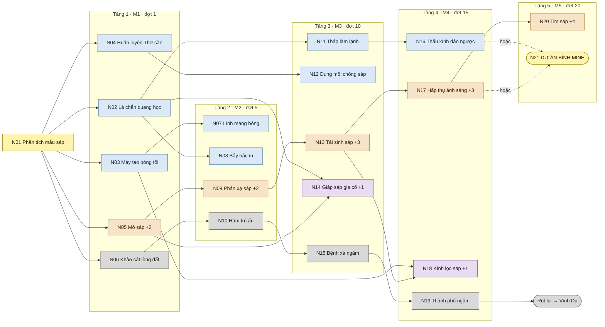

# Guardian of Dawn – Game Design Document

Unified editable master template  |  Worked examples throughout

A practical specification for game vision, player experience, mechanics, worlds, content, user experience, production decisions and validation.

| | |
|---|---|
| **GAME TITLE** | Guardian of Dawn |
| **PREPARED BY** |   |
| **DOCUMENT VERSION** |   |
| **LAST UPDATED** |   |

## How to use this document

This is one coherent, fillable GDD. Each numbered item contains a writing prompt and an illustrative example. Replace the example text with your game’s approved or proposed information, then remove the prompt if producing an external-facing GDD. Retain meaningful IDs and links to related source files.

- Write player-observable rules: inputs, preconditions, states, effects, feedback, limits and error/recovery behavior.
- Separate committed scope from hypotheses; mark unfinished decisions as Proposed rather than claiming uncertain values as facts.
- Use this document for gameplay and experience decisions. Use a technical design document for algorithms, code architecture and infrastructure.
- Keep only applicable sections, but state “Not applicable” when an important capability (such as multiplayer) is intentionally absent.
- Treat this as a living specification. Update sample figures when prototype/playtest evidence changes the decision.
- Editorial note: No single universal GDD format exists. The consolidation preserves the key design topics of the supplied outlines and adds explicitly identified modern practices (scope control, accessibility, validation, traceability, release planning). Sections may be reorganized to match the actual genre and studio.
- Reading notes  •  P0/P1/P2 indicate priority; “optional” sections may be excluded after an explicit scope decision. This unified template is a recommended structure, not an official universal GDD standard.

## 0. Document Control & How to Use This Template

> *Start here. Replace each EXAMPLE paragraph with your own game content, preserving the section headings that apply. Write “Not applicable — because …” for genuinely irrelevant topics; remove optional chapters when justified. Keep the GDD updated as playtests change decisions.*

### 0.1 Project identity and ownership

> *WHAT TO DOCUMENT  Record the game title, short tagline, document owner, team, document status, version and last update.*

Tên game: Guardian of Dawn. Tagline: “Hằng tinh đã phản bội. Bóng tối là tuyến phòng thủ cuối cùng.”

### 0.2 Document purpose and intended readers

> *WHAT TO DOCUMENT  State what decisions this document defines and who should rely on it. Distinguish GDD from implementation plans.*

### 0.3 Scope labels, assumptions and decisions

> *WHAT TO DOCUMENT  Define scope and status labels so readers can tell approved design from ideas and unverified hypotheses.*

### 0.4 Revision and decision history

> *WHAT TO DOCUMENT  Summarize meaningful changes with date, editor and reason, not every grammatical correction.*

*Example revision log*

### 0.5 Source of truth and cross-references

> *WHAT TO DOCUMENT  Specify where assets, technical specs, tasks and diagrams live. Do not duplicate authoritative definitions.*

## 1. Game Overview & High Concept

### 1.1 One-sentence high concept

> *WHAT TO DOCUMENT  Define genre, viewpoint, player role, primary activity and distinctive hook in one or two sentences.*

Guardian of Dawn là game Strategy / Tower Defense kết hợp yếu tố roguelite, trong đó người chơi vào vai Chỉ huy trưởng của Dawnhold – một trong những vùng an toàn cuối cùng của nhân loại – xây dựng phòng tuyến vào ban đêm và chống lại các đợt tấn công của Dị Thể Sáp mỗi khi bình minh lên.

### 1.2 Design vision and player fantasy

> *WHAT TO DOCUMENT  Describe the emotional experience, not merely the feature set.*

Khi mặt trời dị biến, thứ ánh sáng đã nuôi sống nhân loại trở thành vũ khí chống lại loài người. Mọi sinh vật sống tiếp xúc với ánh sáng mặt trời nhanh chóng hóa lỏng thành Dị Thể Sáp – những tàn dư của sự sống, bị thu hút bởi hơi ấm của sự sống.

Người chơi là Chỉ huy trưởng của Dawnhold, có nhiệm vụ giữ vững phòng tuyến và nghiên cứu các Dị Thể Sáp để khám phá bí mật của Dị Thể Mặt Trời, tìm con đường sống còn cho nhân loại. Mỗi ngày trôi qua, ánh sáng mạnh hơn – người chơi phải học cách sống chung với bóng tối.

Câu hỏi trung tâm: “Liệu nhân loại có thể giành lại bình minh, hay chính bình minh sẽ xóa sổ nhân loại?”

### 1.3 Design pillars and non-goals

> *WHAT TO DOCUMENT  Give two to four decision-making principles and explicit things the project will not try to do.*

### 1.4 Genre, perspective and player role

> *WHAT TO DOCUMENT  Identify primary genre, secondary influences, avatar and relationship between player and world.*

Thể loại chính: Strategy / Tower Defense. Spin: Roguelite, với tiến trình nâng cấp vĩnh viễn giữa các lượt chơi. Vai trò người chơi: Chỉ huy trưởng của Dawnhold – quyết định xây dựng, nâng cấp, huấn luyện và nghiên cứu; trong ban ngày, công trình tự động chiến đấu; người chơi di chuyển Thợ săn và Lính mang bóng, và tự canh thời điểm kích hoạt kỹ năng của binh lính. Đồ họa: 2D (góc camera cần nghiên cứu thêm).

### 1.5 Target platforms and play context

> *WHAT TO DOCUMENT  Specify primary/secondary platforms and input devices; note what is validated versus aspirational.*

Nền tảng: PC. Engine: Unity.

### 1.6 Game modes and game length

> *WHAT TO DOCUMENT  Describe single-player/co-op/competitive modes and likely session/campaign lengths as design targets.*

Chế độ chơi: single-player.

Các đợt tấn công của Dị Thể Sáp là vô hạn. Một lượt chơi kéo dài cho đến khi tường thành bị phá hủy (Dawnhold thất thủ) hoặc cho đến khi người chơi hoàn thành Dự Án Bình Minh hoặc chủ động rút lui (Vĩnh Dạ).

### 1.7 Visual and tonal summary

> *WHAT TO DOCUMENT  Use a short description of the art, audio and emotional tone.*

Đồ họa 2D, phong cách lấy cảm hứng từ SCP. Flavor: Sci-fi hậu tận thế, kinh dị sinh tồn; bầu không khí u ám nhưng giàu hy vọng.

### 1.8 Unique selling proposition (USP)

> *WHAT TO DOCUMENT  Explain a concrete differentiation that players can observe; avoid claiming no competitors exist.*

Cơ chế ánh sáng và bóng tối: ánh sáng mặt trời là mối đe dọa chứ không phải nơi an toàn. Khi một khu vực bị ánh sáng chiếu đến, công trình ngừng hoạt động và binh lính mất máu theo thời gian; khu vực chiếu sáng thay đổi theo từng ngày. Cơ chế này gắn với chu kỳ ngày/đêm: ban đêm xây dựng và nâng cấp, ban ngày phòng thủ.

## 2. Audience, Market & Product Position

### 2.1 Primary and secondary audiences

> *WHAT TO DOCUMENT  Describe motivations, experience level, access needs and platform habits without unsupported demographic stereotypes.*

Người chơi yêu thích lập kế hoạch chiến lược, tower defense, nâng cấp đơn vị và vượt qua những thử thách ngày càng khó.

### 2.2 Comparable games and differentiation

> *WHAT TO DOCUMENT  Use two or three relevant games to explain mechanics or positioning; distinguish inspiration from copied content.*

### 2.3 Player promise and success criteria

> *WHAT TO DOCUMENT  State what a good play session delivers and what observable behavior would validate it.*

### 2.4 Business objective and distribution hypothesis

> *WHAT TO DOCUMENT  Distinguish product design from validated market plans and make preliminary assumptions explicit.*

### 2.5 Content suitability and rating intent

> *WHAT TO DOCUMENT  Document sensitive content and intended rating targets; rating decisions belong to rating bodies.*

## 3. Player Experience, Goals & Game Flow

### 3.1 Player objective and victory/failure states

> *WHAT TO DOCUMENT  State a measurable objective and all relevant completion, retry and loss rules.*

Mục tiêu ngắn hạn: phòng thủ Dawnhold, bảo vệ tường thành, sống sót qua các đợt tấn công của Dị Thể Sáp.

Mục tiêu dài hạn: thu thập mẫu vật, phát triển mạng nghiên cứu và hoàn thành Dự Án Bình Minh để giành lại ánh sáng cho nhân loại.

Hoàn thành một ngày: mỗi ngày có một đợt tấn công; tiêu diệt toàn bộ Dị Thể Sáp của đợt đó. Các đợt tấn công là vô hạn; kết thúc cốt truyện chỉ đến từ Dự Án Bình Minh hoặc lựa chọn rút lui.

Hoàn thành Dự Án Bình Minh – kết thúc được quyết định bởi độ sáp hóa (ẩn): thấp → Good ending (Bình Minh Trở Lại); trung bình → Bình Minh Chia Cắt; cao → Bad ending (Hóa Sáp).

Rút lui – Vĩnh Dạ: sau khi hoàn thành nhánh Đào Sâu, người chơi có thể chủ động từ bỏ mặt đất vào bất kỳ lúc nào, kết thúc lượt chơi với kết thúc Vĩnh Dạ.

Thất bại – “Dawnhold thất thủ”: khi tường thành bị phá hủy, lượt chơi kết thúc (không phải kết thúc cốt truyện). Người chơi nhận điểm nâng cấp vĩnh viễn và bắt đầu lượt chơi mới mạnh hơn.

### 3.2 Core gameplay loop

> *WHAT TO DOCUMENT  Express repeated player actions, system responses and rewards in a short cycle.*

1. Ban đêm (Chuẩn bị): dùng tài nguyên để xây dựng/nâng cấp công trình và tường thành, huấn luyện binh lính; dùng mẫu vật thu thập được để nghiên cứu công nghệ, công trình và kỹ thuật mới.

2. Bình minh (Cảnh báo): hệ thống phát cảnh báo bắt đầu phòng thủ; ánh sáng quét qua bản đồ và các vùng chiếu xạ xuất hiện.

3. Ban ngày (Phòng thủ): công trình và binh lính tự động chống lại Dị Thể Sáp; người chơi có thể di chuyển Thợ săn và Lính mang bóng, và kích hoạt kỹ năng chủ động của binh lính đúng thời điểm. Tiêu diệt Dị Thể Sáp nhận tài nguyên và mẫu vật nghiên cứu; tiêu diệt toàn bộ để hoàn thành ngày.

4. Kết thúc ngày → quay lại ban đêm và lặp lại chu kỳ.

### 3.3 Secondary and long-term loops

> *WHAT TO DOCUMENT  Explain supportive loops and how they differ from the main play cycle.*

Mạng nghiên cứu (trong lượt chơi): một mạng nghiên cứu chung, không tuyến tính, gồm ba nhánh liên kết – Nhân loại (công nghệ che chắn, an toàn nhưng chậm và tốn kém), Sáp (sinh học dựa trên mẫu vật, mạnh nhất nhưng tăng độ sáp hóa) và Đào Sâu (nơi trú ẩn dưới lòng đất). Có các nút lai cần điều kiện từ nhiều nhánh.

Nút nghiên cứu được mở khóa theo loại mẫu vật đã thu thập: mỗi loại Dị Thể Sáp rơi ra loại mẫu vật riêng, nên những kẻ địch xuất hiện trong lượt chơi quyết định hướng nghiên cứu khả dụng – mỗi lượt chơi một khác. Câu chuyện được hé lộ dần qua các mẫu vật nghiên cứu.

Roguelite (giữa các lượt chơi): khi Dawnhold thất thủ, người chơi nhận điểm nâng cấp vĩnh viễn để khởi đầu mạnh hơn ở lượt chơi sau. Bản đồ càng khó, hệ số điểm càng cao (×1 đến ×3), và bản đồ mới được mở khóa vĩnh viễn (xem mục 5.4).

Chi tiết các nút, yêu cầu mẫu vật và sơ đồ: xem mục 4.9 – Mạng nghiên cứu (chi tiết).

### 3.4 Minute-to-minute play flow

> *WHAT TO DOCUMENT  Describe the actual order of input, feedback and resulting state changes from the player viewpoint.*

### 3.5 Game-state and screen flow

> *WHAT TO DOCUMENT  List the major states and transitions, including pause, death and restart behavior.*

### 3.6 Difficulty curve and onboarding

> *WHAT TO DOCUMENT  Describe what gets harder and which new idea is introduced at each point.*

Mỗi ngày trôi qua, ánh sáng mạnh hơn và các đợt tấn công khắc nghiệt hơn: Dị Thể Sáp mạnh hơn và đa dạng hơn theo từng ngày, kèm theo các trận đánh trùm.

Mốc tiến hóa: tại các đợt 5, 10, 15, 20, một loại Dị Thể Sáp mới (bậc cao hơn) xuất hiện và tham gia vào bể Dị Thể Sáp.

Độ khó tổng thể được chọn qua bản đồ: 4 tiền đồn từ Dễ đến Ác mộng, mở khóa dần. Xem mục 5.4 – Bản đồ = độ khó.

### 3.7 Feedback and reward cadence

> *WHAT TO DOCUMENT  Specify information provided after actions and why players will continue.*

Xây dựng: công trình hiển thị trên UI kèm âm thanh và báo hiệu. Chiến đấu: tiêu diệt Dị Thể Sáp nhận tài nguyên và mẫu vật. Nghiên cứu: công trình, tường thành và binh lính mới được mở khóa dần; câu chuyện được hé lộ qua mẫu vật. Dawnhold thất thủ: nhận điểm nâng cấp vĩnh viễn, nên người chơi luôn muốn thử lại.

## 4. Gameplay Mechanics & Game Rules

> *This is the most implementation-sensitive design chapter: express exact observable behavior, numerical rules, boundary cases and expected feedback. Keep code structure, rendering algorithms and networking protocols in technical specifications.*

### 4.1 Rule taxonomy and glossary

> *WHAT TO DOCUMENT  Define critical nouns, units, states and invariants that are used across the document.*

Dawnhold: một trong những vùng an toàn còn sót lại của nhân loại; căn cứ người chơi bảo vệ.

Dị Thể Mặt Trời: mặt trời đã dị biến – nguồn gốc của thảm họa.

“Thảm họa: Khi Ngày Tàn”: tên sự kiện mặt trời biến đổi; 6,8 tỷ thương vong được ghi nhận trong vòng 24 giờ.

Dị Thể Sáp: sinh vật sống bị ánh sáng mặt trời hóa lỏng; kẻ địch chính, bị thu hút bởi hơi ấm của sự sống.

Vùng chiếu xạ / vùng chiếu sáng: khu vực bị ánh sáng chiếu đến trong ngày; công trình trong vùng không hoạt động, binh lính mất máu theo thời gian.

Mẫu vật: thu được khi tiêu diệt Dị Thể Sáp; mỗi loại Dị Thể Sáp rơi ra loại mẫu vật riêng. Dùng để mở khóa và thực hiện nghiên cứu.

Mạng nghiên cứu: hệ thống nghiên cứu chung gồm ba nhánh liên kết – Nhân loại, Sáp và Đào Sâu.

Độ sáp hóa (corruption): chỉ số ẩn, tăng khi chọn nghiên cứu/nâng cấp thuộc nhánh Sáp; quyết định kết thúc khi hoàn thành Dự Án Bình Minh. Thể hiện gián tiếp qua mô hình đơn vị bị sáp hóa.

Dự Án Bình Minh (Project Dawn): nghiên cứu cuối cùng; khi hoàn thành, kết thúc được xác định bởi độ sáp hóa.

Đào Sâu (Dig Deep): nhánh nghiên cứu xây dựng nơi trú ẩn dưới lòng đất; mở khóa lựa chọn rút lui (kết thúc Vĩnh Dạ).

Tường thành: tuyến phòng thủ chính của Dawnhold; nâng cấp tường thành mở rộng khu vực đặt công trình/binh lính. Tường thành bị phá hủy = thua lượt chơi.

Dawnhold thất thủ: màn hình thất bại khi tường thành bị phá hủy; kết thúc lượt chơi và trao điểm nâng cấp vĩnh viễn.

Tài nguyên: thu được khi tiêu diệt Dị Thể Sáp; dùng để xây dựng, nâng cấp, huấn luyện và sửa chữa.

Bậc tiến hóa: 5 bậc Dị Thể Sáp; bậc mới xuất hiện tại các đợt 5, 10, 15, 20 do Dị Thể Sáp bậc thấp hợp nhất.

Bể Dị Thể Sáp: tỷ lệ ẩn của từng loại Dị Thể Sáp, quyết định thành phần mỗi đợt; mở khóa dần khả năng xem qua nâng cấp vĩnh viễn (loại → tỷ lệ ước lượng → tỷ lệ chính xác).

Đợt (wave): mỗi ngày có đúng một đợt tấn công của Dị Thể Sáp; đợt N = ngày N.

Đội lính (squad): đơn vị binh lính gồm nhiều thành viên; tối đa 3 đội.

Cấp bậc: kinh nghiệm riêng của từng đội, nhận qua số lượng Dị Thể Sáp tiêu diệt (Lính mang bóng: theo số ngày); mất khi toàn bộ đội chết trong một đợt.

### 4.2 Movement and traversal (MEC-01)

> *WHAT TO DOCUMENT  Specify movement speed, collision, terrain effects, permitted actions and edge behavior.*

### 4.3 Interaction, objects and inventory (MEC-02)

> *WHAT TO DOCUMENT  Define eligible objects, interaction range, inventory limits and how invalid interactions respond.*

Xây dựng công trình/binh lính – Điều kiện: ban đêm, đủ tài nguyên. Kết quả: công trình được xây dựng để bảo vệ Dawnhold.

Huấn luyện binh lính – Điều kiện: ban đêm.

Nâng cấp công trình/binh lính/tường thành – Điều kiện: ban đêm, đủ tài nguyên; nhánh nâng cấp tương ứng đã được mở khóa qua nghiên cứu. Kết quả: công trình/binh lính tăng chỉ số và mở khóa kỹ năng mới; tường thành tăng chỉ số và mở rộng khu vực được đặt công trình/binh lính. Nâng cấp thuộc nhánh Sáp tăng độ sáp hóa.

Sửa chữa tường thành – Điều kiện: ban đêm, đủ tài nguyên.

Sử dụng kỹ năng – Điều kiện: đã mở khóa nghiên cứu nhất định. Kết quả: tùy loại kỹ năng – tăng chỉ số công trình/binh lính, làm suy yếu/gây sát thương lên Dị Thể Sáp, …

Nghiên cứu – Điều kiện: ban đêm, có thời gian chờ, đã thu thập đủ loại mẫu vật yêu cầu. Kết quả: mở khóa nhánh nâng cấp công trình/binh lính/tường thành/kỹ năng; nghiên cứu nhánh Sáp tăng độ sáp hóa; Dự Án Bình Minh dẫn đến kết thúc.

Rút lui xuống lòng đất – Điều kiện: đã hoàn thành nhánh Đào Sâu. Kết quả: kết thúc lượt chơi với kết thúc Vĩnh Dạ.

Di chuyển binh lính – Điều kiện: ban ngày; chỉ Thợ săn và Lính mang bóng (Lính trấn thủ cố định trên tường thành). Kết quả: đổi vị trí/bán kính săn của đội.

Kích hoạt kỹ năng binh lính – Điều kiện: ban ngày, kỹ năng sẵn sàng. Kết quả: Giữ vững / Nhật thực / Hạ sát; người chơi phải tự canh thời điểm.

Hồi máu và bổ sung đội lính – Điều kiện: ban đêm, đủ tài nguyên. Kết quả: đội được hồi máu, bổ sung thành viên và giữ cấp bậc.

### 4.4 Light, darkness and irradiated zones (MEC-03)

> *WHAT TO DOCUMENT  Define input, resource costs, replenishment, start/stop conditions and feedback.*

Khi một khu vực bị ánh sáng chiếu đến, công trình trong khu vực đó không hoạt động và binh lính bị mất máu theo thời gian.

Vào bình minh, hệ thống cảnh báo vị trí các vùng chiếu sáng trước khi phòng thủ bắt đầu; ánh sáng quét qua bản đồ và các vùng chiếu xạ xuất hiện.

Khu vực chiếu sáng thay đổi theo ngày, và ánh sáng mạnh hơn mỗi ngày. Nghiên cứu mở khóa công nghệ chống ánh sáng.

Dị Thể Sáp thấu kính (bậc 4) mang theo một vùng chiếu sáng nhỏ di chuyển cùng nó, đưa ánh sáng vào trong phòng tuyến.

*Example mechanic rule table*

### 4.5 Building placement rules and edge cases (MEC-04)

> *WHAT TO DOCUMENT  Give preconditions, deterministic effects, timers, reset behavior and failure recovery.*

Mục đích: xây dựng công trình phòng thủ. Người chơi quyết định xây mới hay nâng cấp công trình/binh lính, hoặc sửa chữa tường thành; tận dụng địa hình khi chọn vị trí đặt.

Điều kiện kích hoạt: đang là ban đêm và người chơi có đủ tài nguyên.

Đầu vào: danh sách công trình, vị trí đặt, số lượng tài nguyên cần và số lượng tài nguyên hiện có.

Quy định: công trình/binh lính phải đặt ở vị trí đủ rộng (bằng hoặc lớn hơn kích thước của công trình/binh lính) và không vượt quá giới hạn số lượng công trình/binh lính. Mỗi loại công trình có kích thước, loại và số lượng tài nguyên cần thiết khác nhau. Nâng cấp công trình cần mở khóa nghiên cứu nhất định.

Phản hồi: công trình được xây dựng và hiển thị trên UI, kèm âm thanh và báo hiệu.

Điều kiện thất bại: không đủ tài nguyên hoặc vị trí đặt công trình/binh lính không phù hợp.

Giới hạn binh lính: tối đa 3 đội lính cùng lúc. Lính trấn thủ được giao cố định cho một đoạn tường thành.

Vị trí công trình: công trình được xây ở phía trước tường thành (trong khu vực mà tường thành mở rộng), không xây phía sau tường. Dị Thể Sáp đi qua khu vực công trình trước khi tới tường thành. Dị Thể Sáp không tấn công công trình (công trình không thể bị phá hủy), nhưng có tấn công các đội lính.

### 4.6 Hazards, opponents and combat/conflict (MEC-05)

> *WHAT TO DOCUMENT  Describe how threats detect, challenge and damage the player; include non-combat alternatives if appropriate.*

Dị Thể Sáp tấn công Dawnhold mỗi khi bình minh lên, theo các đợt vô hạn; chúng bị thu hút bởi hơi ấm của sự sống. Trong ban ngày, công trình và binh lính tự động chống lại Dị Thể Sáp; người chơi có thể di chuyển Thợ săn và Lính mang bóng, và kích hoạt kỹ năng chủ động của binh lính đúng thời điểm.

Khi Dị Thể Sáp đến được tường thành, chúng gây sát thương liên tục lên tường. Dị Thể Sáp mạnh hơn và đa dạng hơn theo từng ngày; có các trận đánh trùm.

Tiêu diệt Dị Thể Sáp nhận tài nguyên và mẫu vật nghiên cứu.

Tiến hóa Dị Thể Sáp: có 5 loại Dị Thể Sáp theo 5 bậc tiến hóa. Đợt 1: chỉ có Dị Thể Sáp chưa tiến hóa (bậc 1). Tại các đợt 5, 10, 15, 20, một phần Dị Thể Sáp bậc thấp hợp nhất thành loại mới (bậc 2, 3, 4, 5). Loại cũ không biến mất mà giảm tỷ lệ. Sau đợt 20 không còn loại mới; bể tiếp tục dịch chuyển về phía các bậc cao. Sự tiến hóa diễn ra theo lịch cố định, không phản ứng theo chiến thuật của người chơi.

Bể Dị Thể Sáp (wax pool): tỷ lệ phần trăm của từng loại Dị Thể Sáp, quyết định loại nào xuất hiện trong mỗi đợt. Bể bị ẩn với người chơi; có thể mở khóa dần khả năng xem bể qua skill tree nâng cấp vĩnh viễn (loại → tỷ lệ ước lượng → tỷ lệ chính xác).

Mỗi loại Dị Thể Sáp rơi ra loại mẫu vật riêng; mẫu vật bậc cao chỉ có sau các mốc tiến hóa tương ứng.

Bậc 1 – Dị Thể Sáp tiêu chuẩn: loại cơ bản, xuất hiện từ đợt 1.

Bậc 2 – Dị Thể Sáp hổ (đợt 5): Dị Thể Sáp hợp nhất với hổ đã bị sáp hóa; tập trung vào tính cơ động – tốc độ di chuyển cao nhất trong các loại Dị Thể Sáp nhưng máu thấp, lao qua vùng phủ của công trình trước khi bị tiêu diệt.

Bậc 3 – Dị Thể Sáp hồi phục (đợt 10): Dị Thể Sáp hợp nhất với cây cối; hồi máu cho các Dị Thể Sáp khác trong một vùng xung quanh nó. Điểm yếu: phải đứng yên trong khi hồi máu, và mỗi lần hồi máu chỉ kéo dài trong một khoảng thời gian ngắn, giới hạn.

Bậc 4 – Dị Thể Sáp thấu kính (đợt 15): liên quan đến nước; cơ thể dạng nước khúc xạ ánh sáng mặt trời, tạo ra một vùng chiếu sáng nhỏ di chuyển cùng nó. Công trình gần nó ngừng hoạt động và binh lính mất máu theo thời gian, giống như trong vùng chiếu sáng.

Bậc 5 – Dị Thể Sáp tối thượng (đợt 20): hợp nhất từ nhiều Dị Thể Sáp tiêu chuẩn; máu cao, tự hồi phục, nhưng tốc độ di chuyển chậm.

Công trình (6 loại) – tự động chiến đấu, ngừng hoạt động trong vùng chiếu sáng:

- Súng máy: bắn nhanh một mục tiêu, không trượt. Khắc chế: bậc 1, bậc 2. Yếu: bậc 5. Có sẵn từ đầu.
- Súng phun lửa: phun hình nón tầm ngắn; Dị Thể Sáp đang cháy không thể hồi máu/tự hồi phục. Khắc chế: bậc 1, bậc 3, bậc 5. Yếu: bậc 2. Có sẵn từ đầu.
- Súng cối: bắn tầm xa, sát thương lan. Khắc chế: bậc 1, bậc 3 (đứng yên khi hồi máu). Yếu: bậc 2. Có sẵn từ đầu.
- Tháp gia cố: sửa chữa các đoạn tường thành gần đó trong ban ngày và giảm sát thương tường thành phải chịu; không gây sát thương. Khắc chế: bậc 1, bậc 5. Có sẵn từ đầu.
- Tháp làm lạnh: làm chậm Dị Thể Sáp; đóng băng hoàn toàn Dị Thể Sáp thấu kính, tắt vùng chiếu sáng của nó; không gây sát thương. Khắc chế: bậc 2, bậc 4. Mở khóa qua nghiên cứu.
- Máy tạo bóng tối: hỗ trợ, tạo bóng tối hủy ánh sáng trong một vùng để công trình tiếp tục hoạt động; không gây sát thương. Khắc chế: bậc 4 và vùng chiếu sáng hằng ngày. Mở khóa qua nghiên cứu.

Binh lính (3 loại, tối đa 3 đội) – vẫn chiến đấu trong vùng chiếu sáng nhưng mất máu theo thời gian (hồi lại vào ban đêm); mỗi loại có kỹ năng chủ động do người chơi kích hoạt:

- Lính trấn thủ: cố định trên đoạn tường thành được giao, bắn Dị Thể Sáp đến gần đoạn tường đó; đoạn tường có Lính trấn thủ chịu ít sát thương hơn. Không thể di chuyển. Kỹ năng – Giữ vững: đoạn tường đó không nhận sát thương trong vài giây. Khắc chế: bậc 1, bậc 5. Có sẵn từ đầu.
- Lính mang bóng: giữ vị trí được chỉ định (kể cả trong vùng chiếu sáng), tạo một vùng bóng tối quanh mình – binh lính trong vùng không mất máu, công trình trong vùng tiếp tục hoạt động; bắn súng phụ yếu. Có thể di chuyển. Kỹ năng – Nhật thực: tắt toàn bộ một vùng chiếu sáng trong thời gian ngắn. Khắc chế: bậc 1, bậc 4. Mở khóa qua nghiên cứu.
- Thợ săn (DPS): chủ động săn mọi Dị Thể Sáp trong bán kính được giao – rời vị trí, truy đuổi và tấn công; sát thương đơn mục tiêu cao nhất trong các binh lính; vũ khí tẩm dung môi khiến mục tiêu không thể hồi máu/tự hồi phục; ưu tiên Dị Thể Sáp hổ và hồi phục. Có thể di chuyển. Kỹ năng – Hạ sát: một đòn sát thương lớn, gây thêm sát thương lên Dị Thể Sáp đang hồi máu/tự hồi phục. Khắc chế: bậc 2, bậc 3, bậc 5. Mở khóa qua nghiên cứu.

Bảng khắc chế – Bậc 1: súng máy, súng phun lửa, súng cối, tháp gia cố, Lính trấn thủ, Lính mang bóng. Bậc 2: súng máy, tháp làm lạnh, Thợ săn. Bậc 3: súng phun lửa, súng cối, Thợ săn. Bậc 4: tháp làm lạnh, máy tạo bóng tối, Lính mang bóng. Bậc 5: súng phun lửa, tháp gia cố, Lính trấn thủ, Thợ săn.

### 4.7 Health, respawn and checkpoints (MEC-06)

> *WHAT TO DOCUMENT  Set health values, damage response, save state and restart positioning.*

Tường thành là “máu” của Dawnhold: chịu sát thương liên tục khi Dị Thể Sáp tiếp cận và có thể được sửa chữa vào ban đêm. Khi tường thành bị phá hủy → Dawnhold thất thủ, lượt chơi kết thúc và người chơi nhận điểm nâng cấp vĩnh viễn.

Binh lính trong vùng chiếu sáng mất máu theo thời gian.

Mục tiêu của Dị Thể Sáp: tường thành và các đội lính. Công trình không bị tấn công và không có máu.

### 4.8 Economy, currencies and progression costs (MEC-07)

> *WHAT TO DOCUMENT  Describe earned/spent resources and balancing, or explicitly state why there is no economy.*

Mọi tài nguyên đều đến từ Dị Thể Sáp: tiêu diệt chúng trong ban ngày nhận tài nguyên (dùng để xây dựng, nâng cấp, huấn luyện, sửa chữa) và mẫu vật (dùng để nghiên cứu). Không có nguồn tài nguyên nào khác.

Mỗi loại Dị Thể Sáp rơi ra loại mẫu vật riêng; nút nghiên cứu yêu cầu những loại mẫu vật nhất định.

Ba loại tiền tệ, ba hệ thống: tài nguyên → skill tree của từng đơn vị (trong lượt chơi); mẫu vật → mạng nghiên cứu (trong lượt chơi); điểm nâng cấp vĩnh viễn → nâng cấp roguelite (giữa các lượt chơi).

Mỗi loại công trình cần loại và số lượng tài nguyên khác nhau. Người chơi phân bổ tài nguyên giữa phòng thủ, nghiên cứu và mở rộng.

### 4.9 Player abilities, upgrades and balancing (MEC-08)

> *WHAT TO DOCUMENT  Give rules for acquiring abilities, their effects and interactions with earlier puzzles.*

Skill tree đơn vị: mỗi công trình, tường thành và binh lính có skill tree riêng. Nâng cấp làm tăng chỉ số và mở khóa kỹ năng mới; nâng cấp tường thành mở rộng khu vực đặt công trình/binh lính.

Liên kết với mạng nghiên cứu: nghiên cứu mở khóa các nhánh trong skill tree đơn vị. Skill tree có phiên bản Nhân loại (an toàn) và Sáp (mạnh hơn, tăng độ sáp hóa) – ví dụ nâng cấp tường thành bằng thép gia cố hoặc vỏ sáp tự hồi phục. Nhánh Sáp luôn là lựa chọn phòng thủ mạnh nhất để tạo cám dỗ thực sự.

Nút Đào Sâu cũng có giá trị phòng thủ (ví dụ hầm trú giúp binh lính chống lại vùng chiếu sáng), nên người chơi có thể xây dựng nhánh này mà không định rút lui.

Độ sáp hóa: chỉ số ẩn, người chơi không nhìn thấy trực tiếp; tích lũy từ mọi nghiên cứu và nâng cấp thuộc nhánh Sáp.

Tín hiệu thị giác: độ sáp hóa không hiển thị bằng chỉ số, nhưng khi người chơi chọn nâng cấp nhánh Sáp, mô hình của công trình/binh lính/tường thành được nâng cấp sẽ biến đổi dần sang dạng sáp. Người chơi cảm nhận được sự biến đổi qua chính phòng tuyến của mình.

Nâng cấp vĩnh viễn (roguelite): sau khi Dawnhold thất thủ, người chơi nhận điểm nâng cấp vĩnh viễn để mở khóa nâng cấp cho lượt chơi sau. Nâng cấp vĩnh viễn trung lập với kết thúc – không làm thay đổi độ sáp hóa.

Mở khóa xem bể Dị Thể Sáp (skill tree vĩnh viễn), theo thứ tự: (1) biết các loại Dị Thể Sáp sẽ xuất hiện trong đợt tới; (2) biết tỷ lệ phần trăm ước lượng; (3) biết tỷ lệ phần trăm chính xác.

Mở khóa đơn vị: có sẵn từ đầu – súng máy, súng phun lửa, súng cối, tháp gia cố, Lính trấn thủ. Tháp làm lạnh, máy tạo bóng tối, Lính mang bóng và Thợ săn phải được nghiên cứu lần đầu; sau đó chúng xuất hiện trong skill tree vĩnh viễn để có thể mở khóa sẵn từ đầu ở các lượt chơi sau.

Cấp bậc đội lính: mỗi đội có kinh nghiệm riêng, nhận XP khi tiêu diệt Dị Thể Sáp (càng nhiều kill, càng nhiều XP); 3 cấp bậc, mỗi cấp tăng nhẹ máu, sát thương và khả năng chịu ánh sáng; ở cấp 3 kỹ năng chủ động mạnh hơn.

Ngoại lệ – Lính mang bóng: nhận XP cố định theo ngày thay vì theo kill. Cần 2 ngày để lên cấp 1, thêm 3 ngày để lên cấp 2, thêm 4 ngày để lên cấp 3 (tổng 9 ngày).

Đội lính có thể mất thành viên trong đợt tấn công nhưng giữ nguyên cấp bậc nếu còn ít nhất một người sống sót. Vào ban đêm, người chơi dùng tài nguyên để hồi máu và bổ sung thành viên cho đội. Nếu toàn bộ đội chết trong một đợt, cấp bậc bị mất. Cấp bậc chỉ tồn tại trong một lượt chơi và không ảnh hưởng độ sáp hóa.

(Đề xuất) Nâng cấp Lính mang bóng – nhánh Nhân loại: (1) Rộng bóng – vùng bóng tối lớn hơn; (2) Che chở – binh lính trong vùng hồi máu chậm, công trình trong vùng bắn nhanh hơn; (3) Nhật thực kéo dài – thời gian và phạm vi Nhật thực tăng. Nhánh Sáp: (1) Da sáp – bản thân không mất máu trong ánh sáng; (2) Hút sáng – vùng bóng tối hấp thụ ánh sáng và phát xung sát thương lên Dị Thể Sáp bên trong; (3) Hố đen – Nhật thực kéo Dị Thể Sáp thấu kính gần đó vào bóng tối và đóng băng vùng sáng của chúng.

#### Nâng cấp tường thành

Tường thành được nâng cấp như một khối (toàn bộ tường cùng cấp); sửa chữa vẫn theo từng đoạn. Mỗi cấp mở rộng khu vực đặt công trình phía trước tường. Từ cấp 2, người chơi chọn phiên bản Nhân loại hoặc Sáp và phải giữ nhánh đó ở cấp 3 (không đổi nhánh).

| Cấp | Phiên bản Nhân loại (an toàn) | Phiên bản Sáp (+1 độ sáp hóa, mô hình sáp hóa) | Yêu cầu |
|---|---|---|---|
| 0 – Rào phế liệu | Tường khởi đầu: máu thấp, khu vực đặt công trình nhỏ | – | – |
| 1 – Tường bê tông | Tăng máu, mở rộng khu vực đặt công trình (chưa chia nhánh) | – | Tài nguyên |
| 2 | Thép gia cố: tăng máu, giảm sát thương nhận từ mọi đòn đánh | Vỏ sáp: tăng máu nhiều hơn, tự hồi phục chậm trong ban ngày | Nhân loại: N02. Sáp: N05 |
| 3 | Tường điện: Dị Thể Sáp tấn công tường thành bị phản sát thương | Tường sống: hấp thụ Dị Thể Sáp chết gần đó để tự hồi máu | Nhân loại: cấp 2 Nhân loại + M3. Sáp: cấp 2 Sáp + N13 |

#### Mạng nghiên cứu (chi tiết)

*Mọi con số (độ sáp hóa, ngưỡng, thời gian nghiên cứu) là điểm khởi đầu để cân bằng, chưa qua playtest.*

##### 1. Quy tắc chung

- **Mẫu vật:** mỗi bậc Dị Thể Sáp rơi ra một loại mẫu vật riêng.

| Mẫu vật | Nguồn | Có từ đợt |
|---|---|---|
| M1 | Bậc 1 – Dị Thể Sáp tiêu chuẩn | 1 |
| M2 | Bậc 2 – Dị Thể Sáp hổ | 5 |
| M3 | Bậc 3 – Dị Thể Sáp hồi phục | 10 |
| M4 | Bậc 4 – Dị Thể Sáp thấu kính | 15 |
| M5 | Bậc 5 – Dị Thể Sáp tối thượng | 20 |

- **Mạng theo tầng:** nút mở dần theo bậc mẫu vật, khớp với lịch tiến hóa của Dị Thể Sáp. Các nút khắc chế xuất hiện **trước** khi loại Dị Thể Sáp tương ứng tới (Thợ săn trước đợt 5, công nghệ làm lạnh/bóng tối trước đợt 15).
- **Nút ẩn kiểu SCP:** nút của một tầng hiển thị là **[REDACTED]** cho đến khi người chơi thu được mẫu vật đầu tiên của bậc đó.
- **Không thể nghiên cứu hết trong một lượt chơi:** mỗi lúc chỉ nghiên cứu một nút; mỗi nút mất 1–3 đêm. Đến khoảng đợt 25, người chơi hoàn thành khoảng 12–14 trên 21 nút → mỗi lượt chơi có một "bản sắc" riêng.
- **Bốn nhánh:** Nhân loại (an toàn) · Sáp (mạnh nhất, + độ sáp hóa) · Đào Sâu (nơi trú ẩn, kết thúc Vĩnh Dạ) · Lai (cần điều kiện từ hai nhánh, + độ sáp hóa nhỏ).
- Nghiên cứu nhánh Nhân loại/Sáp mở khóa nhánh tương ứng trong **skill tree của từng đơn vị**; mỗi nâng cấp Sáp trong skill tree đơn vị cũng cộng thêm độ sáp hóa (+1).

##### 2. Danh sách nút

###### Tầng 1 – M1 (từ đợt 1)

| ID | Nút | Nhánh | Yêu cầu | Mở khóa / Hiệu ứng | Độ sáp hóa |
|---|---|---|---|---|---|
| N01 | Phân tích mẫu sáp (Wax analysis) | Gốc | M1 | Mở mạng nghiên cứu; hồ sơ SCP đầu tiên về Dị Thể Sáp | 0 |
| N02 | Lá chắn quang học (Optical shielding) | Nhân loại | N01, M1 | Nhánh Nhân loại trong skill tree tường thành và công trình | 0 |
| N03 | Máy tạo bóng tối (Shade generator) | Nhân loại | N01, M1 | Mở khóa công trình Máy tạo bóng tối | 0 |
| N04 | Huấn luyện Thợ săn (Hunter training) | Nhân loại | N01, M1 | Mở khóa binh lính Thợ săn – sẵn sàng trước Dị Thể Sáp hổ (đợt 5) | 0 |
| N05 | Mô sáp (Wax tissue) | Sáp | N01, M1 | Nhánh Sáp trong skill tree của mọi đơn vị | +2 |
| N06 | Khảo sát lòng đất (Underground survey) | Đào Sâu | N01, M1 | Hầm trú gần tường thành: binh lính trong hầm mất ít máu hơn trong vùng chiếu sáng | 0 |

###### Tầng 2 – M2 (từ đợt 5)

| ID | Nút | Nhánh | Yêu cầu | Mở khóa / Hiệu ứng | Độ sáp hóa |
|---|---|---|---|---|---|
| N07 | Lính mang bóng (Shade bearers) | Nhân loại | N03, M1 + M2 | Mở khóa binh lính Lính mang bóng | 0 |
| N08 | Bẫy hắc ín (Tar traps) | Nhân loại | N02, M2 | Nhánh "đặt bẫy" trong skill tree Lính trấn thủ – khắc chế Dị Thể Sáp hổ | 0 |
| N09 | Phản xạ sáp (Wax reflexes) | Sáp | N05, M2 | Nâng cấp Sáp cho Thợ săn và Lính mang bóng: tốc độ di chuyển và tấn công | +2 |
| N10 | Hầm trú ẩn (Shelters) | Đào Sâu | N06, M2 | Binh lính trong hầm hồi máu chậm trong ban ngày | 0 |

###### Tầng 3 – M3 (từ đợt 10)

| ID | Nút | Nhánh | Yêu cầu | Mở khóa / Hiệu ứng | Độ sáp hóa |
|---|---|---|---|---|---|
| N11 | Tháp làm lạnh (Cryo tower) | Nhân loại | N02, M2 + M3 | Mở khóa công trình Tháp làm lạnh – sẵn sàng trước Dị Thể Sáp thấu kính (đợt 15) | 0 |
| N12 | Dung môi chống sáp (Anti-wax solvent) | Nhân loại | N04, M3 | Dung môi của Thợ săn và lửa của Súng phun lửa ngăn hồi máu lâu hơn | 0 |
| N13 | Tái sinh sáp (Wax regeneration) | Sáp | N09, M3 | Nâng cấp Sáp: tường thành vỏ sáp tự hồi phục, binh lính tự hồi máu | +3 |
| N14 | Giáp sáp gia cố (Wax-treated armor) | Lai | N02 + N05, M3 | Giáp cho tường thành và binh lính – mạnh hơn Nhân loại, ít độ sáp hóa hơn Sáp | +1 |
| N15 | Bệnh xá ngầm (Underground infirmary) | Đào Sâu | N10, M3 | Hồi máu và bổ sung đội lính vào ban đêm tốn ít tài nguyên hơn – dễ giữ cấp bậc của đội | 0 |

###### Tầng 4 – M4 (từ đợt 15)

| ID | Nút | Nhánh | Yêu cầu | Mở khóa / Hiệu ứng | Độ sáp hóa |
|---|---|---|---|---|---|
| N16 | Thấu kính đảo ngược (Inverted lens) | Nhân loại | N11, M4 | Công nghệ bẻ cong ánh sáng ra xa: vùng bóng tối lớn hơn. **Phương pháp Nhân loại cho Dự Án Bình Minh** | 0 |
| N17 | Hấp thụ ánh sáng (Light absorption) | Sáp | N13, M4 | Cơ thể sáp hóa: binh lính không mất máu trong vùng chiếu sáng. **Phương pháp Sáp cho Dự Án Bình Minh** | +3 |
| N18 | Kính lọc sáp (Wax filter) | Lai | N03 + N13, M4 | Máy tạo bóng tối hoạt động một phần dưới ánh sáng mạnh | +1 |
| N19 | Thành phố ngầm (Underground city) | Đào Sâu | N15, M4 | Hoàn thành nhánh Đào Sâu → mở khóa lựa chọn **Rút lui (kết thúc Vĩnh Dạ)** | 0 |

###### Tầng 5 – M5 (từ đợt 20)

| ID | Nút | Nhánh | Yêu cầu | Mở khóa / Hiệu ứng | Độ sáp hóa |
|---|---|---|---|---|---|
| N20 | Tim sáp (Wax heart) | Sáp | N17, M5 | Nâng cấp mạnh nhất cho mọi đơn vị – cám dỗ cuối cùng trước Dự Án Bình Minh | +4 |
| N21 | **Dự Án Bình Minh (Project Dawn)** | Cuối | (N16 **hoặc** N17), M1–M5 | Kết thúc lượt chơi; kết thúc được quyết định bởi tổng độ sáp hóa | 0 |

##### 3. Độ sáp hóa và kết thúc

- Tổng độ sáp hóa tối đa từ mạng nghiên cứu: **16** (N05 +2, N09 +2, N13 +3, N17 +3, N20 +4, N14 +1, N18 +1), cộng thêm +1 cho mỗi nâng cấp Sáp trong skill tree đơn vị.
- **Ngưỡng đề xuất** khi hoàn thành Dự Án Bình Minh:

| Độ sáp hóa | Kết thúc |
|---|---|
| 0 – 9 | Bình Minh Trở Lại (good ending) |
| 10 – 19 | Bình Minh Chia Cắt |
| 20+ | Hóa Sáp (bad ending) |

- Dự Án Bình Minh cần **một trong hai phương pháp**: N16 (Nhân loại) hoặc N17 (Sáp). Có thể hoàn thành mà không đụng tới nhánh Sáp – nhưng chậm và khó hơn.
- Vĩnh Dạ không phụ thuộc độ sáp hóa: chỉ cần N19 và chủ động rút lui.

##### 4. Sơ đồ

*Màu: xanh = Nhân loại · cam = Sáp · xám = Đào Sâu · tím = Lai · vàng = gốc/cuối.*

##### 5. Câu hỏi còn mở

- Số lượng mẫu vật mỗi nút cần (hiện chỉ ghi loại).
- Thời gian nghiên cứu cụ thể của từng nút (đề xuất: tầng 1 = 1 đêm, tầng 2–3 = 2 đêm, tầng 4–5 = 3 đêm).
- Ngưỡng độ sáp hóa cần kiểm chứng qua playtest.
- Nội dung hồ sơ SCP (lore) mở ra theo từng nút.

### 4.10 Physics, collision and world simulation

> *WHAT TO DOCUMENT  State only design-observable physics behavior; leave algorithm choices to the TDD.*

### 4.11 Randomness, balancing and determinism

> *WHAT TO DOCUMENT  Specify which elements are randomized and what must be reproducible.*

Thành phần Dị Thể Sáp của mỗi đợt được chọn theo tỷ lệ của bể Dị Thể Sáp (ẩn). Lịch tiến hóa (mốc đợt 5, 10, 15, 20) là cố định.

### 4.12 Saving, loading, replay and cheat/debug behavior

> *WHAT TO DOCUMENT  Define autosave triggers, persistence, failure handling, replay and player-facing cheats.*

## 5. Missions, Levels & Progression

### 5.1 Campaign structure and unlock graph

> *WHAT TO DOCUMENT  Describe level order, prerequisites and optional content.*

Trò chơi tiến triển theo từng ngày (chu kỳ đêm – bình minh – ngày). Mỗi ngày ánh sáng mạnh hơn và đợt tấn công khắc nghiệt hơn; công trình, tường thành và binh lính mới được mở khóa dần qua nghiên cứu.

### 5.2 Tutorial or first-playable level

> *WHAT TO DOCUMENT  Specify the lesson sequence and criteria for a successful first experience.*

### 5.3 Per-level synopsis and objectives

> *WHAT TO DOCUMENT  Provide a repeatable mini-spec for each level: purpose, player goal, environment and expected duration.*

### 5.4 Critical path, optional routes and level map

> *WHAT TO DOCUMENT  Describe entrance, bottlenecks, encounter beats and exit with links to a diagram or map.*

#### Bản đồ = độ khó

Trò chơi không có menu chọn độ khó. Trước mỗi lượt chơi, người chơi chọn một **tiền đồn của Dawnhold** trên bản đồ khu vực; mỗi tiền đồn là một mức độ khó. Tiền đồn càng xa vùng an toàn thì càng khó, nhưng thưởng điểm nâng cấp vĩnh viễn càng nhiều.

Độ khó chỉ được tạo ra bằng các cơ chế đã có: số hướng tấn công (độ dài tường thành phải giữ), diện tích đặt công trình, số lượng và kích thước vùng chiếu sáng mỗi ngày, và tỷ lệ bậc cao trong bể Dị Thể Sáp. Mốc tiến hóa (đợt 5, 10, 15, 20), mạng nghiên cứu, độ sáp hóa và các kết thúc giống nhau trên mọi bản đồ.

| Bản đồ (tên tạm) | Độ khó | Hướng tấn công | Đất xây công trình | Vùng chiếu sáng mỗi ngày | Bể Dị Thể Sáp | Điểm vĩnh viễn | Mở khóa |
|---|---|---|---|---|---|---|---|
| Ngoại ô | Dễ | 1 | Rộng | 1 vùng nhỏ | Bình thường | ×1 | Có sẵn |
| Cầu cảng | Thường | 2 | Vừa | 2 vùng nhỏ | Bình thường | ×1,5 | Sống tới đợt 10 ở Ngoại ô |
| Phố cổ đổ nát | Khó | 2 | Hẹp | 2 vùng lớn | Bậc mới xuất hiện với tỷ lệ cao hơn | ×2 | Sống tới đợt 10 ở Cầu cảng |
| Đồng bằng trắng | Ác mộng | 3 | Vừa | 3 vùng lớn | Bậc mới xuất hiện với tỷ lệ cao hơn | ×3 | Hoàn thành Dự Án Bình Minh (bất kỳ kết thúc nào) |

Quy tắc:

- Mở khóa bản đồ là vĩnh viễn (lưu giữa các lượt chơi), giống skill tree vĩnh viễn.
- Nhiều hướng tấn công nghĩa là tường thành dài hơn: Lính trấn thủ chỉ giữ được một đoạn, nên người chơi phải chia 3 đội lính và công trình cho nhiều hướng.
- Đất xây hẹp khiến nâng cấp tường thành (mở rộng khu vực đặt công trình) có giá trị hơn.
- Ít vùng chiếu sáng thì dễ đoán; nhiều vùng lớn khiến máy tạo bóng tối và Lính mang bóng gần như bắt buộc.
- Điểm vĩnh viễn nhận khi Dawnhold thất thủ được nhân theo hệ số của bản đồ, nên người chơi có lý do thử bản đồ khó dù có thể thua sớm hơn.

### 5.5 Missions, quests and challenge conditions

> *WHAT TO DOCUMENT  Define trigger, objective, progress tracking, reward and failure states.*

### 5.6 Puzzle pacing, dependencies and hint strategy

> *WHAT TO DOCUMENT  Explain why puzzles appear in their order and when hints are available.*

### 5.7 Completion, achievements and replayability

> *WHAT TO DOCUMENT  State the final win condition, collectibles and what happens after completion.*

Kết thúc khi hoàn thành Dự Án Bình Minh (theo độ sáp hóa ẩn): Bình Minh Trở Lại (good ending), Bình Minh Chia Cắt, hoặc Hóa Sáp (bad ending). Kết thúc Vĩnh Dạ khi chủ động rút lui sau nhánh Đào Sâu.

Replay: mạng nghiên cứu phụ thuộc vào loại mẫu vật thu được nên mỗi lượt chơi đi theo hướng khác nhau; nhiều kết thúc khuyến khích chơi lại. Mỗi lần thất bại đều cho điểm nâng cấp vĩnh viễn giúp lượt chơi sau mạnh hơn.

## 6. Game World, Geography & Environment

### 6.1 World premise and spatial organization

> *WHAT TO DOCUMENT  Describe the setting, environmental logic and how areas connect.*

Mặt trời dị biến (Dị Thể Mặt Trời). Trong vòng 24 giờ kể từ khi mặt trời biến đổi, 6,8 tỷ thương vong đã được ghi nhận – sự kiện được gọi là “Thảm họa: Khi Ngày Tàn”. Mọi sinh vật sống tiếp xúc với ánh sáng mặt trời nhanh chóng hóa lỏng thành Dị Thể Sáp. Dawnhold là một trong những vùng an toàn còn sót lại của nhân loại.

### 6.2 Areas and locations

> *WHAT TO DOCUMENT  Give each location a purpose, distinguishing visuals, connected levels and navigation cues.*

Dawnhold: vùng an toàn được bảo vệ bởi tường thành; công trình được đặt ở phía trước tường thành, binh lính trên/quanh tường thành. Khu vực có thể đặt công trình mở rộng khi nâng cấp tường thành.

Các tiền đồn của Dawnhold (bản đồ chơi): Ngoại ô, Cầu cảng, Phố cổ đổ nát, Đồng bằng trắng – càng xa vùng an toàn càng khó. Chi tiết ở mục 5.4.

### 6.3 World scale, travel and navigation

> *WHAT TO DOCUMENT  Describe measurements, travel times, doors, fast travel and navigation rules.*

### 6.4 World objects and interactive props

> *WHAT TO DOCUMENT  Describe important object types and object state changes without repeating mechanics.*

Công trình phòng thủ: súng máy, súng phun lửa, súng cối, tháp gia cố, tháp làm lạnh, máy tạo bóng tối – mỗi loại có kích thước, chi phí và skill tree riêng.

Tường thành: có thể nâng cấp và sửa chữa.

Binh lính: Lính trấn thủ, Lính mang bóng, Thợ săn – tối đa 3 đội; huấn luyện, nâng cấp, có skill tree và cấp bậc riêng của từng đội.

### 6.5 Weather, day/night and passage of time

> *WHAT TO DOCUMENT  Define whether weather/time is cosmetic or affects rules; use N/A when appropriate.*

Chu kỳ ngày/đêm là cơ chế cốt lõi. Ban đêm: chuẩn bị. Bình minh: cảnh báo, ánh sáng quét qua bản đồ, vùng chiếu xạ xuất hiện. Ban ngày: phòng thủ.

Ánh sáng là mối nguy: vùng bị chiếu sáng làm công trình ngừng hoạt động và binh lính mất máu theo thời gian. Khu vực chiếu sáng thay đổi theo ngày và ánh sáng mạnh dần.

### 6.6 Rendering, lighting and environmental readability

> *WHAT TO DOCUMENT  Define the intended perceptual behavior rather than specifying low-level rendering APIs.*

### 6.7 World state persistence and environmental storytelling

> *WHAT TO DOCUMENT  Show how narrative or world changes reflect gameplay progress.*

Câu chuyện được hé lộ dần qua các mẫu vật nghiên cứu.

## 7. Characters, AI & Narrative

### 7.1 Player character sheet

> *WHAT TO DOCUMENT  Describe identity, backstory, personality, silhouette, role, abilities and relationships.*

Người chơi là Chỉ huy trưởng của Dawnhold, chịu trách nhiệm giữ vững phòng tuyến, nghiên cứu Dị Thể Sáp và dẫn dắt nhân loại thoát khỏi tận thế.

### 7.2 Friendly NPCs and interactions

> *WHAT TO DOCUMENT  Describe NPC purpose, dialogue availability, quest support and state changes.*

### 7.3 Enemies, AI roles and behavior

> *WHAT TO DOCUMENT  Specify player-observable perception, decision states and response to interruption.*

Dị Thể Sáp: tàn dư của sinh vật sống đã bị ánh sáng mặt trời hóa lỏng; bị thu hút bởi hơi ấm của sự sống. Tấn công Dawnhold vào ban ngày; khi đến được tường thành thì gây sát thương liên tục lên tường. Mạnh hơn và đa dạng hơn theo từng ngày; có trùm.

Dị Thể Mặt Trời: mặt trời đã dị biến – mối đe dọa gốc mà người chơi nghiên cứu.

Tiến hóa Dị Thể Sáp: có 5 loại Dị Thể Sáp theo 5 bậc tiến hóa. Đợt 1: chỉ có Dị Thể Sáp chưa tiến hóa (bậc 1). Tại các đợt 5, 10, 15, 20, một phần Dị Thể Sáp bậc thấp hợp nhất thành loại mới (bậc 2, 3, 4, 5). Loại cũ không biến mất mà giảm tỷ lệ. Sau đợt 20 không còn loại mới; bể tiếp tục dịch chuyển về phía các bậc cao. Sự tiến hóa diễn ra theo lịch cố định, không phản ứng theo chiến thuật của người chơi.

Bậc 1 – Dị Thể Sáp tiêu chuẩn: loại cơ bản, xuất hiện từ đợt 1.

Bậc 2 – Dị Thể Sáp hổ (đợt 5): Dị Thể Sáp hợp nhất với hổ đã bị sáp hóa; tập trung vào tính cơ động – tốc độ di chuyển cao nhất trong các loại Dị Thể Sáp nhưng máu thấp, lao qua vùng phủ của công trình trước khi bị tiêu diệt.

Bậc 3 – Dị Thể Sáp hồi phục (đợt 10): Dị Thể Sáp hợp nhất với cây cối; hồi máu cho các Dị Thể Sáp khác trong một vùng xung quanh nó. Điểm yếu: phải đứng yên trong khi hồi máu, và mỗi lần hồi máu chỉ kéo dài trong một khoảng thời gian ngắn, giới hạn.

Bậc 4 – Dị Thể Sáp thấu kính (đợt 15): liên quan đến nước; cơ thể dạng nước khúc xạ ánh sáng mặt trời, tạo ra một vùng chiếu sáng nhỏ di chuyển cùng nó. Công trình gần nó ngừng hoạt động và binh lính mất máu theo thời gian, giống như trong vùng chiếu sáng.

Bậc 5 – Dị Thể Sáp tối thượng (đợt 20): hợp nhất từ nhiều Dị Thể Sáp tiêu chuẩn; máu cao, tự hồi phục, nhưng tốc độ di chuyển chậm.

### 7.4 Character roster and relationships

> *WHAT TO DOCUMENT  List main character identities and meaningful bonds instead of exhaustive narrative prose.*

### 7.5 Backstory, theme and plot outline

> *WHAT TO DOCUMENT  Give premise, inciting event, turning points and resolution, with spoiler labels if required.*

Bối cảnh: sự kiện “Thảm họa: Khi Ngày Tàn” – mặt trời dị biến, 6,8 tỷ thương vong trong 24 giờ, ánh sáng biến sinh vật sống thành Dị Thể Sáp. Nhân loại chỉ còn trong các vùng an toàn như Dawnhold.

Chủ đề: “Hằng tinh đã phản bội. Bóng tối là tuyến phòng thủ cuối cùng.” – nhân loại phải học cách sống chung với bóng tối; u ám nhưng giàu hy vọng. Câu hỏi cốt lõi: để sống sót, nhân loại sẵn sàng đánh đổi bao nhiêu phần “con người” của mình?

Mạch truyện: Chỉ huy trưởng giữ vững Dawnhold trước các đợt Dị Thể Sáp vô hạn, đồng thời nghiên cứu mẫu vật của chúng – những sinh vật đã bị ánh sáng biến đổi. Sức mạnh từ Sáp giúp sống sót qua từng ngày nhưng âm thầm biến đổi chính nhân loại. Kết thúc phụ thuộc vào những lựa chọn đó.

### 7.6 Story progression and branching

> *WHAT TO DOCUMENT  Describe when story information appears and the effect of any player choices.*

Câu chuyện được hé lộ dần qua các mẫu vật nghiên cứu. Kết thúc được quyết định bởi tích lũy lựa chọn trong suốt lượt chơi, không phải một quyết định duy nhất:

Bình Minh Trở Lại (good ending): Dự Án Bình Minh với độ sáp hóa thấp – nhân loại giữ nguyên bản chất con người và bước ra dưới ánh mặt trời nhờ công nghệ che chắn.

Bình Minh Chia Cắt: Dự Án Bình Minh với độ sáp hóa trung bình – chỉ một phần dân số thích nghi được; Chỉ huy trưởng phải quyết định ai bước ra ánh sáng và ai ở lại.

Hóa Sáp (bad ending): Dự Án Bình Minh với độ sáp hóa cao – nhân loại thích nghi và bước ra dưới bình minh, nhưng Dị Thể Sáp ngừng tấn công vì coi họ là đồng loại. Chiến thắng, nhưng không còn là con người.

Vĩnh Dạ: chủ động rút lui xuống lòng đất sau nhánh Đào Sâu – nhân loại sống sót nhưng vĩnh viễn từ bỏ mặt đất và không bao giờ thấy lại bình minh.

Dawnhold thất thủ: màn hình thất bại khi tường thành bị phá hủy (không phải kết thúc cốt truyện); người chơi bắt đầu lượt mới với điểm nâng cấp vĩnh viễn.

Ngưỡng độ sáp hóa đề xuất cho từng kết thúc: xem mục 4.9 – Mạng nghiên cứu (chi tiết), phần 3.

### 7.7 Cutscenes, dialogue and cinematic presentation

> *WHAT TO DOCUMENT  Specify trigger, participants, length, skip rules and any interaction lock.*

### 7.8 Character animations and expressiveness

> *WHAT TO DOCUMENT  List essential actions, presentation intent and readability needs.*

## 8. Art Direction & Asset Design

### 8.1 Art bible and visual references

> *WHAT TO DOCUMENT  Define style, palette, shape language, references and prohibited directions.*

Đồ họa 2D, phong cách lấy cảm hứng từ SCP.

### 8.2 Character, environment and prop specifications

> *WHAT TO DOCUMENT  Describe what artists must communicate with silhouettes and core state variants.*

Mỗi công trình, binh lính và tường thành có các biến thể mô hình sáp hóa. Khi chọn nâng cấp nhánh Sáp, mô hình của đơn vị đó biến đổi dần sang dạng sáp; nâng cấp nhánh Nhân loại giữ nguyên ngoại hình con người/công nghệ. Đây là tín hiệu thị giác cho độ sáp hóa ẩn.

### 8.3 Animation and visual effects

> *WHAT TO DOCUMENT  Explain gameplay timing cues, priority and visual consistency.*

*Example control map*

### 8.4 Camera composition and cinematic framing

> *WHAT TO DOCUMENT  Define player-facing framing and transitions; do not duplicate camera input rules from UI.*

### 8.5 Lighting, color accessibility and legibility

> *WHAT TO DOCUMENT  Specify visual priorities under varying displays and color-vision needs.*

### 8.6 Asset inventory and naming

> *WHAT TO DOCUMENT  Define asset categories, identity conventions and links to the tracker.*

## 9. User Interface, Controls & Accessibility

### 9.1 HUD and status communication

> *WHAT TO DOCUMENT  List persistent UI elements, display rules and prioritization.*

### 9.2 Menu hierarchy and navigation flow

> *WHAT TO DOCUMENT  Describe menus, screen transitions and safe exit routes; include wireframe identifiers.*

### 9.3 Input mapping and remapping

> *WHAT TO DOCUMENT  Specify action name, default keys, alternative controller binding and context behavior.*

### 9.4 Camera behavior and options

> *WHAT TO DOCUMENT  Specify perspective, follow rules, zoom, occlusion and motion-sickness options.*

### 9.5 Context prompts, tutorials and help

> *WHAT TO DOCUMENT  Define exactly when prompts appear, what they say and how help is retrieved.*

### 9.6 Feedback, error messages and empty states

> *WHAT TO DOCUMENT  Cover blocked actions, interrupted processes, loading and unavailable content.*

Xây dựng thành công: công trình hiển thị trên UI kèm âm thanh và báo hiệu. Bình minh: hệ thống phát cảnh báo bắt đầu phòng thủ và hiển thị vị trí vùng chiếu sáng.

### 9.7 Accessibility options and inclusive design

> *WHAT TO DOCUMENT  Document player-adjustable options and testing expectations without claiming formal compliance.*

### 9.8 Localization and language support

> *WHAT TO DOCUMENT  Define launch languages, length constraints and text expansion behavior.*

### 9.9 Screen flowboards and wireframe references

> *WHAT TO DOCUMENT  Point to flowboards/mockups and explain state-dependent transitions.*

## 10. Audio, Music & Dialogue

### 10.1 Audio identity and emotional arc

> *WHAT TO DOCUMENT  Describe music and ambience as an extension of player state.*

### 10.2 Music states and transitions

> *WHAT TO DOCUMENT  Specify when tracks change, priorities and fade behavior.*

### 10.3 Sound effects and interactive feedback

> *WHAT TO DOCUMENT  Map crucial gameplay events to sounds and their design role.*

Xây dựng công trình có âm thanh và báo hiệu phản hồi.

### 10.4 Voice, dialogue, subtitles and mix options

> *WHAT TO DOCUMENT  Specify spoken content, caption rules and user-controlled volume categories.*

### 10.5 Spatial audio and technical handoff

> *WHAT TO DOCUMENT  Describe desired spatial perception while leaving engine/API choices to audio engineering.*

## 11. Single-Player, Multiplayer & Online Features

> *Keep this chapter even for a single-player game: explicitly state what is not supported. The optional multiplayer examples illustrate how to fill a future design without implying that these features are committed.*

### 11.1 Single-player session lifecycle

> *WHAT TO DOCUMENT  Clarify offline availability, pause semantics, load/save and player identity.*

Trò chơi là single-player.

### 11.2 Multiplayer applicability and mode design

> *WHAT TO DOCUMENT  Explicitly mark N/A when not planned; if planned, specify cooperative/competitive rules.*

Không áp dụng – trò chơi chỉ có chế độ single-player.

### 11.3 Party size, matchmaking and joining [optional]

> *WHAT TO DOCUMENT  If multiplayer is planned, define maximum players, invites, join-in-progress and disconnection behavior.*

### 11.4 Online world persistence and authority [optional]

> *WHAT TO DOCUMENT  State player-observable persistence rules and ownership of progress; technical architecture goes in TDD.*

### 11.5 Communication, safety and moderation [optional]

> *WHAT TO DOCUMENT  Describe text/voice/chat restrictions, blocking, reporting and age-sensitive design.*

### 11.6 Networking performance and failure states [optional]

> *WHAT TO DOCUMENT  Express desired player-visible behavior during latency, reconnection and session failure.*

## 12. Tools, Editor & Technical Design Constraints

### 12.1 Engine, middleware and platform dependencies

> *WHAT TO DOCUMENT  Record selected tools and any design-facing constraint, not detailed code or architectural instructions.*

Engine: Unity (2D). Nền tảng: PC.

### 12.2 Internal editor and world-authoring workflow

> *WHAT TO DOCUMENT  Explain editor expectations for designers, including validation rules and output assets.*

### 12.3 Data-driven content and configuration

> *WHAT TO DOCUMENT  Describe what designers should tune and where authoritative values are defined.*

### 12.4 Performance and device targets

> *WHAT TO DOCUMENT  State measurable targets and minimum playability; treat hardware targets as hypotheses pending profiling.*

### 12.5 Reliability, offline behavior and save integrity

> *WHAT TO DOCUMENT  State recovery guarantees and player-visible behavior.*

### 12.6 Privacy, data collection and service boundaries

> *WHAT TO DOCUMENT  Specify whether any analytics, accounts or telemetry are used and require truthful player-facing disclosure.*

### 12.7 Technical design document and integration references

> *WHAT TO DOCUMENT  Link design rules to corresponding implementation specifications and automated tests.*

## 13. Monetization, Publishing, IP & Compliance

### 13.1 Monetization and purchasing model

> *WHAT TO DOCUMENT  Define purchase and optional in-game transactions in precise, player-visible terms.*

*Example prioritized feature register*

| ID | Feature | Priority | Status |
|---|---|---|---|
| F-01 | Hệ thống ngày và đêm |   |   |
| F-02 | Cơ chế ánh sáng và bóng tối |   |   |
| F-03 | Xây dựng và mở rộng vùng an toàn |   |   |
| F-04 | Skill tree công trình/tường thành/binh lính |   |   |
| F-05 | Nâng cấp vĩnh viễn (roguelite) |   |   |

### 13.2 Publisher pitch and product positioning

> *WHAT TO DOCUMENT  Summarize the evidence package used to seek funding or approval without confusing it with the GDD.*

### 13.3 Intellectual property and ownership

> *WHAT TO DOCUMENT  Identify ownership decisions and distinguish copyright, trademarks, patents and contracts.*

### 13.4 Third-party assets, licenses and attribution

> *WHAT TO DOCUMENT  List components, provenance, usage rights and attribution obligations.*

### 13.5 Content safety and age ratings

> *WHAT TO DOCUMENT  Specify potentially sensitive content and steps for regional review.*

### 13.6 Storefront, user agreement and privacy notices

> *WHAT TO DOCUMENT  Identify publishing-facing requirements that affect product design.*

### 13.7 Commercial risks and financial assumptions

> *WHAT TO DOCUMENT  Keep speculative estimates labeled and state their review triggers.*

## 14. Feature Scope, Production & Milestones

### 14.1 Feature list and priority matrix

> *WHAT TO DOCUMENT  Give stable feature IDs, priorities, owners, status and links to acceptance tests.*

F-01 Hệ thống ngày và đêm: phòng thủ ban ngày, xây dựng và nâng cấp ban đêm.

F-02 Cơ chế ánh sáng và bóng tối: khu vực bị chiếu sáng làm công trình ngừng hoạt động, binh lính mất máu theo thời gian.

F-03 Xây dựng và mở rộng vùng an toàn: nghiên cứu càng nhiều, càng có thêm công cụ và tài nguyên để chống lại ánh sáng.

F-04 Skill tree cho từng công trình, tường thành và binh lính.

F-05 Nâng cấp vĩnh viễn sau khi phòng thủ thất bại (roguelite).

F-06 Mạng nghiên cứu ba nhánh (Nhân loại / Sáp / Đào Sâu), mở khóa theo loại mẫu vật, với độ sáp hóa ẩn quyết định một trong bốn kết thúc.

F-07 Đội hình phòng thủ: 6 loại công trình (tự động) và 3 loại binh lính (điều khiển vị trí, kỹ năng chủ động, cấp bậc theo kill), mỗi loại khắc chế 2–3 bậc Dị Thể Sáp.

### 14.2 MVP, first playable and vertical slice

> *WHAT TO DOCUMENT  Distinguish tests of mechanics from a near-representative portion of the final experience.*

Mục tiêu là hoàn thành toàn bộ GDD. Các mốc dưới đây là phương án dự phòng: mỗi mốc là một bản game **hoàn chỉnh, chơi được**, mốc sau cộng thêm vào mốc trước.

| Mốc | Nội dung thêm vào | Kết quả |
|---|---|---|
| 50% – Lõi tower defense | Chu kỳ ngày/đêm, cơ chế ánh sáng (vùng chiếu sáng đổi theo ngày), 1 bản đồ; 4 công trình cơ bản (súng máy, súng phun lửa, súng cối, tháp gia cố); Lính trấn thủ (Giữ vững), hồi máu ban đêm, giới hạn 3 đội; Dị Thể Sáp bậc 1–3 (tiến hóa ở đợt 5, 10), bể ẩn; tài nguyên & mẫu vật; mạng nghiên cứu nhỏ chỉ nhánh Nhân loại (~6 nút); tường cấp 0–2 (Nhân loại); 1 chiến thắng đơn giản (sống tới đợt 15 + Dự Án Bình Minh rút gọn) và Dawnhold thất thủ; nâng cấp vĩnh viễn cơ bản (tài nguyên khởi đầu, máu tường); đồ họa placeholder, UI đơn giản | Một tower defense hoàn chỉnh nhưng chưa có điểm nhấn riêng |
| 70% – Hệ thống đạo đức | Nhánh Sáp, nâng cấp Sáp cho đơn vị, độ sáp hóa ẩn; 3 kết thúc Dự Án Bình Minh (màn hình kết thúc đơn giản); mô hình sáp hóa dạng tint/overlay; Dị Thể Sáp thấu kính (bậc 4); tháp làm lạnh, máy tạo bóng tối; Thợ săn và Lính mang bóng (di chuyển được); nghiên cứu tầng 1–4; tường cấp 0–3 cả hai nhánh | Có điểm nhấn của game: đánh đổi sức mạnh lấy nhân tính |
| 80% – Đủ hệ thống | Dị Thể Sáp tối thượng (bậc 5), nghiên cứu tầng 5 (Tim sáp, Dự Án Bình Minh đầy đủ); hệ thống cấp bậc đội lính; nhánh Đào Sâu và kết thúc Vĩnh Dạ; nút Lai; skill tree vĩnh viễn đầy đủ (mở khóa sẵn đơn vị đã nghiên cứu, xem bể Dị Thể Sáp 3 bước); màn hình chọn bản đồ, bản đồ Cầu cảng và Phố cổ đổ nát, hệ số điểm theo bản đồ | Mọi hệ thống trong GDD đều hoạt động |
| 90% – Nội dung & trình bày | Mô hình sáp hóa dần đầy đủ; hồ sơ lore kiểu SCP và nút [REDACTED]; cảnh kết thúc cho từng kết thúc; bản đồ Đồng bằng trắng (Ác mộng); nhạc và hiệu ứng âm thanh; menu cài đặt; cân bằng lần đầu | Trải nghiệm trọn vẹn, chưa được đánh bóng |
| 100% – Toàn bộ GDD | Đồ họa và âm thanh hoàn chỉnh, toàn bộ lore, cân bằng theo playtest | Bản phát hành |

Lưu ý: ở mốc 50%, game chưa có điểm nhấn riêng (độ sáp hóa và các kết thúc xuất hiện ở 70%). Nếu cần thể hiện ý tưởng cốt lõi sớm, có thể đưa phiên bản rút gọn của độ sáp hóa (2–3 nút Sáp, 2 kết thúc) vào mốc 50% và dời Thợ săn sang mốc 70%.

### 14.3 Milestone definitions and acceptance criteria

> *WHAT TO DOCUMENT  Define stage gates based on evidence rather than universal time intervals.*

### 14.4 Dependencies, staffing and external inputs

> *WHAT TO DOCUMENT  Specify who must deliver what before work can proceed, and how handoffs are tracked.*

*Example detailed QA test*

### 14.5 Risks, assumptions and mitigations

> *WHAT TO DOCUMENT  For each major risk identify impact, uncertainty, mitigation and owner.*

### 14.6 Change management and out-of-scope items

> *WHAT TO DOCUMENT  Describe how late design changes are proposed, evaluated and communicated.*

### 14.7 Deliverables and ownership sign-off

> *WHAT TO DOCUMENT  State what artifacts prove a section is production-ready and who signs off.*

## 15. Playtesting, QA, Evaluation & Analytics

### 15.1 Design hypotheses and research questions

> *WHAT TO DOCUMENT  List falsifiable questions about learnability, balance, usability and enjoyment.*

### 15.2 Playtest plan and participant tasks

> *WHAT TO DOCUMENT  Define who tests, the build, protocol, tasks, consent and observations.*

### 15.3 Core experience metrics and thresholds

> *WHAT TO DOCUMENT  Give numerical success indicators as design targets, not fabricated results.*

### 15.4 Functional QA and mechanics test cases

> *WHAT TO DOCUMENT  Describe reproducible steps, expected output and edge cases.*

### 15.5 Accessibility and compatibility test cases

> *WHAT TO DOCUMENT  Test representative settings and devices using explicit observations.*

### 15.6 Defect severity, triage and release criteria

> *WHAT TO DOCUMENT  Define what blocks a release and how defects are prioritized.*

### 15.7 Feedback-to-design revision process

> *WHAT TO DOCUMENT  Link observations to a decision with ownership and re-test expectations.*

## 16. Release, Operations & Postmortem

### 16.1 Release candidate and platform submission

> *WHAT TO DOCUMENT  Describe player-facing readiness and any platform approval requirement.*

### 16.2 Launch and first-session readiness

> *WHAT TO DOCUMENT  Specify onboarding, store expectations, customer-facing support and crash recovery.*

### 16.3 Patches, updates and compatibility

> *WHAT TO DOCUMENT  State what kinds of changes are supported after launch and whether existing saves remain valid.*

*Example traceability entries*

### 16.4 Live operations and community [optional]

> *WHAT TO DOCUMENT  Describe live-service work only if supported, rather than presuming every title is live-service.*

### 16.5 Postmortem and reusable learning

> *WHAT TO DOCUMENT  Document what worked, what failed, causes, evidence and recommended next changes.*

## 17. Appendices, Traceability & References

### 17.1 Reusable entity/character/level specification cards

> *WHAT TO DOCUMENT  Define the minimum fields that a repeatable content page must include.*

### 17.2 Glossary and naming conventions

> *WHAT TO DOCUMENT  Explain identifiers and critical terms so teams do not silently reinterpret them.*

### 17.3 Traceability matrix

> *WHAT TO DOCUMENT  Connect player goals to mechanics, levels, assets and tests to reveal missing work.*

### 17.4 Design references and further documentation

> *WHAT TO DOCUMENT  List influences with source details and explain how they were used; separate external references from original assets.*

## Template completion checklist

- The high concept identifies player role, core activity, audience, platform and differentiating promise.
- Every P0 mechanic has defined inputs, states, limits, feedback, failure recovery and a test reference.
- Player flow, tutorial, level progression, narrative and rewards tell the same story without contradiction.
- Art/audio/UI/controls describe observable design intent, while implementation details are linked elsewhere.
- Optional capabilities have explicit in-scope / out-of-scope status; marketing and budgets are marked as assumptions where unvalidated.
- Accessibility, save behavior, testing and release acceptance criteria are documented.
- The document has an owner, version, change log, references and a review process.

## Source basis and editorial notes

- Game Design Document Outline — simple outline (from Lecturer).
- Chris Taylor. Design Document for: Name of Game.
- Jukka Haltsonen (2015). Guide to Writing a Game Design Document. Bachelor’s thesis, Oulu University of Applied Sciences. Includes the Angry Mobs example GDD.
- Adams, Ernest (2010). Fundamentals of Game Design, 2nd ed. Referenced by Haltsonen.
- Schell, Jesse (2008). The Art of Game Design: A Book of Lenses. Referenced by Haltsonen.
