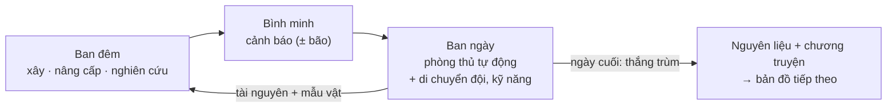
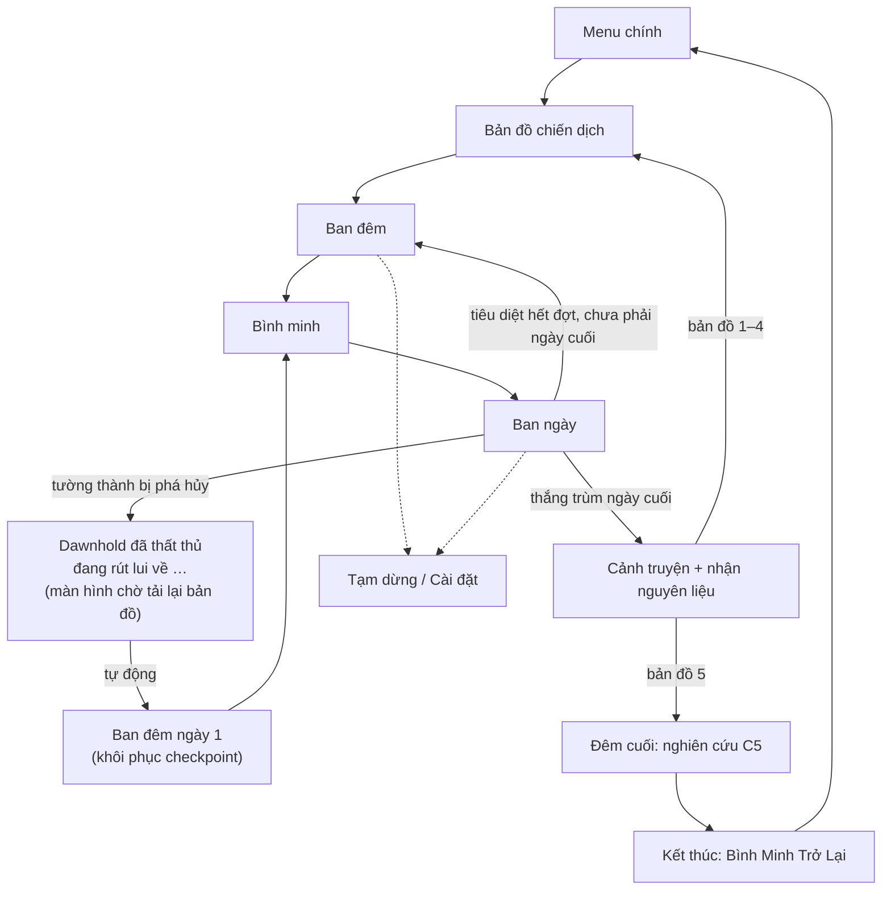
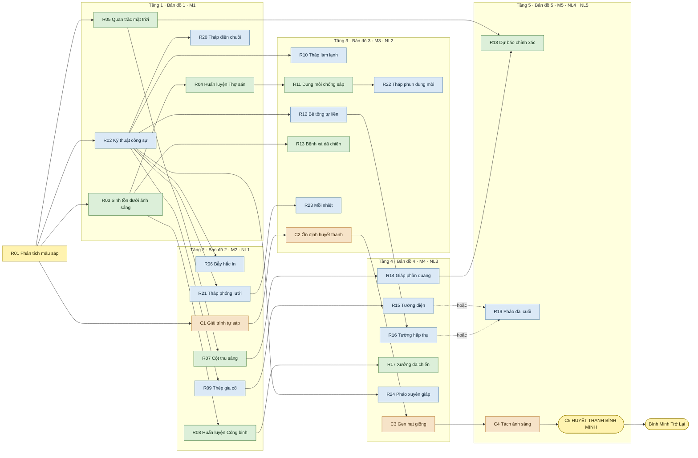
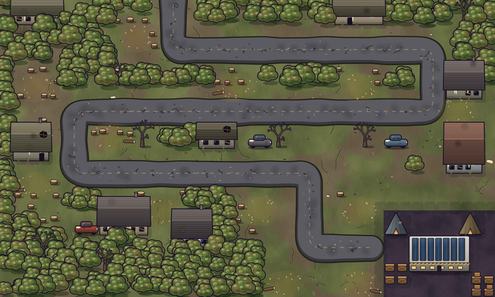
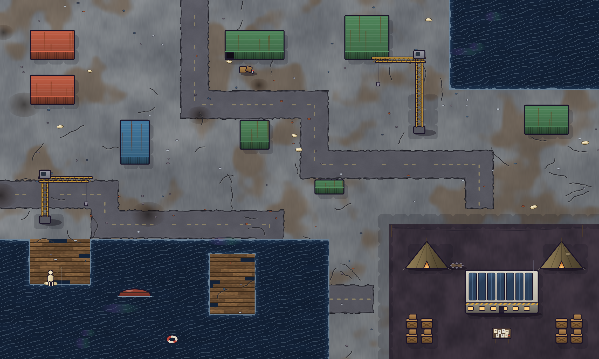
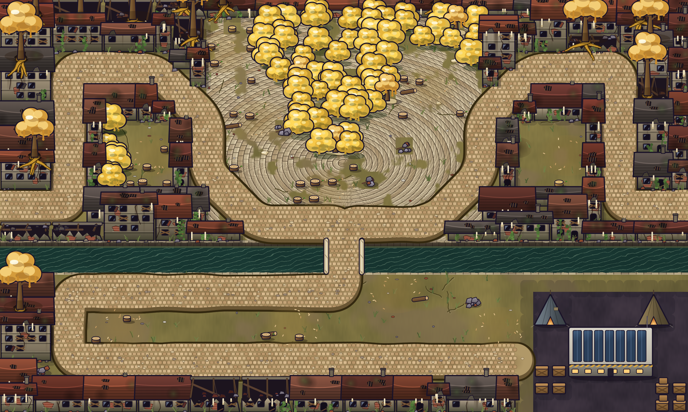
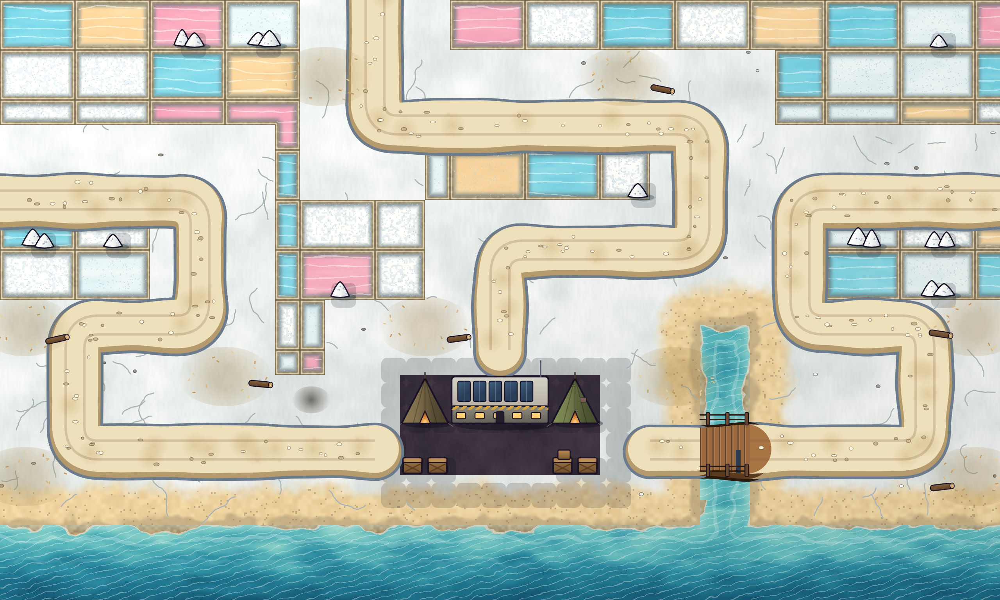
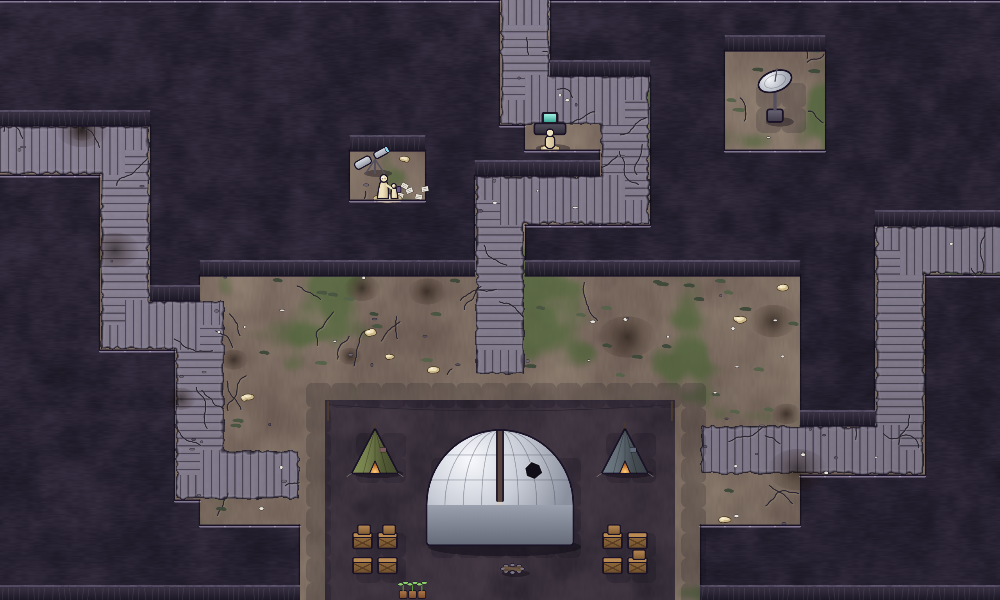

# Guardian of Dawn – Tài liệu thiết kế game (GDD v2)

*Hằng tinh đã phản bội. Bóng tối là tuyến phòng thủ cuối cùng.*

| | |
|---|---|
| **TÊN GAME** | Guardian of Dawn |
| **THỂ LOẠI** | Strategy / Tower Defense theo chiến dịch |
| **NỀN TẢNG / ENGINE** | PC (Windows) / Unity 2D |
| **NGƯỜI SOẠN** |   |
| **PHIÊN BẢN** | 2.0 |
| **CẬP NHẬT** | 2026-11-12 |
| **TRẠNG THÁI** | Bản nộp |

**Quy ước trong tài liệu**

- **(Đề xuất)**: quyết định hoặc con số chưa chốt, cần playtest xác nhận. Nội dung không có nhãn này là thiết kế đã chốt.
- **P0 / P1 / P2**: mức ưu tiên – P0 bắt buộc cho bản chơi được, P1 cần cho trải nghiệm trọn vẹn, P2 có thì tốt.
- **Không áp dụng**: tính năng được cố ý loại khỏi phạm vi (ví dụ multiplayer), kèm lý do.
- Mã tham chiếu: `MEC-xx` (cơ chế), `Rxx` / `Cx` (nút nghiên cứu), `Mx` (mẫu vật), `NLx` (nguyên liệu đặc biệt), `F-xx` (tính năng), `QA-xx` (ca kiểm thử).

## 0. Quản lý tài liệu

### 0.1 Thông tin dự án và quyền sở hữu

Tên game: Guardian of Dawn. Tagline: “Hằng tinh đã phản bội. Bóng tối là tuyến phòng thủ cuối cùng.”

Loại dự án: đồ án cuối kỳ môn thiết kế game, phát triển bởi nhóm sinh viên. Tài liệu do nhóm thiết kế sở hữu và cập nhật.

### 0.2 Mục đích tài liệu và người đọc

Tài liệu này định nghĩa **trải nghiệm và luật chơi** của Guardian of Dawn: tầm nhìn, vòng lặp chơi, cơ chế, kẻ địch, bản đồ, cốt truyện, giao diện, âm thanh và phạm vi sản xuất. Người đọc chính:

- Giảng viên – đánh giá thiết kế của đồ án.
- Lập trình viên – hiểu luật chơi cần hiện thực (kiến trúc mã nằm ở tài liệu Class Design, mục 12.7).
- Họa sĩ và người làm âm thanh – hiểu những gì hình ảnh/âm thanh phải truyền đạt.
- Người kiểm thử – biết hành vi mong đợi để viết ca kiểm thử.

GDD không mô tả thuật toán, cấu trúc lớp hay cách cài đặt; những nội dung đó nằm trong tài liệu kỹ thuật.

### 0.3 Nhãn phạm vi, giả định và quyết định

| Nhãn | Ý nghĩa |
|---|---|
| Đã chốt | Thiết kế được nhóm thống nhất, dùng để sản xuất |
| (Đề xuất) | Hướng đi hoặc con số ban đầu, sẽ điều chỉnh theo playtest |
| Câu hỏi mở | Chưa có quyết định; được liệt kê ở cuối mục liên quan |
| Không áp dụng | Cố ý loại khỏi phạm vi |

Giả định chính:

- Mọi con số cân bằng (máu, sát thương, chi phí, xác suất, thời gian nghiên cứu) là điểm khởi đầu, chưa qua playtest.
- Đồ họa và âm thanh hiện là placeholder; thiết kế mô tả ý đồ, không phải tài sản cuối cùng.
- Phạm vi có các mốc dự phòng (mục 14.2): nếu thiếu thời gian, mỗi mốc vẫn là một bản game hoàn chỉnh.

### 0.4 Lịch sử phiên bản và quyết định

| Phiên bản | Ngày | Thay đổi chính | Lý do |
|---|---|---|---|
| 1.0 | 2026-10-28 | GDD đầu tiên: tower defense ngày/đêm, ánh sáng ban ngày gây hại liên tục (độ sáp hóa), Lính mang bóng, máy tạo bóng tối, cấu trúc roguelite, thiết lập độ khó, nhiều kết thúc | – |
| 2.0 | 2026-11-12 | Hướng chiến dịch cứu chữa: mục tiêu là chữa Dị Thể Sáp trở lại thành người (cột mốc cốt truyện, không phải cơ chế trong trận); chiến dịch 5 bản đồ có cốt truyện; ánh sáng không còn ảnh hưởng tới công trình hay binh lính, thay bằng bão mặt trời hiếm gặp phá hủy 1–2 công trình; binh lính mở khóa qua nghiên cứu, gồm 3 loại (Lính trấn thủ, Thợ săn, Công binh); bỏ Lính mang bóng, máy tạo bóng tối, độ sáp hóa, roguelite, thiết lập độ khó và các kết thúc phụ | Thu gọn phạm vi cho vừa thời gian đồ án; làm cốt truyện và mục tiêu dài hạn rõ ràng hơn; biến ánh sáng từ hình phạt liên tục thành một rủi ro có thể đầu tư phòng ngừa |

## 1. Tổng quan và ý tưởng cốt lõi

### 1.1 Ý tưởng cốt lõi trong một câu

Guardian of Dawn là game Strategy / Tower Defense theo chiến dịch, trong đó người chơi vào vai Chỉ huy trưởng của Dawnhold, dẫn đoàn viễn chinh qua 5 vùng đất, dựng phòng tuyến vào ban đêm, chống lại Dị Thể Sáp mỗi khi bình minh lên, và thu thập 5 nguyên liệu đặc biệt để chữa Dị Thể Sáp trở lại thành người.

### 1.2 Tầm nhìn thiết kế và trải nghiệm người chơi

Khi mặt trời dị biến, thứ ánh sáng đã nuôi sống nhân loại trở thành vũ khí chống lại loài người. Mọi sinh vật sống tiếp xúc với ánh sáng mặt trời nhanh chóng hóa lỏng thành Dị Thể Sáp – những tàn dư của sự sống, bị thu hút bởi hơi ấm của sự sống.

Người chơi là Chỉ huy trưởng của Dawnhold. Nghiên cứu mẫu vật cho thấy Dị Thể Sáp vẫn còn mang dấu vết của con người – chúng có thể được cứu. Người chơi dẫn đoàn viễn chinh rời Dawnhold, giữ vững từng tiền đồn tạm thời đủ lâu để lấy được nguyên liệu chữa trị ở mỗi vùng đất. Mỗi bản đồ hoàn thành là một bước tiến tới ngày những người đã mất được đưa trở về.

Cảm xúc mong muốn: áp lực của người chỉ huy phải chuẩn bị trong bóng tối, sự hồi hộp khi bình minh lên, và niềm hy vọng lớn dần qua từng cột mốc chữa trị.

Câu hỏi trung tâm: “Liệu nhân loại có thể cứu được những người đã mất vào ánh sáng?”

### 1.3 Trụ cột thiết kế và những điều không làm

**Trụ cột thiết kế** – dùng để quyết định khi có tranh luận:

1. **Đêm quyết định, ngày kiểm chứng.** Phần lớn quyết định diễn ra vào ban đêm (xây, nâng cấp, nghiên cứu). Ban ngày là lúc kế hoạch được thử thách, người chơi chỉ can thiệp bằng vài hành động có thời điểm (di chuyển đội, kỹ năng chủ động).
2. **Rủi ro hiếm nhưng nặng.** Bão mặt trời ít khi xảy ra nhưng phá hủy công trình kèm toàn bộ cấp nâng cấp. Mọi quyết định đầu tư đều phải cân nhắc “nếu bão đánh vào đây thì sao”.
3. **Không có lời giải duy nhất.** Mỗi Dị Thể Sáp có ít nhất 2 cách khắc chế, mỗi công trình khắc chế ít nhất 2 mục tiêu. Người chơi chọn cách phòng thủ theo phong cách của mình.
4. **Cứu rỗi, không tiêu diệt.** Tiến trình dài hạn là hành trình chữa trị: kẻ địch là những người đã mất, và mỗi bản đồ đưa họ gần ngày trở về hơn.

**Không phải mục tiêu (non-goals):**

- Không roguelite, không bản đồ sinh ngẫu nhiên – 5 bản đồ được thiết kế thủ công.
- Không thiết lập độ khó, không nhiều kết thúc – độ khó tăng theo bản đồ, game có một kết thúc duy nhất.
- Không điều khiển trực tiếp từng người lính (không micro kiểu RTS).
- Không chữa Dị Thể Sáp trong trận – việc chữa trị là cột mốc cốt truyện.
- Không multiplayer, không tính năng online.

### 1.4 Thể loại, góc nhìn và vai trò người chơi

Thể loại chính: Strategy / Tower Defense. Điểm khác biệt: chiến dịch 5 bản đồ có cốt truyện; nghiên cứu được giữ xuyên suốt chiến dịch.

Vai trò người chơi: Chỉ huy trưởng của Dawnhold – quyết định xây dựng, nâng cấp, huấn luyện và nghiên cứu. Vào ban ngày, công trình tự động chiến đấu; người chơi di chuyển Thợ săn và Công binh, và tự canh thời điểm kích hoạt kỹ năng của binh lính. Người chơi không có nhân vật đại diện trên bản đồ.

Góc nhìn: 2D, góc 3/4 từ trên cao (theo sprite đã sản xuất, mục 8.1); camera nhìn toàn cảnh tiền đồn.

### 1.5 Nền tảng và bối cảnh chơi

Nền tảng: PC (Windows). Engine: Unity. Điều khiển: chuột và bàn phím (mục 9.3). Tay cầm: không hỗ trợ.

Bối cảnh chơi: ngồi tại bàn, phiên chơi 20–50 phút (một bản đồ). Có thể tạm dừng bất cứ lúc nào nên phù hợp cả phiên ngắn.

### 1.6 Chế độ chơi và thời lượng

Chế độ chơi: single-player.

Chiến dịch gồm 5 bản đồ chơi theo thứ tự. Mỗi bản đồ có số ngày cố định (8–15 ngày, mỗi ngày một đợt); tổng cộng 57 ngày. Thua một bản đồ thì chơi lại bản đồ đó từ đầu. Chiến dịch kết thúc khi hoàn thành bản đồ 5 và điều chế Huyết thanh Bình Minh. Không có thiết lập độ khó: độ khó chỉ tăng theo thứ tự bản đồ.

Thời lượng mục tiêu (Đề xuất): mỗi ngày (đêm + ngày) 2–4 phút → mỗi bản đồ 20–50 phút → toàn chiến dịch khoảng 3–4 giờ, chưa tính số lần chơi lại.

### 1.7 Phong cách hình ảnh và không khí

Đồ họa 2D, phong cách lấy cảm hứng từ hồ sơ SCP: giao diện nghiên cứu dạng hồ sơ mật, nút bị che **[REDACTED]**, ảnh mẫu vật kèm chú thích. Đơn vị trên bản đồ dùng màu sáng và viền đậm để đọc rõ trên nền u ám; ánh sáng mặt trời được thể hiện trắng chói, gây cảm giác nguy hiểm.

Flavor: Sci-fi hậu tận thế, kinh dị sinh tồn; bầu không khí u ám nhưng giàu hy vọng.

### 1.8 Điểm độc đáo (USP)

**Bão mặt trời:** ánh sáng không còn là mối nguy hằng ngày, mà là một rủi ro hiếm gặp nhưng nặng nề – mỗi cơn bão phá hủy 1–2 công trình ngẫu nhiên, kèm toàn bộ cấp nâng cấp của chúng. Người chơi phải cân nhắc giữa dồn tài nguyên vào vài công trình mạnh hay rải ra nhiều công trình, và giữa đầu tư vào phòng ngừa (Cột thu sáng, Giáp phản quang) hay vào hỏa lực.

**Hành trình chữa trị:** cốt truyện là hành trình chữa Dị Thể Sáp; mỗi bản đồ hoàn thành mang về một nguyên liệu và một cột mốc chữa trị. Kẻ địch không chỉ là mục tiêu cần tiêu diệt mà là những người cần được cứu.

## 2. Đối tượng, thị trường và định vị sản phẩm

### 2.1 Đối tượng người chơi chính và phụ

Đối tượng chính: người chơi yêu thích lập kế hoạch chiến lược, tower defense, nâng cấp đơn vị và vượt qua những thử thách ngày càng khó. Họ quen với khái niệm “khắc chế” (counter) và thích thử nhiều cách bố trí khác nhau.

Đối tượng phụ: người thích cốt truyện bí ẩn, khám phá lore dần dần (kiểu hồ sơ SCP), chấp nhận độ khó vừa phải để xem câu chuyện.

Nhu cầu: chơi được bằng chuột là chính; có tạm dừng để suy nghĩ; không đòi hỏi phản xạ nhanh.

### 2.2 Game tương tự và điểm khác biệt

| Game | Điểm tương đồng | Guardian of Dawn khác ở đâu |
|---|---|---|
| Kingdom Rush | Tower defense có cây nâng cấp từng tháp, binh lính có thể điều chỉnh vị trí, kẻ địch đòi hỏi tháp khắc chế | Công trình có thể bị bão phá hủy kèm cấp nâng cấp; nghiên cứu xuyên chiến dịch; chu kỳ đêm/ngày tách chuẩn bị và chiến đấu |
| They Are Billions | Phòng thủ bằng tường thành trước làn sóng kẻ địch; sống sót qua số ngày cố định | Không quản lý kinh tế thành phố; trọng tâm là chọn công trình khắc chế và quản lý rủi ro bão |
| Plants vs. Zombies | Mỗi màn giới thiệu một loại kẻ địch mới; đợt lớn được báo trước | Kẻ địch tích lũy qua chiến dịch (bậc tiến hóa và biến thể), có nghiên cứu mở khóa dần và bể kẻ địch ẩn |

Tham khảo không khí và cách trình bày lore: định dạng hồ sơ của dự án SCP Foundation (chỉ lấy cảm hứng về hình thức, không dùng nội dung – xem 13.3).

### 2.3 Lời hứa với người chơi và tiêu chí thành công

Lời hứa với người chơi: mỗi đêm là một bài toán bố trí có nhiều lời giải; mỗi ngày cho thấy ngay kế hoạch đó đúng hay sai; mỗi bản đồ hoàn thành đưa câu chuyện tiến thêm một bước.

Hành vi quan sát được để xác nhận lời hứa (chi tiết ở 15.3):

- Sau khi thua, người chơi thay đổi bố trí thay vì lặp lại y nguyên.
- Người chơi giải thích được vì sao chọn một công trình (ví dụ “xây Súng cối vì Sáp vụn đi theo bầy”).
- Người chơi chủ động nói về rủi ro bão khi quyết định nâng cấp.
- Người chơi muốn chơi tiếp bản đồ sau để xem cột mốc chữa trị tiếp theo.

### 2.4 Mục tiêu và hình thức phân phối

Đây là đồ án học tập, không có mục tiêu thương mại. Bản phân phối là một build PC (Windows) nộp kèm tài liệu. (Đề xuất) Có thể đăng bản miễn phí lên itch.io sau khi nộp để lấy thêm phản hồi playtest.

### 2.5 Mức độ nội dung và phân loại độ tuổi

Nội dung nhạy cảm: kinh dị nhẹ (sinh vật hóa sáp, cơ thể biến dạng), nhắc tới thảm họa với số thương vong lớn. Không có máu me chi tiết, không bạo lực với con người – kẻ địch là sinh vật sáp, và chúng được chữa chứ không bị giết trong cốt truyện.

Mức phân loại dự kiến: tương đương PEGI 12 / ESRB Teen. Đây là ý định thiết kế; game chưa được tổ chức phân loại nào đánh giá.

## 3. Trải nghiệm, mục tiêu và luồng chơi

### 3.1 Mục tiêu, điều kiện thắng và thua

Mục tiêu ngắn hạn: giữ tường thành của tiền đồn hiện tại, sống sót qua mọi ngày của bản đồ.

Mục tiêu trung hạn: hoàn thành bản đồ – đánh bại Dị Thể Sáp nguồn (trùm) vào ngày cuối và nhận nguyên liệu đặc biệt của bản đồ đó.

Mục tiêu dài hạn: thu thập đủ 5 nguyên liệu, phát triển mạng nghiên cứu và điều chế Huyết thanh Bình Minh để chữa Dị Thể Sáp trở lại thành người.

Hoàn thành một ngày: mỗi ngày có một đợt tấn công; tiêu diệt toàn bộ Dị Thể Sáp của đợt đó.

Chiến thắng – “Bình Minh Trở Lại”: kết thúc duy nhất của game. Đạt được khi hoàn thành bản đồ 5 và nghiên cứu xong Huyết thanh Bình Minh.

Thất bại – “Dawnhold đã thất thủ”: khi tường thành bị phá hủy, bản đồ hiện tại thất bại. Màn hình thua hiển thị “Dawnhold đã thất thủ – đang rút lui về …” và đóng vai trò màn hình chờ trong lúc bản đồ được tải lại; sau đó người chơi chơi lại bản đồ đó từ ngày 1, với nghiên cứu, đội lính và nguyên liệu như lúc bắt đầu bản đồ. Không có game over vĩnh viễn.

### 3.2 Vòng lặp chơi cốt lõi

1. **Ban đêm (Chuẩn bị):** dùng tài nguyên để xây dựng/nâng cấp công trình và tường thành, huấn luyện binh lính; dùng mẫu vật thu thập được để nghiên cứu công nghệ, công trình và kỹ thuật mới.
2. **Bình minh (Cảnh báo):** hệ thống phát cảnh báo bắt đầu phòng thủ. Nếu hôm nay có bão mặt trời, cảnh báo bão được phát.
3. **Ban ngày (Phòng thủ):** công trình và binh lính tự động chống lại Dị Thể Sáp; người chơi di chuyển Thợ săn và Công binh, và kích hoạt kỹ năng chủ động của binh lính đúng thời điểm. Tiêu diệt Dị Thể Sáp nhận tài nguyên và mẫu vật nghiên cứu; tiêu diệt toàn bộ để hoàn thành ngày.
4. **Kết thúc ngày** → quay lại ban đêm và lặp lại chu kỳ. Sau ngày cuối của bản đồ (trùm) → nhận nguyên liệu, xem chương truyện, chuyển sang bản đồ tiếp theo.



### 3.3 Vòng lặp phụ và dài hạn

**Mạng nghiên cứu (xuyên suốt chiến dịch):** một mạng nghiên cứu chung, không tuyến tính, gồm ba nhánh – Phòng thủ (công trình, tường thành), Sinh tồn (binh lính, bão mặt trời) và Chữa trị (dùng nguyên liệu đặc biệt; các cột mốc cốt truyện dẫn đến Huyết thanh Bình Minh). Mạng có 5 tầng, mỗi tầng ứng với một bản đồ.

Nút nghiên cứu được mở khóa theo loại mẫu vật đã thu thập: mỗi loại Dị Thể Sáp rơi ra loại mẫu vật riêng, và mỗi bản đồ giới thiệu một loại Dị Thể Sáp mới, nên tầng nghiên cứu mới mở ra theo tiến trình chiến dịch. Câu chuyện được hé lộ dần qua các mẫu vật nghiên cứu.

**Chiến dịch (giữa các bản đồ):** nghiên cứu, đội lính (kèm cấp bậc) và nguyên liệu được mang sang bản đồ tiếp theo. Công trình, tường thành và tài nguyên bắt đầu lại ở mỗi bản đồ mới (tiền đồn mới). Xem mục 5.1.

**Cấp bậc đội lính:** mỗi đội tích lũy kinh nghiệm qua nhiều bản đồ; giữ được một đội cựu binh sống sót là mục tiêu dài hạn riêng (mục 4.9).

Chi tiết các nút, yêu cầu mẫu vật và sơ đồ: xem mục 4.9 – Mạng nghiên cứu (chi tiết).

### 3.4 Diễn biến từng phút

**Ban đêm** (không giới hạn thời gian; người chơi bấm “Đón bình minh” khi sẵn sàng – Đề xuất):

1. Màn hình tổng kết ngày vừa qua: Dị Thể Sáp tiêu diệt, tài nguyên và mẫu vật nhận được, công trình bị mất.
2. Nếu đã có R05: xem xác suất bão ngày mai; nếu đã có R18: xem công trình nào sẽ bị đánh.
3. Mở mạng nghiên cứu, chọn nút cho đêm nay (một nút mỗi lúc).
4. Xây mới, nâng cấp, xây lại đống đổ nát, sửa tường; hồi máu và bổ sung đội lính.
5. Đặt vị trí ban đầu cho Thợ săn và Công binh.

**Bình minh** (vài giây): còi báo động, thông báo hướng tấn công; cảnh báo bão nếu có. Sau C1, hiển thị các loại Dị Thể Sáp sẽ xuất hiện.

**Ban ngày** (khoảng 1–3 phút – Đề xuất):

1. Dị Thể Sáp vào từ các hướng tấn công; công trình tự bắn khi mục tiêu vào tầm.
2. Người chơi theo dõi thanh máu tường thành, kéo Thợ săn tới chỗ nguy hiểm, đưa Công binh về sát tường để sửa.
3. Khi một kỹ năng sẵn sàng, người chơi chọn thời điểm dùng (ví dụ “Giữ vững” khi trùm tới tường).
4. Nếu có bão: vòng đánh dấu xuất hiện trên công trình bị nhắm 10 giây trước; công trình bị phá để lại đống đổ nát.
5. Tiêu diệt Dị Thể Sáp cuối cùng → ngày kết thúc → chuyển sang đêm.

Người chơi có thể tạm dừng hoặc chơi tốc độ ×2 bất cứ lúc nào trong ban ngày.

### 3.5 Trạng thái game và luồng màn hình



- **Tạm dừng:** dừng toàn bộ mô phỏng; từ đây có thể vào Cài đặt, quay về bản đồ chiến dịch hoặc thoát game. Khi thoát, tiến độ được lưu và lần sau bắt đầu lại từ đầu ngày hiện tại (4.12).
- **Thua:** không mất gì ngoài tiến độ của bản đồ hiện tại (mục 4.7).
- **Sau kết thúc:** người chơi quay về menu; bản đồ chiến dịch cho phép chơi lại từng bản đồ (mục 5.7).

### 3.6 Đường cong độ khó và làm quen

Độ khó tăng theo bản đồ (không có thiết lập độ khó riêng): mỗi bản đồ dài hơn, có nhiều hướng tấn công hơn, bão mặt trời thường xuyên hơn và một bậc Dị Thể Sáp mới. Trong một bản đồ, đợt tấn công mạnh dần mỗi ngày và ngày cuối là trận đánh trùm.

Mỗi bản đồ giới thiệu một ý tưởng mới:

| Bản đồ              | Ý tưởng mới                                                                                                                            |
| ------------------- | -------------------------------------------------------------------------------------------------------------------------------------- |
| 1 – Ngoại ô         | Lõi tower defense; mở khóa binh lính qua nghiên cứu; một cơn bão mặt trời hướng dẫn; biến thể Sáp vụn (bầy đông) và Tháp điện chuỗi    |
| 2 – Cầu cảng        | Dị Thể Sáp hổ (tốc độ); 2 hướng tấn công; bão mặt trời ngẫu nhiên; Công binh; biến thể Sáp vỏ cua (giáp phía trước) và Tháp phóng lưới |
| 3 – Phố cổ đổ nát   | Dị Thể Sáp hồi phục; đất xây hẹp; biến thể Sáp bào tử (vỡ ra khi chết); Tháp phun dung môi và Mồi nhiệt                                |
| 4 – Đồng bằng trắng | Dị Thể Sáp thấu kính (hội tụ ánh sáng lên công trình); 3 hướng tấn công; biến thể Sáp gương (phản đạn); Pháo xuyên giáp                |
| 5 – Đài thiên văn   | Dị Thể Sáp tối thượng; biến thể Sáp kích động (tăng tốc đồng loại); mọi mối nguy cùng lúc                                              |

Nhịp trong một bản đồ theo mô hình “đoạn – nút thắt” (chi tiết bản đồ 1: tài liệu Level Flow – Map 1):

- Mỗi đoạn đợt dạy một điều; nút thắt (mini-boss giữa bản đồ, trùm ngày cuối) chỉ kiểm tra những gì đã được dạy trước đó.
- Sau mỗi nút thắt là một đợt nhẹ hơn để người chơi xây lại và tiêu phần thưởng.
- Nội dung mới (biến thể, bão) xuất hiện ngay sau nút thắt, không đặt ngay trước nó.

Chi tiết từng bản đồ: mục 5.3. Hướng dẫn chơi lần đầu: mục 5.2.

### 3.7 Nhịp phản hồi và phần thưởng

| Nhịp               | Phản hồi / phần thưởng                                                       |
| ------------------ | ---------------------------------------------------------------------------- |
| Mỗi giây           | Số sát thương, hiệu ứng trúng đòn, máu tường thành                           |
| Mỗi lần tiêu diệt  | Tài nguyên và mẫu vật bay về thanh HUD                                       |
| Mỗi đêm            | Tổng kết ngày; xây/nâng cấp có âm thanh và hiệu ứng; tiến độ nghiên cứu      |
| Mỗi nút nghiên cứu | Công trình, tường thành hoặc binh lính mới; một hồ sơ lore được mở           |
| Mỗi bản đồ         | Nguyên liệu đặc biệt, cột mốc chữa trị (cảnh truyện), bản đồ tiếp theo mở ra |

Người chơi thấy rõ mình tiến gần tới việc cứu nhân loại: thanh tiến trình chữa trị (5 nguyên liệu) luôn hiện trên bản đồ chiến dịch.

## 4. Cơ chế và luật chơi

*Chương này mô tả hành vi người chơi quan sát được: điều kiện, hiệu ứng, giới hạn và phản hồi. Cách cài đặt nằm trong tài liệu Class Design.*

### 4.1 Thuật ngữ

**Dawnhold:** một trong những vùng an toàn còn sót lại của nhân loại; nơi đoàn viễn chinh xuất phát.

**Tiền đồn:** căn cứ tạm thời đoàn viễn chinh dựng ở mỗi bản đồ; người chơi bảo vệ tường thành của tiền đồn.

**Dị Thể Mặt Trời:** mặt trời đã dị biến – nguồn gốc của thảm họa.

**“Thảm họa: Khi Ngày Tàn”:** tên sự kiện mặt trời biến đổi; 6,8 tỷ thương vong được ghi nhận trong vòng 24 giờ.

**Dị Thể Sáp:** sinh vật sống bị ánh sáng mặt trời hóa lỏng; kẻ địch chính, bị thu hút bởi hơi ấm của sự sống.

**Bão mặt trời:** sự kiện hiếm; tia sáng cực mạnh đánh xuống 1–2 công trình ngẫu nhiên và phá hủy chúng. Cùng với hội tụ của Dị Thể Sáp thấu kính, đây là cách duy nhất ánh sáng ảnh hưởng tới trận đánh.

**Mẫu vật:** thu được khi tiêu diệt Dị Thể Sáp; mỗi loại Dị Thể Sáp rơi ra loại mẫu vật riêng (M1–M5). Dùng để mở khóa và thực hiện nghiên cứu.

**Nguyên liệu đặc biệt:** 5 nguyên liệu chữa trị (NL1–NL5), mỗi bản đồ cho đúng một nguyên liệu khi hoàn thành. Dùng cho nhánh Chữa trị – mỗi nguyên liệu mở một cột mốc chữa trị.

**Mạng nghiên cứu:** hệ thống nghiên cứu chung gồm ba nhánh – Phòng thủ, Sinh tồn và Chữa trị; 5 tầng ứng với 5 bản đồ.

**Huyết thanh Bình Minh:** nghiên cứu cuối cùng (C5), cần cả 5 nguyên liệu; hoàn thành → kết thúc Bình Minh Trở Lại.

**Tường thành:** tuyến phòng thủ chính của tiền đồn, có **một thanh máu chung**; nâng cấp tường thành tăng máu và lắp thêm súng máy trên tường. Tường thành bị phá hủy = thua bản đồ.

**Dawnhold đã thất thủ:** màn hình thất bại khi tường thành bị phá hủy, hiển thị “Dawnhold đã thất thủ – đang rút lui về …” trong lúc bản đồ được tải lại; người chơi chơi lại bản đồ từ ngày 1.

**Tài nguyên:** thu được khi tiêu diệt Dị Thể Sáp; dùng để xây dựng, nâng cấp, huấn luyện và sửa chữa. Không mang sang bản đồ sau.

**Bậc tiến hóa:** 5 bậc Dị Thể Sáp; mỗi bản đồ giới thiệu một bậc mới (bản đồ N → bậc N).

**Biến thể:** phiên bản đột biến của một bậc đã có; mỗi bản đồ thêm một biến thể (tổng 5). Biến thể rơi cùng loại mẫu vật với bậc gốc.

**Bể Dị Thể Sáp:** tỷ lệ ẩn của từng loại Dị Thể Sáp, quyết định thành phần mỗi đợt; mở khóa dần khả năng xem qua nhánh Chữa trị (loại → tỷ lệ ước lượng → tỷ lệ chính xác).

**Đợt (wave):** mỗi ngày có đúng một đợt tấn công của Dị Thể Sáp; đợt N = ngày N của bản đồ hiện tại.

**Dị Thể Sáp nguồn:** trùm của mỗi bản đồ, xuất hiện vào ngày cuối; là phiên bản lớn của bậc mới trên bản đồ đó và giữ nguyên liệu đặc biệt.

**Đội lính (squad):** đơn vị binh lính gồm nhiều thành viên; 3 loại (Lính trấn thủ, Thợ săn, Công binh); tối đa 3 đội; chỉ có sau khi nghiên cứu Sinh tồn dưới ánh sáng (R03). Từ đó binh lính không bị ánh sáng ảnh hưởng.

**Cấp bậc:** kinh nghiệm riêng của từng đội; mỗi loại lính nhận kinh nghiệm theo cách riêng (Thợ săn: tiêu diệt; Lính trấn thủ: sống sót qua đợt; Công binh: sửa chữa/xây lại); mất khi toàn bộ đội chết trong một đợt; được mang sang bản đồ sau.

**Skill tree đơn vị:** cây nâng cấp riêng của từng công trình, tường thành và đội lính, mua bằng tài nguyên; khác với mạng nghiên cứu (mua bằng mẫu vật, giữ cả chiến dịch).

### 4.2 Di chuyển (MEC-01)

Người chơi không có nhân vật di chuyển; chuyển động trên bản đồ gồm Dị Thể Sáp và binh lính.

**Dị Thể Sáp:**

- Xuất hiện ở rìa bản đồ theo các hướng tấn công (1–3 tùy bản đồ) và đi theo lối đi cố định về phía tường thành.
- Lối đi chạy từ rìa bản đồ tới tường thành; công trình đặt trên ô đất trống dọc lối đi và không chặn đường (không có lối chơi “xếp mê cung”).
- Tốc độ tương đối: bậc 2 (hổ) nhanh nhất; bậc 5 (tối thượng) và Sáp vỏ cua chậm nhất. Sáp kích động tăng tốc các Dị Thể Sáp xung quanh.
- Có thể bị đổi hướng (Mồi nhiệt), làm chậm (Tháp làm lạnh, Bẫy hắc ín), trói (Tháp phóng lưới) hoặc đóng băng (Tháp làm lạnh với bậc 4).
- Khi gặp một đội lính trên đường, Dị Thể Sáp dừng lại tấn công đội đó; khi tới tường thành, chúng đứng tại chỗ và tấn công tường thành.

**Binh lính:**

- Lính trấn thủ đứng cố định trên tường thành tại vị trí được chọn vào ban đêm; không di chuyển trong ban ngày.
- Thợ săn và Công binh: người chơi chọn đội rồi chọn điểm đến (ban đêm hoặc ban ngày). Đội tự đi tới đó và hoạt động trong bán kính quanh điểm đó.
- Binh lính có thể ra phía trước tường; đứng ở đó thì có thể bị Dị Thể Sáp tấn công.
- Điểm đến không hợp lệ (ngoài bản đồ, trên vật cản): con trỏ hiện dấu đỏ, lệnh không được nhận.

### 4.3 Tương tác và hành động (MEC-02)

| Hành động | Điều kiện | Kết quả |
|---|---|---|
| Xây dựng công trình | Ban đêm; đủ tài nguyên; công trình đã mở khóa; vị trí hợp lệ (4.5) | Công trình xuất hiện ở cấp 0 và hoạt động từ ngày kế tiếp |
| Huấn luyện đội lính | Ban đêm; đủ tài nguyên; loại lính đã mở khóa; chưa đủ 3 đội | Đội mới ở cấp bậc 1 |
| Nâng cấp công trình/đội lính/tường thành | Ban đêm; đủ tài nguyên; nhánh nâng cấp tương ứng đã được mở khóa qua nghiên cứu | Công trình/đội lính tăng chỉ số và mở khóa kỹ năng mới; tường thành tăng chỉ số và có thêm súng máy gắn trên tường |
| Xây lại công trình bị phá hủy | Ban đêm (hoặc ban ngày bằng Công binh) | Đống đổ nát được thay bằng công trình cùng loại ở cấp 0; tốn 50% chi phí ban đầu (25% sau R17); cấp nâng cấp cũ bị mất |
| Sửa chữa tường thành | Ban đêm; đủ tài nguyên | Tường thành hồi máu |
| Hồi máu và bổ sung đội lính | Ban đêm; đủ tài nguyên | Đội được hồi máu, bổ sung thành viên và giữ cấp bậc |
| Nghiên cứu | Ban đêm; không có nút nào đang nghiên cứu; đã thu thập đủ loại mẫu vật yêu cầu | Sau 1–3 đêm: mở khóa công trình, binh lính hoặc nhánh nâng cấp; nút Chữa trị cần thêm nguyên liệu đặc biệt; Huyết thanh Bình Minh dẫn đến kết thúc |
| Di chuyển đội lính | Thợ săn hoặc Công binh (Lính trấn thủ cố định trên tường) | Đổi vị trí và bán kính hoạt động của đội |
| Kích hoạt kỹ năng đội lính | Ban ngày; kỹ năng đã hồi | Giữ vững / Hạ sát / Dựng khẩn cấp (mục 4.6); người chơi phải tự canh thời điểm |

Người chơi không có kho đồ. Ba loại tiền tệ (tài nguyên, mẫu vật, nguyên liệu) được hiển thị trên HUD (mục 4.8, 9.1).

Hành động không hợp lệ: nút bị làm mờ, chi phí còn thiếu hiển thị màu đỏ, tooltip giải thích lý do (mục 9.6).

### 4.4 Ánh sáng và bão mặt trời (MEC-03)

Ánh sáng chỉ ảnh hưởng tới trận đánh qua **bão mặt trời** và **hội tụ của Dị Thể Sáp thấu kính**. Ánh sáng ban ngày bình thường không ảnh hưởng tới công trình hay binh lính: binh lính chỉ được ra trận sau nghiên cứu Sinh tồn dưới ánh sáng, và từ đó miễn nhiễm với ánh sáng.

**Bão mặt trời**

- Mỗi ngày có một xác suất nhỏ xảy ra bão mặt trời (theo bản đồ, mục 5.3); tối đa 1 cơn mỗi ngày, và sau một cơn bão có 2 ngày không thể có bão. Bản đồ 1 chỉ có một cơn bão hướng dẫn vào ngày 6.
- Bình minh: nếu hôm nay có bão, cảnh báo “Bão mặt trời” được phát (chưa biết công trình nào bị đánh).
- Giữa ngày: 1–2 công trình được chọn ngẫu nhiên và đánh dấu 10 giây trước khi tia bão đánh xuống (tỷ lệ đề xuất: 60% một công trình, 40% hai công trình). Công trình không thể di chuyển.
- Khi bão đánh xuống: công trình bị đánh trúng bị phá hủy (để lại đống đổ nát) và mất toàn bộ cấp nâng cấp. Bão không đánh vào tường thành hay binh lính.
- Xây lại: ban đêm, tốn 50% chi phí ban đầu; hoặc ngay trong ngày bằng Công binh.
- Phòng ngừa (nghiên cứu, mục 4.9): Quan trắc mặt trời – R05 (báo trước xác suất bão của ngày mai), Cột thu sáng – R07 (tia bão nhắm vào công trình trong bán kính của cột sẽ bị hút vào cột), Giáp phản quang – R14 (công trình bị đánh không bị phá hủy mà quá nhiệt tới đêm), Dự báo chính xác – R18 (biết trước công trình nào sẽ bị đánh từ đêm hôm trước, để kịp đặt Cột thu sáng).

**Dị Thể Sáp thấu kính (bậc 4)** – (Đề xuất) Hội tụ: cơ thể dạng nước khúc xạ ánh sáng; nếu nó đứng cạnh cùng một công trình đủ 5 giây, nó hội tụ ánh sáng thành một tia bão nhỏ, phá hủy công trình đó (Cột thu sáng và Giáp phản quang có tác dụng như với bão). Tháp làm lạnh đóng băng nó và ngắt quá trình hội tụ.

**Trường hợp biên:**

- Nếu tiền đồn chưa có công trình nào, bão vẫn xảy ra theo lịch: cảnh báo, tia bão và hiệu ứng hình ảnh vẫn xuất hiện (đánh xuống một ô đất trống trước tường) nhưng không gây ảnh hưởng gì.
- Cột thu sáng cũng hoạt động với chính nó: tia nhắm vào cột bị cột hút như mọi tia khác – chỉ cột bị phá hủy, không ảnh hưởng công trình xung quanh.
- Nếu hai tia cùng nhắm vào các công trình trong bán kính của một Cột thu sáng: cột hút tia đầu tiên và bị phá hủy; tia thứ hai đánh vào mục tiêu ban đầu của nó.
- Công trình đang quá nhiệt vẫn có thể bị chọn làm mục tiêu; lần trúng thứ hai trong cùng ngày phá hủy nó.

| Sự kiện | Điều kiện kích hoạt | Hiệu ứng | Phản hồi | Cách đối phó |
|---|---|---|---|---|
| Cảnh báo bão | Bình minh, ngày có bão | Không | Banner + âm báo bão | Chuẩn bị Công binh |
| Đánh dấu mục tiêu | Giữa ngày | 10 giây đếm ngược trên 1–2 công trình | Vòng đỏ nhấp nháy, âm đếm ngược | Dựng khẩn cấp sẵn sàng, Cột thu sáng |
| Tia bão | Hết 10 giây | Phá hủy công trình, mất cấp nâng cấp | Tia sáng trắng, rung màn hình, đống đổ nát | Giáp phản quang, Cột thu sáng |
| Hội tụ (thấu kính) | Đứng cạnh công trình 5 giây | Như tia bão | Thanh hội tụ trên đầu Dị Thể Sáp | Tháp làm lạnh, Thợ săn |

### 4.5 Quy tắc đặt công trình và trường hợp biên (MEC-04)

**Mục đích:** xây dựng công trình phòng thủ. Người chơi quyết định xây mới hay nâng cấp công trình/đội lính, hoặc sửa chữa tường thành; tận dụng địa hình khi chọn vị trí đặt.

**Điều kiện kích hoạt:** đang là ban đêm và người chơi có đủ tài nguyên.

**Đầu vào:** danh sách công trình, vị trí đặt, số lượng tài nguyên cần và số lượng tài nguyên hiện có.

**Quy định:**

- Bản đồ chia thành ô xây; 1 ô = 1 unit. Công trình phải đặt ở vị trí đủ rộng (bằng hoặc lớn hơn kích thước của công trình), không chồng lên công trình khác, đống đổ nát hay lối đi.
- **Đặt tự do:** công trình xây được trên mọi ô đất trống phía trước tường thành, ở mọi cấp tường; không có ô xây cố định. Không xây trên lối đi, trên vật cản hay phía sau tường. Người chơi rải công trình dọc lối đi để đánh Dị Thể Sáp suốt quãng đường tới tường.
- Xây xa tường không bị tấn công (Dị Thể Sáp không đánh công trình), nhưng Công binh phải đi xa hơn để xây lại sau bão, nên chậm hơn và dễ bị tấn công hơn.
- Mỗi loại công trình có kích thước, loại và số lượng tài nguyên cần thiết khác nhau. Nâng cấp công trình cần mở khóa nghiên cứu nhất định.
- Giới hạn binh lính: tối đa 3 đội lính cùng lúc (sau khi đã mở khóa binh lính qua nghiên cứu). Lính trấn thủ được đặt cố định tại một vị trí trên tường thành (chọn vào ban đêm).
- Dị Thể Sáp không tấn công công trình, nhưng có tấn công các đội lính. Công trình chỉ có thể bị phá hủy bởi ánh sáng: bão mặt trời và (Đề xuất) hội tụ của Dị Thể Sáp thấu kính.

**Phản hồi:** khi kéo công trình, bóng mờ hiện màu xanh (hợp lệ) hoặc đỏ (không hợp lệ) kèm tầm bắn; khi đặt xong, công trình xuất hiện với hoạt ảnh xây dựng, âm thanh và số tài nguyên bị trừ.

**Điều kiện thất bại:** không đủ tài nguyên hoặc vị trí đặt không phù hợp → không xây, hiển thị lý do.

**Trường hợp biên:**

- Đống đổ nát chiếm ô cho tới khi được xây lại hoặc dọn đi (dọn miễn phí, chỉ vào ban đêm).
- Công trình không thể di chuyển sau khi đặt. Dỡ bỏ công trình vào ban đêm hoàn lại 50% chi phí xây, không hoàn chi phí nâng cấp.
- Khi tường thành lên cấp, súng máy trên tường xuất hiện và hoạt động ngay từ ngày kế tiếp.

### 4.6 Kẻ địch và chiến đấu (MEC-05)

Dị Thể Sáp tấn công tiền đồn mỗi khi bình minh lên; chúng bị thu hút bởi hơi ấm của sự sống. Vào ban ngày, công trình và binh lính tự động chống lại Dị Thể Sáp; người chơi có thể di chuyển Thợ săn và Công binh, và kích hoạt kỹ năng chủ động của binh lính đúng thời điểm.

Khi Dị Thể Sáp đến được tường thành, chúng gây sát thương liên tục lên tường thành. Đợt tấn công mạnh dần theo từng ngày trong bản đồ; ngày cuối của mỗi bản đồ là trận đánh trùm (Dị Thể Sáp nguồn).

Tiêu diệt Dị Thể Sáp nhận tài nguyên và mẫu vật nghiên cứu. Việc chữa Dị Thể Sáp không diễn ra trong trận: đó là các cột mốc cốt truyện của nhánh Chữa trị (mục 4.9, 7.5).

**Tiến hóa Dị Thể Sáp:** có 10 loại Dị Thể Sáp – 5 bậc tiến hóa và 5 biến thể. Mỗi bản đồ giới thiệu một bậc mới: bản đồ N có Dị Thể Sáp từ bậc 1 tới bậc N. Bậc mới tham gia bể từ ngày 3 của bản đồ (bản đồ 1: bậc 1 từ ngày 1), để người chơi kịp thu mẫu vật mới trong chính bản đồ đó. Bậc cũ không biến mất mà giảm tỷ lệ. Lịch giới thiệu là cố định, không phản ứng theo chiến thuật của người chơi.

**Bể Dị Thể Sáp (wax pool):** tỷ lệ phần trăm của từng loại Dị Thể Sáp, quyết định loại nào xuất hiện trong mỗi đợt. Bể bị ẩn với người chơi; có thể mở khóa dần khả năng xem bể qua nhánh Chữa trị (loại → tỷ lệ ước lượng → tỷ lệ chính xác).

Mỗi loại Dị Thể Sáp rơi ra loại mẫu vật riêng; mẫu vật bậc N chỉ có từ bản đồ N.

#### Bậc tiến hóa

- **Bậc 1 – Dị Thể Sáp tiêu chuẩn** (bản đồ 1): loại cơ bản.
- **Bậc 2 – Dị Thể Sáp hổ** (bản đồ 2): Dị Thể Sáp hợp nhất với hổ đã bị sáp hóa; tập trung vào tính cơ động – tốc độ di chuyển cao nhất trong các loại Dị Thể Sáp nhưng máu thấp, lao qua vùng phủ của công trình trước khi bị tiêu diệt.
- **Bậc 3 – Dị Thể Sáp hồi phục** (bản đồ 3): Dị Thể Sáp hợp nhất với cây cối; hồi máu cho các Dị Thể Sáp khác trong một vùng xung quanh nó. Điểm yếu: phải đứng yên trong khi hồi máu, và mỗi lần hồi máu chỉ kéo dài trong một khoảng thời gian ngắn, có giới hạn.
- **Bậc 4 – Dị Thể Sáp thấu kính** (bản đồ 4): liên quan đến nước; cơ thể dạng nước khúc xạ ánh sáng mặt trời. (Đề xuất) Hội tụ: đứng cạnh một công trình đủ 5 giây sẽ phá hủy công trình đó (mục 4.4) – loại Dị Thể Sáp duy nhất đe dọa trực tiếp công trình.
- **Bậc 5 – Dị Thể Sáp tối thượng** (bản đồ 5): hợp nhất từ nhiều Dị Thể Sáp tiêu chuẩn; máu cao, tự hồi phục, nhưng tốc độ di chuyển chậm.

#### Biến thể

Mỗi bản đồ một biến thể, tham gia bể từ khoảng giữa bản đồ – sau khi bậc mới của bản đồ đó đã xuất hiện (bản đồ 1: từ ngày 4). Biến thể rơi cùng loại mẫu vật với bậc gốc.

| Biến thể | Bản đồ | Gốc | Đặc điểm | Khắc chế | Yếu với nó |
|---|---|---|---|---|---|
| Sáp vụn | 1 | Bậc 1 | Rất nhỏ, máu rất thấp, đi theo bầy 10–20 con | Súng phun lửa, Súng cối, Tháp điện chuỗi | Súng máy (lãng phí đạn từng con), Pháo xuyên giáp |
| Sáp vỏ cua | 2 | Bậc 1 | Mai cứng phía trước: giảm mạnh sát thương đánh trực diện; chậm | Súng cối (bắn từ trên), Pháo xuyên giáp, Tháp phun dung môi (làm tan mai) | Súng máy, Lính trấn thủ |
| Sáp bào tử | 3 | Bậc 3 | Khi chết vỡ thành 3 Sáp vụn – trừ khi chết lúc đang cháy hoặc dính dung môi | Súng phun lửa, Tháp phun dung môi | Súng cối, Pháo xuyên giáp |
| Sáp gương | 4 | Bậc 4 | Da tinh thể muối phản lại một phần đạn đơn mục tiêu; không phản lửa, điện, sát thương lan | Tháp điện chuỗi, Súng phun lửa, Súng cối | Súng máy, Thợ săn |
| Sáp kích động | 5 | Bậc 2 | Gào lên định kỳ, tăng tốc độ di chuyển cho Dị Thể Sáp xung quanh; luôn đi giữa bầy | Thợ săn (ưu tiên mục tiêu), Tháp phóng lưới, Pháo xuyên giáp | Súng phun lửa (tầm ngắn, khó với tới) |

#### Công trình (11 loại)

Tự động chiến đấu, không bị ánh sáng ban ngày ảnh hưởng, nhưng có thể bị bão mặt trời phá hủy.

| Công trình | Hành vi | Khắc chế | Yếu với | Mở khóa |
|---|---|---|---|---|
| Súng máy | Bắn nhanh một mục tiêu, không trượt | Bậc 1, bậc 2 | Bậc 5 | Có sẵn |
| Súng phun lửa | Phun hình nón tầm ngắn; Dị Thể Sáp đang cháy không thể hồi máu/tự hồi phục | Bậc 1, bậc 3, bậc 5 | Bậc 2 | Có sẵn |
| Súng cối | Bắn tầm xa, sát thương lan | Bậc 1, bậc 3 (đứng yên khi hồi máu) | Bậc 2 | Có sẵn |
| Tháp gia cố | Hồi máu tường thành trong ban ngày và giảm sát thương tường thành phải chịu (nhiều tháp cộng dồn, có giới hạn – Đề xuất); không gây sát thương | Bậc 1, bậc 5 | – | Có sẵn |
| Tháp điện chuỗi | Tia điện nảy qua 3–5 Dị Thể Sáp đứng gần nhau, sát thương giảm sau mỗi lần nảy; không bị Sáp gương phản | Bậc 1, Sáp vụn, Sáp gương | Bậc 5, mục tiêu đi lẻ | R20 (tầng 1) |
| Cột thu sáng | Hỗ trợ, không gây sát thương. Nếu tia bão (hoặc hội tụ) nhắm vào một công trình trong bán kính của cột, tia bị hút vào cột – chỉ cột bị phá hủy. Rẻ, nhỏ, nhưng chiếm một ô xây | Bão mặt trời, hội tụ (bậc 4) | – | R07 (tầng 2) |
| Tháp phóng lưới | Bắn lưới trói chặt một Dị Thể Sáp trong vài giây (mục tiêu lớn – bậc 5, trùm – chỉ bị làm chậm); không gây sát thương | Bậc 2, Sáp kích động | – | R21 (tầng 2) |
| Tháp làm lạnh | Làm chậm Dị Thể Sáp; đóng băng hoàn toàn Dị Thể Sáp thấu kính và ngắt hội tụ của nó; không gây sát thương | Bậc 2, bậc 4 | – | R10 (tầng 3) |
| Tháp phun dung môi | Phun một vũng dung môi lên lối đi; Dị Thể Sáp đi qua mất máu theo thời gian, không thể hồi máu và bị làm tan giáp | Bậc 3, bậc 5, Sáp bào tử, Sáp vỏ cua | Bậc 2 (đi qua quá nhanh) | R22 (tầng 3) |
| Mồi nhiệt | Tỏa hơi ấm giả như sự sống; Dị Thể Sáp trong bán kính đổi hướng đi về phía mồi trước khi tới tường, kéo chúng vào vùng hỏa lực. Không gây sát thương và không bị tấn công; sau vài giây hoạt động phải nguội lại | Bậc 2 (kéo lệch đường lao), bậc 5 (giữ xa tường) | – | R23 (tầng 3) |
| Pháo xuyên giáp | Bắn rất chậm, đạn xuyên thẳng hàng, sát thương theo % máu tối đa | Bậc 5, Sáp vỏ cua, trùm | Sáp vụn, bầy đông | R24 (tầng 4 – trước bậc 5 ở bản đồ 5) |

#### Binh lính (3 loại, tối đa 3 đội)

Chỉ có sau khi nghiên cứu Sinh tồn dưới ánh sáng (R03); không bị ánh sáng ảnh hưởng. Mỗi loại có kỹ năng chủ động do người chơi kích hoạt.

- **Lính trấn thủ:** đứng cố định trên tường thành tại vị trí được chọn vào ban đêm, bắn Dị Thể Sáp đến gần vị trí đó; mỗi đội Lính trấn thủ giảm nhẹ sát thương toàn bộ tường thành phải chịu. Không thể di chuyển trong ban ngày. Kỹ năng – **Giữ vững:** toàn bộ tường thành không nhận sát thương trong vài giây. Khắc chế: bậc 1, bậc 5. Mở khóa cùng R03.
- **Thợ săn (DPS):** chủ động săn mọi Dị Thể Sáp trong bán kính được giao – rời vị trí, truy đuổi và tấn công; sát thương đơn mục tiêu cao nhất trong các binh lính; vũ khí tẩm dung môi khiến mục tiêu không thể hồi máu/tự hồi phục; ưu tiên Dị Thể Sáp hổ, hồi phục và thấu kính. Có thể di chuyển. Kỹ năng – **Hạ sát:** một đòn sát thương lớn, gây thêm sát thương lên Dị Thể Sáp đang hồi máu/tự hồi phục. Khắc chế: bậc 2, bậc 3, bậc 4, bậc 5. Mở khóa qua R04.
- **Công binh (hỗ trợ):** hồi máu tường thành khi đứng sát tường trong ban ngày và có thể xây lại công trình bị bão phá hủy ngay trong ngày (chậm, vẫn tốn 50% chi phí); bắn súng phụ yếu. Có thể di chuyển, nhưng dễ bị Dị Thể Sáp tấn công khi đứng phía trước tường. Kỹ năng – **Dựng khẩn cấp:** xây lại tức thì một công trình bị phá hủy (cấp 0, không tốn tài nguyên). Khắc chế: gián tiếp – giảm thiệt hại từ bão, hội tụ và bậc 5 (giữ tường). Mở khóa qua R08.

#### Bảng khắc chế

| Dị Thể Sáp | Công trình | Binh lính |
|---|---|---|
| Bậc 1 – tiêu chuẩn | Súng máy, Súng phun lửa, Súng cối, Tháp gia cố, Tháp điện chuỗi | Lính trấn thủ |
| Sáp vụn | Súng phun lửa, Súng cối, Tháp điện chuỗi | – |
| Sáp vỏ cua | Súng cối, Pháo xuyên giáp, Tháp phun dung môi | – |
| Bậc 2 – hổ | Súng máy, Tháp làm lạnh, Tháp phóng lưới, Mồi nhiệt | Thợ săn |
| Sáp kích động | Tháp phóng lưới, Pháo xuyên giáp | Thợ săn |
| Bậc 3 – hồi phục | Súng phun lửa, Súng cối, Tháp phun dung môi | Thợ săn |
| Sáp bào tử | Súng phun lửa, Tháp phun dung môi | – |
| Bậc 4 – thấu kính | Tháp làm lạnh, Cột thu sáng | Thợ săn, Công binh |
| Sáp gương | Tháp điện chuỗi, Súng phun lửa, Súng cối | – |
| Bậc 5 – tối thượng | Súng phun lửa, Tháp gia cố, Tháp phun dung môi, Mồi nhiệt, Pháo xuyên giáp | Lính trấn thủ, Thợ săn, Công binh |
| Bão mặt trời | Cột thu sáng | Công binh |

Mỗi Dị Thể Sáp có ít nhất 2 cách khắc chế, và mỗi công trình khắc chế ít nhất 2 mục tiêu – không có lựa chọn duy nhất đúng.

### 4.7 Máu, thua và checkpoint (MEC-06)

Tường thành là “máu” của tiền đồn: **một thanh máu chung** cho toàn bộ tường, bất kể Dị Thể Sáp tấn công từ hướng nào. Tường chịu sát thương liên tục khi Dị Thể Sáp tiếp cận và có thể được sửa chữa vào ban đêm (hoặc hồi máu ban ngày bởi Tháp gia cố, Công binh). Khi máu tường thành về 0 → Dawnhold đã thất thủ, chơi lại bản đồ từ ngày 1.

Lý do dùng một thanh máu: người chơi chỉ cần theo dõi một con số, dễ đọc khi có 2–3 hướng tấn công cùng lúc; áp lực từ nhiều hướng vẫn được giữ vì mọi Dị Thể Sáp lọt tới tường đều trừ vào cùng một thanh máu.

Checkpoint: game tự lưu ở đầu mỗi bản đồ (nghiên cứu, đội lính, nguyên liệu). Chơi lại bản đồ sẽ khôi phục trạng thái này. Khi thua không có checkpoint giữa bản đồ (bản lưu khi thoát game ở 4.12 chỉ để tiếp tục chơi, không dùng khi thua) – vì vậy bản đồ đầu ngắn và nút thắt được thiết kế công bằng (tài liệu Level Flow – Map 1).

Binh lính chỉ mất máu do Dị Thể Sáp tấn công; ánh sáng và bão không gây sát thương cho binh lính. Thành viên chết không hồi sinh trong ngày; được bổ sung vào ban đêm (mục 4.9).

Mục tiêu của Dị Thể Sáp: tường thành và các đội lính. Công trình không bị tấn công và không có máu; công trình chỉ có hai trạng thái – còn nguyên hoặc bị phá hủy (bởi bão/hội tụ). Với Giáp phản quang, có thêm trạng thái “quá nhiệt”: ngừng hoạt động tới đêm.

### 4.8 Kinh tế, tiền tệ và chi phí (MEC-07)

Mọi tài nguyên đều đến từ Dị Thể Sáp: tiêu diệt chúng trong ban ngày nhận tài nguyên (dùng để xây dựng, nâng cấp, huấn luyện, sửa chữa) và mẫu vật (dùng để nghiên cứu). Ngoài ra, mỗi bản đồ bắt đầu với một lượng tài nguyên khởi đầu cố định.

Mỗi loại Dị Thể Sáp rơi ra loại mẫu vật riêng; nút nghiên cứu yêu cầu những loại mẫu vật nhất định.

Ba loại tiền tệ:

| Tiền tệ | Nguồn | Dùng cho | Mang sang bản đồ sau? |
|---|---|---|---|
| Tài nguyên | Tiêu diệt Dị Thể Sáp; lượng khởi đầu mỗi bản đồ | Xây dựng, skill tree đơn vị, sửa chữa, huấn luyện và hồi máu đội | Không |
| Mẫu vật (M1–M5) | Tiêu diệt Dị Thể Sáp | Mạng nghiên cứu | Có |
| Nguyên liệu đặc biệt (NL1–NL5) | Hoàn thành bản đồ | Nhánh Chữa trị | Có |

Đánh đổi chính: dồn tài nguyên nâng cấp vài công trình mạnh (mất nhiều nếu bão đánh trúng) hay rải ra nhiều công trình rẻ; và chi cho phòng ngừa bão (Cột thu sáng, Công binh) thay vì hỏa lực.

Mỗi loại công trình cần loại và số lượng tài nguyên khác nhau. Người chơi phân bổ tài nguyên giữa công trình, đội lính và nâng cấp tường thành.

Nguyên tắc cân bằng (Đề xuất):

- Tài nguyên một đợt bình thường đủ cho khoảng 1 công trình mới hoặc 1–2 lần nâng cấp, để mỗi đêm có một lựa chọn thực sự.
- Chi phí nâng cấp tăng theo cấp, nên tổng giá trị bị mất khi bão đánh vào công trình cấp cao là đáng kể nhưng không làm thua ngay.
- Chi phí xây lại (50%, 25% sau R17) luôn thấp hơn xây mới, để người chơi xây lại thay vì bỏ trống ô.

### 4.9 Nâng cấp, nghiên cứu và cấp bậc (MEC-08)

**Skill tree đơn vị:** mỗi công trình, tường thành và đội lính có skill tree riêng, mua bằng tài nguyên. Nâng cấp làm tăng chỉ số và mở khóa kỹ năng mới; nâng cấp tường thành lắp thêm súng máy trên tường. Skill tree thuộc về từng công trình cụ thể, nên khi công trình bị bão phá hủy, các cấp nâng cấp của nó cũng mất – đầu tư nhiều vào một công trình là đặt cược vào việc nó không nằm trên đường bão.

**Liên kết với mạng nghiên cứu:** nghiên cứu mở khóa các nhánh trong skill tree đơn vị. Nghiên cứu được giữ suốt chiến dịch; skill tree (cấp nâng cấp đã mua) thì bắt đầu lại ở mỗi bản đồ cùng với công trình.

**Mở khóa đơn vị:** có sẵn từ đầu – Súng máy, Súng phun lửa, Súng cối, Tháp gia cố. Không có binh lính lúc bắt đầu chiến dịch: Lính trấn thủ mở khóa cùng nghiên cứu Sinh tồn dưới ánh sáng (R03), Thợ săn qua R04, Công binh qua R08. Bảy công trình còn lại mở khóa qua nghiên cứu: Tháp điện chuỗi (R20), Cột thu sáng (R07), Tháp phóng lưới (R21), Tháp làm lạnh (R10), Tháp phun dung môi (R22), Mồi nhiệt (R23), Pháo xuyên giáp (R24).

**Cấp bậc đội lính:** mỗi đội có kinh nghiệm (XP) riêng; 3 cấp bậc, mỗi cấp tăng nhẹ máu và sát thương; ở cấp 3 kỹ năng chủ động mạnh hơn. Mỗi loại lính lên cấp theo đúng vai trò của mình:

| Loại lính | Nhận XP khi | Lý do |
|---|---|---|
| Thợ săn | Tiêu diệt Dị Thể Sáp – càng nhiều lần tiêu diệt, càng nhiều XP | Vai trò DPS, săn mục tiêu |
| Lính trấn thủ | Sống sót qua một đợt – mỗi đợt kết thúc mà đội còn ít nhất một thành viên; (Đề xuất) thêm XP nếu đội không mất ai | Vai trò giữ tường, chịu đòn |
| Công binh | Sửa chữa – theo lượng máu tường đã sửa và số công trình đã xây lại | Vai trò hỗ trợ |

Đội lính có thể mất thành viên trong đợt tấn công nhưng giữ nguyên cấp bậc nếu còn ít nhất một người sống sót. Vào ban đêm, người chơi dùng tài nguyên để hồi máu và bổ sung thành viên cho đội. Nếu toàn bộ đội chết trong một đợt, cấp bậc bị mất. Đội lính và cấp bậc được mang sang bản đồ sau – một đội cựu binh là tài sản của cả chiến dịch.

#### Nâng cấp tường thành

Mỗi bản đồ là một tiền đồn mới nên tường thành bắt đầu lại từ cấp 0; các cấp đã nghiên cứu vẫn được giữ, chỉ cần trả tài nguyên để nâng. Tường thành được nâng cấp và sửa chữa như một khối (một cấp, một thanh máu).

**Súng máy trên tường:** mỗi cấp lắp thêm súng máy trên tường (cấp 0/1/2/3: 0/2/4/6 khẩu – Đề xuất), có sẵn khi nâng cấp, không tốn ô xây. Súng trên tường bắn tầm ngắn hơn và chậm hơn Súng máy thường, chỉ chặn đoạn cuối lối đi. Bão mặt trời không đánh vào tường thành nên không phá được súng trên tường – đây là hỏa lực “an toàn” duy nhất. Súng được đặt tự động, ưu tiên những chỗ lối đi chạm tường.

Từ cấp 2, người chơi chọn phiên bản Chống chịu hoặc Hồi phục và phải giữ nhánh đó ở cấp 3 trong bản đồ hiện tại (bản đồ sau có thể chọn lại).

| Cấp               | Phiên bản Chống chịu                                           | Phiên bản Hồi phục                                          | Yêu cầu                        |
| ----------------- | -------------------------------------------------------------- | ----------------------------------------------------------- | ------------------------------ |
| 0 – Rào phế liệu  | Tường khởi đầu: máu thấp, chưa có súng trên tường | –                                                           | –                              |
| 1 – Tường bê tông | Tăng máu, 2 súng máy trên tường (chưa chia nhánh) | –                                                           | R02                            |
| 2                 | Thép gia cố: tăng máu, giảm sát thương nhận từ mọi đòn đánh; 4 súng máy trên tường | Bê tông tự liền: tăng máu, tự hồi phục chậm trong ban ngày; 4 súng máy trên tường | Chống chịu: R09. Hồi phục: R12 |
| 3                 | Tường điện: Dị Thể Sáp tấn công tường thành bị phản sát thương; 6 súng máy trên tường | Tường hấp thụ: hấp thụ Dị Thể Sáp chết gần đó để tự hồi máu; 6 súng máy trên tường | Chống chịu: R15. Hồi phục: R16 |

#### Mạng nghiên cứu (chi tiết)

*Mọi con số (thời gian nghiên cứu, xác suất, số mẫu vật) là điểm khởi đầu để cân bằng, chưa qua playtest.*

##### 1. Quy tắc chung

- **Mẫu vật:** mỗi bậc Dị Thể Sáp rơi ra một loại mẫu vật riêng; bậc N xuất hiện từ bản đồ N.

| Mẫu vật | Nguồn | Có từ |
|---|---|---|
| M1 | Bậc 1 – Dị Thể Sáp tiêu chuẩn (và Sáp vụn, Sáp vỏ cua) | Bản đồ 1 |
| M2 | Bậc 2 – Dị Thể Sáp hổ (và Sáp kích động) | Bản đồ 2 |
| M3 | Bậc 3 – Dị Thể Sáp hồi phục (và Sáp bào tử) | Bản đồ 3 |
| M4 | Bậc 4 – Dị Thể Sáp thấu kính (và Sáp gương) | Bản đồ 4 |
| M5 | Bậc 5 – Dị Thể Sáp tối thượng | Bản đồ 5 |

- **Nguyên liệu đặc biệt:** nhận khi hoàn thành bản đồ (đánh bại Dị Thể Sáp nguồn), nên nguyên liệu của bản đồ N chỉ dùng được từ bản đồ N+1.

| Nguyên liệu              | Bản đồ              | Ý nghĩa trong cốt truyện                                                |
| ------------------------ | ------------------- | ----------------------------------------------------------------------- |
| NL1 – Sáp nguyên sơ      | 1 – Ngoại ô         | Mẫu sáp từ người đầu tiên bị biến đổi, vẫn còn nguyên ADN người         |
| NL2 – Nước vực sâu       | 2 – Cầu cảng        | Nước dưới đáy cảng chưa từng bị ánh sáng dị biến chạm tới               |
| NL3 – Hạt giống kho lạnh | 3 – Phố cổ đổ nát   | Hạt giống trong kho lưu trữ từ trước thảm họa – sự sống “sạch”          |
| NL4 – Lõi khúc xạ        | 4 – Đồng bằng trắng | Lõi của Dị Thể Sáp thấu kính nguồn; tách được ánh sáng dị biến khỏi sáp |
| NL5 – Tim sáp            | 5 – Đài thiên văn   | Trái tim của Dị Thể Sáp tối thượng nguồn, hợp nhất từ hàng nghìn người  |

- **Mạng theo tầng:** 5 tầng ứng với 5 bản đồ. Các nút khắc chế xuất hiện **trước** bản đồ mà loại Dị Thể Sáp tương ứng tới (Thợ săn ở tầng 1 trước hổ ở bản đồ 2; Tháp làm lạnh ở tầng 3 trước thấu kính ở bản đồ 4; Cột thu sáng và Công binh ở tầng 2 khi bão bắt đầu ngẫu nhiên).
- **Nút ẩn kiểu SCP:** nút của một tầng hiển thị là **[REDACTED]** cho đến khi người chơi thu được mẫu vật đầu tiên của bậc đó.
- **Một nút một lúc:** mỗi lúc chỉ nghiên cứu một nút; mỗi nút mất 1–3 đêm. Chiến dịch có đủ đêm để nghiên cứu gần hết mạng, nên lựa chọn quan trọng là **thứ tự**: nút nào cần trước bản đồ tiếp theo.
- **Ba nhánh:** Phòng thủ (công trình, tường thành) · Sinh tồn (binh lính, bão mặt trời) · Chữa trị (cần nguyên liệu đặc biệt; mỗi nút là một **cột mốc cốt truyện** của quá trình chữa trị, kèm khả năng xem bể Dị Thể Sáp; không có công cụ chữa trong trận).
- **Mã nút:** R01–R19 là các nút gốc theo thứ tự tầng; R20–R24 là các nút mở khóa công trình, nằm trong tầng tương ứng ở bảng dưới, không theo thứ tự số. C1–C5 là nhánh Chữa trị.

##### 2. Danh sách nút

###### Tầng 1 – Bản đồ 1 (M1)

| ID  | Nút                                     | Nhánh     | Yêu cầu | Mở khóa / Hiệu ứng                                                                                           |
| --- | --------------------------------------- | --------- | ------- | ------------------------------------------------------------------------------------------------------------ |
| R01 | Phân tích mẫu sáp (Wax analysis)        | Gốc       | M1      | Mở mạng nghiên cứu; hồ sơ SCP đầu tiên: Dị Thể Sáp vẫn còn ADN người – chúng có thể được cứu                 |
| R02 | Kỹ thuật công sự (Fortification)        | Phòng thủ | R01, M1 | Tường cấp 1; nhánh nâng cấp đầu tiên trong skill tree công trình                                             |
| R03 | Sinh tồn dưới ánh sáng (Light survival) | Sinh tồn  | R01, M1 | Đồ bảo hộ giúp binh lính ra trận dưới ánh mặt trời mà không bị ảnh hưởng – mở khóa đội lính và Lính trấn thủ |
| R04 | Huấn luyện Thợ săn (Hunter training)    | Sinh tồn  | R03, M1 | Mở khóa Thợ săn – sẵn sàng trước Dị Thể Sáp hổ (bản đồ 2)                                                    |
| R05 | Quan trắc mặt trời (Solar observation)  | Sinh tồn  | R01, M1 | Ban đêm hiển thị xác suất bão của ngày mai                                                                   |
| R20 | Tháp điện chuỗi (Chain tesla)           | Phòng thủ | R02, M1 | Mở khóa Tháp điện chuỗi – sẵn sàng cho Sáp vụn (bản đồ 1, từ ngày 4)                                         |

###### Tầng 2 – Bản đồ 2 (M2, NL1)

| ID  | Nút                                      | Nhánh     | Yêu cầu  | Mở khóa / Hiệu ứng                                                                                                                                      |
| --- | ---------------------------------------- | --------- | -------- | ------------------------------------------------------------------------------------------------------------------------------------------------------- |
| R06 | Bẫy hắc ín (Tar traps)                   | Phòng thủ | R02, M2  | Nhánh “đặt bẫy” trong skill tree Lính trấn thủ – làm chậm, khắc chế Dị Thể Sáp hổ                                                                       |
| R07 | Cột thu sáng (Sun rod)                   | Sinh tồn  | R05, M2  | Mở khóa công trình Cột thu sáng                                                                                                                         |
| R08 | Huấn luyện Công binh (Engineer training) | Sinh tồn  | R03, M2  | Mở khóa Công binh – sẵn sàng khi bão bắt đầu ngẫu nhiên (bản đồ 2)                                                                                      |
| R09 | Thép gia cố (Steel reinforcement)        | Phòng thủ | R02, M2  | Tường cấp 2 – phiên bản Chống chịu                                                                                                                      |
| R21 | Tháp phóng lưới (Net launcher)           | Phòng thủ | R02, M2  | Mở khóa Tháp phóng lưới – khắc chế Dị Thể Sáp hổ                                                                                                        |
| C1  | Giải trình tự sáp (Wax sequencing)       | Chữa trị  | R01, NL1 | **Cột mốc 1:** xác nhận ADN người trong sáp có thể khôi phục (cảnh truyện, hồ sơ). Xem bể Dị Thể Sáp – bước 1: biết các loại sẽ xuất hiện trong đợt tới |

###### Tầng 3 – Bản đồ 3 (M3, NL2)

| ID | Nút | Nhánh | Yêu cầu | Mở khóa / Hiệu ứng |
|---|---|---|---|---|
| R10 | Tháp làm lạnh (Cryo tower) | Phòng thủ | R02, M2 + M3 | Mở khóa Tháp làm lạnh – sẵn sàng trước Dị Thể Sáp thấu kính (bản đồ 4) |
| R11 | Dung môi chống sáp (Anti-wax solvent) | Sinh tồn | R04, M3 | Dung môi của Thợ săn và lửa của Súng phun lửa ngăn hồi máu lâu hơn |
| R12 | Bê tông tự liền (Self-healing concrete) | Phòng thủ | R02, M3 | Tường cấp 2 – phiên bản Hồi phục |
| R13 | Bệnh xá dã chiến (Field infirmary) | Sinh tồn | R03, M3 | Hồi máu và bổ sung đội lính vào ban đêm tốn ít tài nguyên hơn |
| R22 | Tháp phun dung môi (Solvent sprayer) | Phòng thủ | R11, M3 | Mở khóa Tháp phun dung môi – khắc chế Dị Thể Sáp hồi phục và Sáp bào tử |
| R23 | Mồi nhiệt (Heat decoy) | Phòng thủ | R21, M3 | Mở khóa Mồi nhiệt |
| C2 | Ổn định huyết thanh (Serum stabilization) | Chữa trị | C1, NL2 | **Cột mốc 2:** huyết thanh đầu tiên giữ được ổn định trong nước vực sâu. Xem bể – bước 2: tỷ lệ ước lượng |

###### Tầng 4 – Bản đồ 4 (M4, NL3)

| ID  | Nút                                  | Nhánh     | Yêu cầu      | Mở khóa / Hiệu ứng                                                                                                          |
| --- | ------------------------------------ | --------- | ------------ | --------------------------------------------------------------------------------------------------------------------------- |
| R14 | Giáp phản quang (Reflective plating) | Phòng thủ | R07, M4      | Công trình bị bão hoặc hội tụ đánh trúng không bị phá hủy mà “quá nhiệt” – ngừng hoạt động tới đêm, giữ nguyên cấp nâng cấp |
| R15 | Tường điện (Electrified wall)        | Phòng thủ | R09, M4      | Tường cấp 3 – phiên bản Chống chịu                                                                                          |
| R16 | Tường hấp thụ (Absorbing wall)       | Phòng thủ | R12, M4      | Tường cấp 3 – phiên bản Hồi phục                                                                                            |
| R17 | Xưởng dã chiến (Field workshop)      | Sinh tồn  | R08, M4      | Xây lại công trình bị phá hủy chỉ tốn 25% chi phí; Công binh xây lại nhanh hơn                                              |
| R24 | Pháo xuyên giáp (Piercing cannon)    | Phòng thủ | R02, M3 + M4 | Mở khóa Pháo xuyên giáp – sẵn sàng trước Dị Thể Sáp tối thượng (bản đồ 5)                                                   |
| C3  | Gen hạt giống (Seed genome)          | Chữa trị  | C2, NL3      | **Cột mốc 3:** tái tạo mô người sạch từ hạt giống. Xem bể – bước 3: tỷ lệ chính xác                                         |

###### Tầng 5 – Bản đồ 5 (M5, NL4, NL5)

| ID | Nút | Nhánh | Yêu cầu | Mở khóa / Hiệu ứng |
|---|---|---|---|---|
| R18 | Dự báo chính xác (Storm prediction) | Sinh tồn | R05 + R14, M5 | Ban đêm biết trước công trình nào sẽ bị bão đánh vào ngày mai |
| R19 | Pháo đài cuối (Last bastion) | Phòng thủ | R15 **hoặc** R16, M5 | Tăng mạnh máu tường; Tháp gia cố sửa chữa nhanh hơn |
| C4 | Tách ánh sáng (Light separation) | Chữa trị | C3, NL4, M5 | **Cột mốc 4:** lần đầu chữa thành công một Dị Thể Sáp bị bắt giữ – người đầu tiên trở về (cảnh truyện) |
| C5 | **Huyết thanh Bình Minh (Dawn serum)** | Cuối | C4, NL5, M1–M5 | Nghiên cứu trong đêm cuối sau khi hoàn thành bản đồ 5 → kết thúc **Bình Minh Trở Lại** |

##### 3. Sơ đồ



*Màu: xanh dương = Phòng thủ · xanh lá = Sinh tồn · cam = Chữa trị · vàng = gốc/cuối.*

##### 4. Câu hỏi còn mở

- Số lượng mẫu vật mỗi nút cần (hiện chỉ ghi loại).
- Thời gian nghiên cứu cụ thể của từng nút (đề xuất: tầng 1 = 1 đêm, tầng 2–3 = 2 đêm, tầng 4–5 = 3 đêm).
- Nghiên cứu đang dở khi chuyển bản đồ: giữ tiến độ hay phải bắt đầu lại (đề xuất: giữ).
- Nội dung hồ sơ SCP (lore) mở ra theo từng nút.

### 4.10 Vật lý và va chạm

Game không mô phỏng vật lý; mọi chuyển động và va chạm được quy định bởi luật chơi:

- **Đạn:** Súng máy trúng ngay (không trượt); Súng cối bay theo đường cong và nổ tại điểm rơi sau một khoảng trễ ngắn – Dị Thể Sáp nhanh có thể chạy thoát; Pháo xuyên giáp bắn đường thẳng, trúng mọi Dị Thể Sáp trên đường đạn.
- **Hướng đòn đánh:** quan trọng với Sáp vỏ cua (mai phía trước giảm sát thương trực diện; Súng cối đánh từ trên nên không bị giảm) và Sáp gương (phản một phần đạn đơn mục tiêu).
- **Vùng hiệu ứng:** lửa, vũng dung môi, vùng hồi máu của bậc 3 và bán kính Mồi nhiệt/Cột thu sáng là các vùng tròn hoặc nón cố định, hiển thị khi chọn công trình.
- **Va chạm:** Dị Thể Sáp không chặn nhau và có thể chồng lên nhau trên lối đi; đội lính chặn Dị Thể Sáp khi giao chiến (4.2).

### 4.11 Yếu tố ngẫu nhiên và cố định

**Cố định:** lịch giới thiệu bậc mới (bản đồ N → bậc N), thời điểm biến thể tham gia bể, trùm ngày cuối, số ngày mỗi bản đồ, cơn bão hướng dẫn ở bản đồ 1 (ngày 6).

**Ngẫu nhiên:**

- Thành phần Dị Thể Sáp của mỗi đợt, chọn theo tỷ lệ của bể Dị Thể Sáp (ẩn).
- Việc có bão mặt trời hay không (theo xác suất của bản đồ, có thời gian hồi 2 ngày), số công trình bị đánh (1 hoặc 2) và công trình nào bị đánh.

**Giới hạn ngẫu nhiên để giữ công bằng:** tối đa 1 cơn bão mỗi ngày; 2 ngày hồi sau mỗi cơn; mục tiêu luôn được báo trước 10 giây; R05 và R18 cho người chơi thông tin trước để chủ động.

**Mỗi lần chơi một khác:** bão mặt trời được tung ngẫu nhiên lại ở mỗi lần chơi bản đồ. Chơi lại bản đồ từ ngày 1 (sau khi thua hoặc khi replay) có thể có bão vào ngày khác, đánh vào công trình khác; người chơi không thể học thuộc lịch bão. Ngoại lệ duy nhất là cơn bão hướng dẫn cố định của bản đồ 1.

Trong cùng một lần chơi, kết quả bão của một ngày được quyết định khi bắt đầu đêm trước đó và được lưu lại: thoát game rồi vào lại (4.12) không làm đổi bão, và dự báo của R05/R18 luôn đúng.

### 4.12 Lưu, tải, chơi lại và chế độ debug

- **Tự lưu:** ở đầu mỗi bản đồ (checkpoint: nghiên cứu, mẫu vật, đội lính và cấp bậc, nguyên liệu) và khi hoàn thành bản đồ.
- **Thoát giữa bản đồ:** game lưu tiến độ hiện tại, kể cả khi thoát giữa trận ban ngày. Khi vào lại, người chơi bắt đầu lại **từ đầu ngày đó**: thoát trong ban đêm → quay lại đầu đêm; thoát trong ban ngày → quay lại bình minh của ngày đó, giữ nguyên mọi thứ đã xây, nâng cấp và nghiên cứu trong đêm trước. Diễn biến của trận đang dở (sát thương lên tường, tài nguyên nhặt được trong ngày) không được giữ.
- **Thua không dùng bản lưu này:** khi thua, bản lưu giữa bản đồ bị xóa và người chơi quay về checkpoint đầu bản đồ (4.7).
- **Một hồ sơ chiến dịch:** “Chiến dịch mới” ghi đè lên hồ sơ cũ sau khi xác nhận.
- **Replay:** sau khi hoàn thành chiến dịch, có thể chơi lại bất kỳ bản đồ nào; chơi lại không thay đổi trạng thái chiến dịch (5.7).
- **Cheat/debug:** chỉ có trong bản build phát triển (bỏ qua đợt, thêm tài nguyên/mẫu vật, kích hoạt bão, mở toàn bộ nghiên cứu). Bản phát hành không có cheat.

## 5. Bản đồ và tiến trình

### 5.1 Cấu trúc chiến dịch

Chiến dịch tuyến tính gồm 5 bản đồ, chơi theo thứ tự; hoàn thành bản đồ N mở bản đồ N+1. Mỗi bản đồ là một chương truyện: đoàn viễn chinh đi xa dần khỏi Dawnhold để tìm nguyên liệu chữa trị.

Trong mỗi bản đồ: chu kỳ đêm – bình minh – ngày lặp lại trong số ngày cố định; ngày cuối là trận đánh trùm. Hoàn thành → nhận nguyên liệu, xem cảnh truyện, sang bản đồ tiếp theo.


Giữa các bản đồ:

| Được giữ | Bắt đầu lại |
|---|---|
| Nghiên cứu đã hoàn thành, mẫu vật chưa dùng | Công trình và skill tree của chúng |
| Đội lính (kèm cấp bậc và máu đã hồi đầy) | Tường thành (về cấp 0) |
| Nguyên liệu đặc biệt | Tài nguyên (về lượng khởi đầu của bản đồ mới) |

Sau khi hoàn thành, người chơi có thể chơi lại bất kỳ bản đồ nào đã qua (không ảnh hưởng chiến dịch).

### 5.2 Bản đồ hướng dẫn

Bản đồ 1 – Ngoại ô là bản đồ hướng dẫn: không có màn tutorial riêng, mỗi đợt dạy một điều mới qua lời nhắc ngắn (9.5). Nhịp đợt (theo tài liệu Level Flow – Map 1; vị trí từng đợt là đề xuất):

| Đợt | Phần | Nội dung | Dạy / kiểm tra |
|---|---|---|---|
| 1 | Đoạn 1 | Ít Dị Thể Sáp bậc 1, một lối đi | Đặt công trình, chu kỳ đêm/ngày |
| 2 | Đoạn 1 | Nhiều bậc 1 hơn; đủ mẫu vật cho R03 | Nâng cấp, nghiên cứu, đội Lính trấn thủ đầu tiên |
| 3 | Đoạn 1 | Nhóm lớn hơn; vài Sáp vụn đầu tiên | Công trình + binh lính phối hợp; sát thương lan có ích |
| **4** | **Nút thắt 1** | **Bầy Sáp vụn lớn (10–20 con) dẫn bởi một bậc 1 cỡ lớn** | **Người chơi đã xây sát thương lan (Súng phun lửa, Súng cối) chưa?** |
| 5 | Đoạn 2 (nghỉ) | Đợt nhẹ; đủ mẫu vật cho Tháp điện chuỗi | Tiêu phần thưởng sau mini-boss |
| 6 | Đoạn 2 | **Cơn bão hướng dẫn** (phá 1 công trình, báo trước 10 giây) + đợt thường | Xây lại; không dồn hết vào một công trình |
| 7 | Đoạn 2 | Đợt thường lớn nhất: bầy Sáp vụn + bậc 1 | Kiểm tra toàn bộ phòng tuyến trước trùm |
| **8** | **Nút thắt 2** | **Sáp Nguyên Thủy** + Sáp vụn hộ tống | **Sát thương đơn mục tiêu (trùm) và sát thương lan (hộ tống) cùng lúc** |

Tiêu chí thành công của trải nghiệm đầu tiên (Đề xuất): người chơi mới hoàn thành bản đồ 1 trong tối đa 2 lần thử, tự xây được ít nhất 3 loại công trình, và sau cơn bão hướng dẫn giải thích được tại sao công trình bị mất.

### 5.3 Tóm tắt và mục tiêu từng bản đồ

*Tên bản đồ là tên tạm; mọi con số là điểm khởi đầu để cân bằng.*

| # | Bản đồ | Số ngày | Bậc mới | Biến thể mới | Hướng tấn công | Đất xây | Xác suất bão mỗi ngày | Trùm (ngày cuối) | Nguyên liệu |
|---|---|---|---|---|---|---|---|---|---|
| 1 | Ngoại ô | 8 | Bậc 1 – tiêu chuẩn | Sáp vụn | 1 | Rộng | 1 cơn hướng dẫn (ngày 6) | Sáp Nguyên Thủy | NL1 – Sáp nguyên sơ |
| 2 | Cầu cảng | 10 | Bậc 2 – hổ | Sáp vỏ cua | 2 | Vừa | 10% | Hổ Sáp Đầu Đàn | NL2 – Nước vực sâu |
| 3 | Phố cổ đổ nát | 12 | Bậc 3 – hồi phục | Sáp bào tử | 2 | Hẹp | 12% | Cây Sáp Mẹ | NL3 – Hạt giống kho lạnh |
| 4 | Đồng bằng trắng | 12 | Bậc 4 – thấu kính | Sáp gương | 3 | Vừa | 15% | Lăng Kính Sống | NL4 – Lõi khúc xạ |
| 5 | Đài thiên văn | 15 | Bậc 5 – tối thượng | Sáp kích động | 3 | Hẹp | 20% | Khối Sáp Vạn Người | NL5 – Tim sáp |

**Bản đồ 1 – Ngoại ô.** Mục đích: dạy lõi tower defense, nghiên cứu, mở khóa binh lính (R03) và cơn bão mặt trời đầu tiên. Bối cảnh: rìa Dawnhold, khu dân cư bỏ hoang. Mục tiêu: sống sót 8 ngày, đánh bại Sáp Nguyên Thủy – một Dị Thể Sáp tiêu chuẩn khổng lồ, là người đầu tiên bị biến đổi trong vùng. Thời lượng dự kiến: 20–25 phút.

**Bản đồ 2 – Cầu cảng.** Mục đích: hổ sáp buộc người chơi phủ tốc độ (Súng máy, Thợ săn, bẫy); 2 hướng tấn công chia nhỏ phòng tuyến; bão bắt đầu ngẫu nhiên. Bối cảnh: bến cảng, cần cẩu, container. Trùm: Hổ Sáp Đầu Đàn – lao thẳng vào tường, triệu hồi hổ con. Thời lượng dự kiến: 25–35 phút.

**Bản đồ 3 – Phố cổ đổ nát.** Mục đích: Dị Thể Sáp hồi phục buộc phải có sát thương lan và chống hồi máu; đất xây hẹp làm mỗi ô xây quý giá hơn, và mất một công trình vì bão đau hơn. Bối cảnh: phố hẹp, nhà sụp, cây sáp mọc xuyên đường. Trùm: Cây Sáp Mẹ – cây sáp khổng lồ đi bằng rễ về phía tường, hồi máu cho đám hộ tống quanh nó. Thời lượng dự kiến: 30–40 phút.

**Bản đồ 4 – Đồng bằng trắng.** Mục đích: Dị Thể Sáp thấu kính đe dọa công trình bằng hội tụ; 3 hướng tấn công chia mỏng phòng tuyến. Bối cảnh: cánh đồng muối trắng, không chỗ che. Trùm: Lăng Kính Sống – hội tụ lên nhiều công trình cùng lúc. Thời lượng dự kiến: 30–40 phút.

**Bản đồ 5 – Đài thiên văn.** Mục đích: kiểm tra mọi kỹ năng; bão thường xuyên nhất. Bối cảnh: đài thiên văn nơi Dị Thể Mặt Trời lần đầu được ghi nhận. Trùm: Khối Sáp Vạn Người – Dị Thể Sáp tối thượng lớn nhất, chậm, máu cực cao, tự hồi phục. Thời lượng dự kiến: 40–50 phút.

#### Trùm (chi tiết)

*Mọi con số trong phần này là đề xuất, cần cân bằng qua playtest.*

**Quy tắc chung:**

- Trùm là phiên bản lớn của bậc mới trên bản đồ đó: Tháp phóng lưới chỉ làm chậm, không trói được trùm.
- Trùm chỉ kiểm tra những gì bản đồ đó đã dạy; lời giải luôn nghiên cứu được trước khi trùm xuất hiện.
- Mọi kỹ năng nguy hiểm có cảnh báo hình ảnh ít nhất 2 giây.
- Bình minh của ngày trước ngày trùm có cảnh báo “Trùm sắp xuất hiện”; khi trùm vào trận, thanh máu riêng của nó hiện trên HUD.
- Kỹ năng theo ngưỡng máu (66%, 50%, 33%, 10%) kích hoạt đúng một lần khi máu trùm giảm qua ngưỡng đó.

##### Trùm 1 – Sáp Nguyên Thủy (Ngoại ô, ngày 8)

**Hình ảnh:** người đầu tiên trong vùng bị hóa sáp; một Dị Thể Sáp bậc 1 khổng lồ, trên người còn dính mảnh quần áo.

- **Bong tróc (66% và 33% máu):** các mảng sáp rơi khỏi người, thành 8–10 Sáp vụn quanh trùm. Cảnh báo: vết nứt trên người phát sáng 3 giây. Lời giải: sát thương lan – Súng phun lửa, Súng cối, Tháp điện chuỗi.
- **Bước nặng (luôn có):** chậm, máu rất cao, đánh tường rất mạnh. Lời giải: sát thương đơn mục tiêu (Súng máy, súng máy trên tường); Giữ vững của Lính trấn thủ khi trùm tới tường.

**Kiểm tra:** sát thương đơn mục tiêu (trùm) và sát thương lan (bầy Sáp vụn) cùng lúc.

**Khi chết:** sáp tan, để lộ thoáng chốc một hình người bên trong – mở đầu cho câu hỏi “Còn ai trong đó?” (R01, C1).

##### Trùm 2 – Hổ Sáp Đầu Đàn (Cầu cảng, ngày 10)

**Hình ảnh:** hổ đầu đàn hợp nhất với sáp, đầy sẹo, cổ còn vòng xích gãy.

- **Vồ (mỗi ~15 giây):** cúi người rồi nhảy một quãng xa dọc lối đi, vượt qua vùng phủ của công trình. Cảnh báo: cúi người 2 giây, vạch đỏ chỉ điểm rơi. Lời giải: Hạ sát của Thợ săn trúng lúc trùm đang cúi sẽ hủy cú vồ; Tháp phóng lưới và Bẫy hắc ín kéo dài thời gian cúi.
- **Gọi bầy (50% máu):** triệu hồi 4–6 hổ con (nhỏ, nhanh, máu thấp) từ cả hai hướng tấn công. Cảnh báo: tiếng gầm, mép màn hình nhấp nháy. Lời giải: phủ cả hai hướng – Súng máy, Tháp phóng lưới.

- **Húc tường (đòn đầu tiên lên tường):** gây sát thương rất lớn. Cảnh báo: cúi đầu 1,5 giây. Lời giải: dùng Giữ vững đúng lúc.

**Kiểm tra:** xử lý tốc độ, phủ hai hướng tấn công và canh thời điểm kỹ năng đội lính.

##### Trùm 3 – Cây Sáp Mẹ (Phố cổ đổ nát, ngày 12)

**Hình ảnh:** một cây sáp khổng lồ đi bằng rễ về phía tường thành, cành còn vướng mảnh nhà cũ. Trùm luôn di chuyển, không đứng yên.

- **Rễ nuôi (luôn có):** Dị Thể Sáp quanh trùm hồi máu chậm khi nó đi, nên đám hộ tống rất khó giết. Cảnh báo: vòng xanh trên mặt đất quanh trùm. Lời giải: Dị Thể Sáp đang cháy hoặc dính dung môi không thể hồi máu; Mồi nhiệt kéo đám hộ tống ra khỏi vòng.
- **Vỏ cây (luôn có):** lớp vỏ dày phía trước giảm mạnh sát thương đánh trực diện, giống Sáp vỏ cua. Lời giải: Súng cối bắn từ trên; Tháp phun dung môi làm tan vỏ trong vài giây.

- **Gieo hạt (66% và 33% máu):** thả 4–6 quả hạt dọc lối đi phía sau; mỗi quả nở thành một Dị Thể Sáp hồi phục sau 5 giây. Cảnh báo: quả hạt nhấp nháy. Lời giải: sát thương lan lên quả hạt trước khi nở – Súng cối, Súng phun lửa.

**Kiểm tra:** chống hồi máu, xuyên giáp phía trước (đã dạy qua Sáp vỏ cua ở bản đồ 2) và sát thương lan.

##### Trùm 4 – Lăng Kính Sống (Đồng bằng trắng, ngày 12)

**Hình ảnh:** một lăng kính sống bằng nước và muối, tách ánh sáng mặt trời thành các tia.

- **Hội tụ (mỗi ~20 giây):** dừng cạnh công trình gần nhất và hội tụ ánh sáng lên nó như Dị Thể Sáp bậc 4, nhưng tầm xa hơn. Cảnh báo: tia sáng nạp trong 5 giây. Lời giải: Tháp làm lạnh ngắt hội tụ; Cột thu sáng và Giáp phản quang bảo vệ công trình.
- **Hội tụ đa điểm (một lần, 50% máu):** đánh dấu 3 công trình và phá hủy chúng như tia bão. Cảnh báo: 3 tia nạp trong 5 giây. Lời giải: như Hội tụ, thêm Dựng khẩn cấp để xây lại.

- **Da gương (luôn có):** phản lại một phần sát thương đơn mục tiêu. Lời giải: lửa, Tháp điện chuỗi và Súng cối không bị phản.
- **Mở lõi (khi đang nạp tia):** trùm nhận gấp đôi sát thương. Cảnh báo: lõi phát sáng. Lời giải: dồn sát thương lúc này – Pháo xuyên giáp, Hạ sát.

**Kiểm tra:** bảo vệ công trình khỏi ánh sáng (chủ đề của bản đồ 4) và nhịp phòng thủ rồi dồn sát thương.

**Khi chết:** để lại NL4 – Lõi khúc xạ.

##### Trùm 5 – Khối Sáp Vạn Người (Đài thiên văn, ngày 15)

**Hình ảnh:** một khối sáp chậm chạp như ngọn núi, hợp nhất từ hàng nghìn người, những khuôn mặt hiện trên bề mặt.

- **Hấp thụ (luôn có):** chậm, tự hồi máu và hấp thụ Dị Thể Sáp chết gần đó để hồi thêm. Cảnh báo: xác bị kéo về phía trùm. Lời giải: lửa hoặc dung môi chặn hồi máu; Mồi nhiệt kéo Dị Thể Sáp nhỏ ra xa để giết chúng xa trùm.
- **Vạn người (hai lần, 66% và 33% máu):** sinh ra hỗn hợp mọi bậc kèm Sáp kích động tăng tốc cả bầy. Cảnh báo: các khuôn mặt gào thét. Lời giải: Tháp phóng lưới, Thợ săn ưu tiên Sáp kích động, sát thương lan.

- **Trái tim cuối cùng (10% máu):** lớp vỏ ngoài hóa cứng – công trình và súng máy trên tường không còn gây sát thương. Trái tim mở ra trên lưng và chỉ đội lính đánh được vào nó. Trùm đi nhanh hơn về phía tường; nếu tới tường, nó rút máu tường rất nhanh. Cảnh báo: thân nứt, tim phát sáng, màn hình tối lại 3 giây. Lời giải: Thợ săn đuổi theo và đánh vào tim (Hạ sát gây sát thương lớn); Lính trấn thủ bắn tim khi trùm tới gần tường, Giữ vững câu thêm thời gian; Công binh sửa tường trong lúc trùm lao tới.

**Kiểm tra:** mọi thứ – và đòn kết liễu phải đến từ những đội lính người chơi đã giữ được qua cả chiến dịch.

**Khi chết:** sáp chảy tràn, những người bị giam bên trong hiện ra; trái tim còn lại là NL5 – Tim sáp, dẫn thẳng vào đêm cuối và C5.

**Câu hỏi mở:** người chơi không có đội lính nào sẽ không thể thắng Trái tim cuối cùng. Đề xuất: bình minh hôm trước nhắc “Hãy chuẩn bị đội lính”, và nếu không có đội nào thì lớp vỏ cứng chỉ kéo dài 20 giây.

### 5.4 Tuyến đường chính và bố cục bản đồ

Bản đồ chiến dịch hiển thị 5 điểm trên một tấm bản đồ khu vực, nối với nhau bằng hành trình của đoàn viễn chinh từ Dawnhold: Ngoại ô → Cầu cảng → Phố cổ đổ nát → Đồng bằng trắng → Đài thiên văn. Không có nhánh rẽ hay bản đồ phụ; độ khó tăng theo thứ tự bản đồ (xem 5.3).

Trong mỗi bản đồ: Dị Thể Sáp vào từ 1–3 hướng tấn công ở rìa bản đồ, đi theo lối đi qua vùng đất trống phía trước tường thành, rồi tới tường. Công trình có thể đặt ở bất kỳ ô trống nào dọc lối đi; súng máy trên tường chặn đoạn cuối.

Bố cục bản đồ chơi (sơ đồ khái niệm):

```
 [Hướng tấn công A]        [Hướng tấn công B]
        │                          │
        ▼      đất trống           ▼
   ─────┼── ô đất trống: đặt tự do ──┼─────
        │    (công trình dọc lối đi)  │
        ▼                          ▼
 ══ TƯỜNG THÀNH (một thanh máu chung · súng máy trên tường) ══
            tiền đồn · người đã được chữa (từ C4)
```

Bố cục thực tế của từng bản đồ (ảnh chụp bản mẫu trong Google Doc và `Guardian of Dawn - Map Prototype.html`; ảnh dưới đây là ảnh nền bản đồ trong `Assets/Art/Maps/`):

#### Bản đồ 1 – Ngoại ô

- **Hướng tấn công:** 1 – HƯỚNG 1 ở rìa trên.
- **Tuyến đường:** lối chữ S dài qua khu dân cư bỏ hoang, kết thúc ở tường thành góc dưới bên phải.
- **Bố trí:** đất xây rộng; công trình đặt tự do trên đất trống dọc hai bên đường; nhiều khúc cua giúp một công trình phủ được nhiều đoạn đường.



*Bố cục Bản đồ 1 – Ngoại ô (bản mẫu).*

#### Bản đồ 2 – Cầu cảng

- **Hướng tấn công:** 2 – HƯỚNG 1 (đất liền, rìa trên) và HƯỚNG 2 (cầu tàu, rìa trái).
- **Tuyến đường:** HƯỚNG 1 đi lối ván gỗ uốn vòng trên đất liền; HƯỚNG 2 đi cầu tàu hình chữ U trên mặt nước; hai lối gặp nhau ở tiền đồn sát bờ, mép phải.
- **Bố trí:** mặt nước chia đôi phòng tuyến; trên mặt nước chỉ xây được trên các bệ nổi giữa các khúc cầu tàu (đất trống, đặt tự do). Container, cần cẩu và tàu hàng mắc cạn chỉ để trang trí.



*Bố cục Bản đồ 2 – Cầu cảng (bản mẫu).*

#### Bản đồ 3 – Phố cổ đổ nát

- **Hướng tấn công:** 2 – HƯỚNG 1 (rìa trái) và HƯỚNG 2 (rìa phải), bố trí đối xứng.
- **Tuyến đường:** mỗi hướng vòng quanh quảng trường cây sáp vàng, nhập lại ở cây cầu duy nhất qua kênh, rồi chạy dọc phía dưới tới tường thành góc dưới bên phải.
- **Bố trí:** cây cầu là nút thắt chung; đất xây hẹp, đất trống chủ yếu nằm trong quảng trường và giữa các khúc đường.



*Bố cục Bản đồ 3 – Phố cổ đổ nát (bản mẫu).*

#### Bản đồ 4 – Đồng bằng trắng

- **Hướng tấn công:** 3 – HƯỚNG 1 (rìa trên), HƯỚNG 2 (rìa trái), HƯỚNG 3 (rìa phải).
- **Tuyến đường:** ba lối uốn khúc dồn về tiền đồn ở giữa, sát bờ biển: HƯỚNG 1 đánh vào cổng trên, HƯỚNG 2 vào cạnh trái, HƯỚNG 3 qua cầu gỗ nhỏ vào cạnh phải.
- **Bố trí:** ruộng muối trắng bằng phẳng, không có chỗ che; phòng tuyến bị chia ba nên người chơi phải chọn hướng cần phủ mạnh nhất.



*Bố cục Bản đồ 4 – Đồng bằng trắng (bản mẫu).*

#### Bản đồ 5 – Đài thiên văn

- **Hướng tấn công:** 3 – HƯỚNG 1 (phía trên, cạnh đài thiên văn), HƯỚNG 2 (rìa trái), HƯỚNG 3 (rìa phải).
- **Tuyến đường:** các lối đi qua cầu gỗ bắc ngang vực rồi dồn về tiền đồn ở giữa; HƯỚNG 1 và HƯỚNG 2 đánh vào cạnh trái, HƯỚNG 3 vào cạnh phải.
- **Bố trí:** mỏm núi tuyết bị chia cắt bởi vực; cầu gỗ là nút thắt tự nhiên; đất xây hẹp, chỉ có trên các mỏm cạnh đường.



*Bố cục Bản đồ 5 – Đài thiên văn (bản mẫu).*

### 5.5 Nhiệm vụ và thử thách

Không có nhiệm vụ phụ. Mục tiêu duy nhất của mỗi bản đồ là sống sót qua mọi ngày và đánh bại trùm (3.1). Tiến độ được theo dõi bằng bộ đếm ngày trên HUD (ví dụ “Ngày 5/10”, có biểu tượng trùm ở ngày cuối).

(Đề xuất, P2) Thử thách tùy chọn theo bản đồ, chỉ là thành tích, không thưởng tài nguyên – xem 5.7.

### 5.6 Nhịp thử thách và gợi ý

Không có câu đố theo nghĩa truyền thống; “câu đố” của game là chọn công trình khắc chế đúng loại Dị Thể Sáp đang tới. Thứ tự giới thiệu đảm bảo lời giải luôn có trước vấn đề: nút khắc chế nằm ở tầng nghiên cứu trước bản đồ mà Dị Thể Sáp tương ứng xuất hiện (4.9).

Gợi ý được cung cấp qua:

- Hồ sơ mẫu vật: mỗi loại Dị Thể Sáp có hồ sơ mô tả hành vi và điểm yếu, mở khi thu được mẫu vật đầu tiên.
- Tooltip công trình: ghi “Khắc chế” và “Yếu với”.
- Xem bể Dị Thể Sáp (C1–C3): biết trước loại và tỷ lệ Dị Thể Sáp của đợt tới.
- Tổng kết ngày: cho biết loại Dị Thể Sáp nào gây nhiều sát thương lên tường nhất.

### 5.7 Hoàn thành, thành tích và chơi lại

Điều kiện thắng cuối cùng: hoàn thành bản đồ 5, thu đủ 5 nguyên liệu và nghiên cứu Huyết thanh Bình Minh → kết thúc duy nhất **Bình Minh Trở Lại**.

Replay: sau kết thúc, người chơi có thể chơi lại từng bản đồ để thử cách phòng thủ khác (ví dụ nhánh tường khác, đội hình binh lính khác).

(Đề xuất) Thành tích theo bản đồ: hoàn thành không mất đội nào; không mất công trình nào vì bão; hoàn thành mà không sửa tường lần nào.

## 6. Thế giới game

### 6.1 Bối cảnh thế giới

Mặt trời dị biến (Dị Thể Mặt Trời). Trong vòng 24 giờ kể từ khi mặt trời biến đổi, 6,8 tỷ thương vong đã được ghi nhận – sự kiện được gọi là “Thảm họa: Khi Ngày Tàn”. Mọi sinh vật sống tiếp xúc với ánh sáng mặt trời nhanh chóng hóa lỏng thành Dị Thể Sáp. Dawnhold là một trong những vùng an toàn còn sót lại của nhân loại. Từ Dawnhold, đoàn viễn chinh đi qua 5 vùng đất theo một tuyến đường cố định; ở mỗi nơi họ dựng một tiền đồn tạm thời.

### 6.2 Khu vực và địa điểm

**Dawnhold:** vùng an toàn, nơi xuất phát của đoàn viễn chinh; xuất hiện trong cảnh truyện và màn hình bản đồ chiến dịch, không phải bản đồ chơi.

**Tiền đồn (bản đồ chơi):** mỗi tiền đồn có tường thành; công trình được đặt ở phía trước tường thành, binh lính trên/quanh tường thành. Công trình đặt tự do trên mọi ô đất trống trước tường; nâng cấp tường thành lắp thêm súng máy trên tường.

**5 vùng đất** – càng xa Dawnhold càng khó:

| Vùng đất | Nhận diện hình ảnh | Dấu hiệu điều hướng |
|---|---|---|
| Ngoại ô | Nhà dân bỏ hoang, hàng rào, đường nhựa nứt; tông nâu xám | Một lối đi thẳng, dễ đọc |
| Cầu cảng | Container, cần cẩu, mặt nước tối; tông xanh rêu, rỉ sét | Hai lối đi theo cầu tàu |
| Phố cổ đổ nát | Nhà sụp, cây sáp mọc xuyên đường; tông vàng sáp | Lối đi hẹp, ô xây xen giữa đống đổ nát |
| Đồng bằng trắng | Cánh đồng muối phẳng, phản chiếu ánh sáng; tông trắng chói | Ba lối đi mở, không chỗ che |
| Đài thiên văn | Mái vòm, kính viễn vọng, sáp phủ khắp nơi; tông vàng – tím | Ba lối đi hội tụ về tường |

Chi tiết từng bản đồ ở mục 5.3.

### 6.3 Tỷ lệ thế giới và di chuyển

- 1 ô xây = 1 unit = 128 px ở độ phóng to mặc định; công trình nhỏ chiếm 1 ô.
- Mỗi bản đồ chơi vừa khoảng một đến một rưỡi màn hình; người chơi có thể kéo camera để xem toàn bộ (9.4).
- Di chuyển giữa các vùng đất chỉ diễn ra trên bản đồ chiến dịch (hoạt cảnh đoàn viễn chinh di chuyển); không có di chuyển tự do hay dịch chuyển nhanh.

### 6.4 Vật thể trong thế giới

**Công trình phòng thủ:** Súng máy, Súng phun lửa, Súng cối, Tháp gia cố, Tháp điện chuỗi, Cột thu sáng, Tháp phóng lưới, Tháp làm lạnh, Tháp phun dung môi, Mồi nhiệt, Pháo xuyên giáp – mỗi loại có kích thước, chi phí và skill tree riêng. Trạng thái: còn nguyên / quá nhiệt (có Giáp phản quang) / đống đổ nát (bị bão phá hủy, xây lại 50% chi phí).

**Tường thành:** một khối với một thanh máu chung; có thể nâng cấp và sửa chữa. Trạng thái hình ảnh theo máu: nguyên vẹn / nứt / sắp vỡ.

**Binh lính:** Lính trấn thủ, Thợ săn, Công binh – tối đa 3 đội; mở khóa qua nghiên cứu; huấn luyện, nâng cấp, có skill tree và cấp bậc riêng của từng đội.

**Đất trống và lối đi:** khi đang đặt công trình, các ô đất trống đặt được sẽ được tô sáng (không có ô xây cố định); lối đi của Dị Thể Sáp hiển thị bằng mũi tên mờ vào ban đêm.

### 6.5 Thời tiết, ngày/đêm và thời gian

Chu kỳ ngày/đêm là cơ chế cốt lõi. Ban đêm: chuẩn bị. Bình minh: cảnh báo (kèm cảnh báo bão nếu có). Ban ngày: phòng thủ. Thời gian trôi theo hành động của người chơi (đêm kết thúc khi người chơi bấm “Đón bình minh”; ngày kết thúc khi đợt bị tiêu diệt hết), không theo đồng hồ thực.

Ánh sáng ban ngày không ảnh hưởng tới luật chơi; mối nguy duy nhất là bão mặt trời – “thời tiết” hiếm gặp, phá hủy 1–2 công trình ngẫu nhiên (mục 4.4).

### 6.6 Ánh sáng và độ dễ đọc của môi trường

- **Đêm:** tông xanh tối, đèn pha của tiền đồn chiếu sáng vùng đất trước tường – nơi người chơi làm việc.
- **Ngày:** tông sáng, hơi chói; Dị Thể Sáp có viền sáng để nổi trên nền.
- **Ưu tiên thị giác** (từ cao xuống thấp): cảnh báo bão/hội tụ → tường thành sắp vỡ → trùm và Dị Thể Sáp đặc biệt → kỹ năng sẵn sàng → mọi thứ khác.
- Hiệu ứng (lửa, dung môi, băng) không được che mất Dị Thể Sáp hoặc vòng cảnh báo bão.

### 6.7 Thay đổi của thế giới và kể chuyện qua môi trường

Câu chuyện được hé lộ dần qua các mẫu vật nghiên cứu và cảnh truyện sau mỗi bản đồ. Mỗi cột mốc chữa trị (C1–C5) có một cảnh truyện riêng; từ cột mốc 4, những người đầu tiên được chữa xuất hiện trong tiền đồn (đứng sau tường thành) như một chi tiết hình ảnh, không ảnh hưởng luật chơi.

Trên bản đồ chiến dịch, các vùng đất đã hoàn thành chuyển từ màu sáp sang màu tự nhiên, cho thấy hành trình đã đi qua.

## 7. Nhân vật, AI và cốt truyện

### 7.1 Nhân vật người chơi

Người chơi là **Chỉ huy trưởng của Dawnhold**, dẫn đoàn viễn chinh qua 5 vùng đất, chịu trách nhiệm giữ vững từng tiền đồn, nghiên cứu Dị Thể Sáp và tìm cách chữa họ trở lại thành người.

Chỉ huy trưởng không xuất hiện trên bản đồ và không có thoại; người chơi nhìn thế giới qua các quyết định và qua hồ sơ nghiên cứu gửi tới bàn làm việc của mình. Điều này giúp người chơi tự đặt mình vào vai trò người ra quyết định.

### 7.2 Phe ta và NPC

Không có NPC tương tác trong trận. Các nhóm phe ta:

- **Đoàn viễn chinh:** các đội lính người chơi chỉ huy (4.6).
- **Bộ phận nghiên cứu Dawnhold:** “giọng” của các hồ sơ SCP và cảnh truyện (Đề xuất); không phải nhân vật điều khiển được.
- **Những người được chữa:** xuất hiện sau tường thành từ cột mốc 4 (6.7), chỉ mang tính hình ảnh.

### 7.3 Kẻ địch và hành vi AI

**Dị Thể Sáp:** tàn dư của sinh vật sống đã bị ánh sáng mặt trời hóa lỏng; bị thu hút bởi hơi ấm của sự sống. Tấn công tiền đồn vào ban ngày; khi đến được tường thành thì gây sát thương liên tục lên tường. Bên trong vẫn còn con người – có thể được chữa.

**Dị Thể Mặt Trời:** mặt trời đã dị biến – mối đe dọa gốc mà người chơi nghiên cứu.

**Tiến hóa Dị Thể Sáp:** 5 bậc, mỗi bản đồ giới thiệu một bậc mới; ngày cuối mỗi bản đồ có một Dị Thể Sáp nguồn (trùm). Chi tiết chỉ số từng loại: mục 4.6; danh sách trùm: mục 5.3.

Hành vi người chơi quan sát được:

| Loại | Trạng thái mặc định | Phản ứng | Bị ngắt bởi |
|---|---|---|---|
| Mọi Dị Thể Sáp | Đi theo lối đi về tường | Gặp đội lính → dừng và tấn công; tới tường → tấn công tường thành; trong bán kính Mồi nhiệt → đi về phía mồi | Lưới, đóng băng, chết |
| Bậc 2 – hổ | Lao nhanh | Không dừng để đánh đội lính trừ khi bị chặn | Lưới, làm chậm, Bẫy hắc ín |
| Bậc 3 – hồi phục | Đi chậm sau bầy | Dừng lại hồi máu cho đồng loại trong vùng (ngắn, có hồi chiêu) | Lửa, dung môi (chặn hồi máu), Hạ sát |
| Bậc 4 – thấu kính | Đi theo lối đi | Đứng cạnh công trình gần nhất và hội tụ (5 giây) | Đóng băng, chết |
| Bậc 5 – tối thượng | Đi rất chậm, tự hồi máu | Đập tường mạnh | Lửa, dung môi (chặn tự hồi) |
| Sáp kích động | Đi giữa bầy | Gào định kỳ, tăng tốc đồng loại xung quanh | Lưới, chết |
| Trùm | Theo bậc gốc, có kỹ năng riêng (5.3) | Xuất hiện cuối đợt cuối, có thanh máu riêng trên HUD | – |

### 7.4 Danh sách nhân vật và quan hệ

| Nhân vật / phe | Vai trò | Quan hệ |
|---|---|---|
| Chỉ huy trưởng | Người chơi | Chỉ huy đoàn viễn chinh, quyết định hướng nghiên cứu |
| Đoàn viễn chinh | Binh lính | Người được Chỉ huy trưởng bảo vệ và chỉ huy; đội cựu binh theo suốt chiến dịch |
| Bộ phận nghiên cứu Dawnhold | Người kể chuyện qua hồ sơ | Biến mẫu vật thành hiểu biết, rồi thành huyết thanh |
| Dị Thể Sáp | Kẻ địch | Những người đã mất – vừa là mối đe dọa vừa là người cần cứu |
| 5 Dị Thể Sáp nguồn | Trùm | Mỗi trùm giữ một nguyên liệu; trùm cuối được hợp nhất từ hàng nghìn người |
| Dị Thể Mặt Trời | Nguồn gốc thảm họa | Không thể đánh bại; chỉ có thể hiểu và vô hiệu hóa tác hại của nó |

### 7.5 Bối cảnh, chủ đề và mạch truyện

**Bối cảnh:** sự kiện “Thảm họa: Khi Ngày Tàn” – mặt trời dị biến, 6,8 tỷ thương vong trong 24 giờ, ánh sáng biến sinh vật sống thành Dị Thể Sáp. Nhân loại chỉ còn trong các vùng an toàn như Dawnhold.

**Chủ đề:** “Hằng tinh đã phản bội. Bóng tối là tuyến phòng thủ cuối cùng.” – nhưng câu chuyện là về **cứu rỗi**: kẻ địch là những người đã mất, và mục tiêu là đưa họ trở về. U ám nhưng giàu hy vọng.

**Mạch truyện** (5 chương, mỗi chương một bản đồ):

1. **Ngoại ô – “Còn ai trong đó?”** Phân tích mẫu sáp đầu tiên cho thấy ADN người vẫn còn nguyên. Chỉ huy trưởng quyết định: không chỉ phòng thủ, mà phải tìm cách chữa. Nguyên liệu: Sáp nguyên sơ.
2. **Cầu cảng – “Nơi ánh sáng không chạm tới.”** Đoàn viễn chinh tìm nước ở đáy cảng, nơi ánh sáng dị biến chưa từng chạm tới – môi trường để giữ huyết thanh ổn định. Nguyên liệu: Nước vực sâu.
3. **Phố cổ đổ nát – “Hạt giống.”** Kho lưu trữ hạt giống từ trước thảm họa: mẫu sự sống “sạch” để so sánh và tái tạo. Nguyên liệu: Hạt giống kho lạnh.
4. **Đồng bằng trắng – “Bẻ cong ánh sáng.”** Lõi của Lăng Kính Sống cho thấy cách tách ánh sáng dị biến khỏi sáp – mảnh ghép kỹ thuật còn thiếu. Nguyên liệu: Lõi khúc xạ.
5. **Đài thiên văn – “Vạn người.”** Nơi Dị Thể Mặt Trời lần đầu được ghi nhận. Khối Sáp Vạn Người được hợp nhất từ hàng nghìn người; trái tim của nó là mảnh cuối cùng. Nguyên liệu: Tim sáp.

**Kết thúc:** Huyết thanh Bình Minh được điều chế và phát tán; Dị Thể Sáp quanh Đài thiên văn tan ra, những con người bên trong trở về.

### 7.6 Tiến trình câu chuyện

Câu chuyện được hé lộ qua hồ sơ mẫu vật (theo nút nghiên cứu) và cảnh truyện sau mỗi bản đồ. Cốt truyện tuyến tính, không rẽ nhánh; chỉ có **một kết thúc**:

- **Bình Minh Trở Lại:** hoàn thành bản đồ 5 và Huyết thanh Bình Minh – Dị Thể Sáp được chữa trở lại thành người; nhân loại bắt đầu đón những người đã mất trở về.
- **Dawnhold đã thất thủ:** màn hình thất bại khi tường thành bị phá hủy (không phải kết thúc cốt truyện); người chơi chơi lại bản đồ đó.

| Thời điểm | Nội dung truyện |
|---|---|
| Bắt đầu chiến dịch | Cảnh mở đầu: Thảm họa, Dawnhold, quyết định lập đoàn viễn chinh |
| Mỗi nút nghiên cứu | Một hồ sơ lore (mẫu vật, thí nghiệm, nhật ký) |
| Hoàn thành mỗi bản đồ | Cảnh chương truyện + nhận nguyên liệu |
| Hoàn thành C1–C4 | Cảnh cột mốc chữa trị |
| Hoàn thành C5 | Cảnh kết thúc |

### 7.7 Cảnh truyện và lời thoại

- **Hình thức** (Đề xuất): cảnh tĩnh gồm tranh minh họa và chữ dạng hồ sơ, có chuyển cảnh nhẹ (lia, mờ dần); không có thoại lồng tiếng.
- **Thời lượng:** 30–60 giây mỗi cảnh; cảnh kết thúc 1–2 phút.
- **Kích hoạt:** đầu chiến dịch, sau khi thắng trùm mỗi bản đồ, khi hoàn thành nút C1–C5.
- **Bỏ qua:** mọi cảnh đều có thể bỏ qua (bấm nút “Bỏ qua”, hoặc giữ Space); có thể xem lại trong mục Hồ sơ.
- Trong cảnh truyện, mọi điều khiển trận bị khóa; trò chơi không chạy ngầm.

### 7.8 Hoạt ảnh

| Đối tượng | Hoạt ảnh cần có | Mục đích đọc hiểu |
|---|---|---|
| Công trình | xây dựng, đứng yên, ngắm/xoay (8 hướng), bắn, nâng cấp, quá nhiệt, phá hủy → đống đổ nát | Biết tháp đang hoạt động, đang nhắm hướng nào, đã bị phá |
| Dị Thể Sáp | đi, tấn công, trúng đòn, chết (tan chảy) | Biết con nào đang đánh tường |
| Bậc 3 / bậc 4 / Sáp kích động | hồi máu (vùng xanh) / hội tụ (thanh sáng) / gào (sóng âm) | Thấy rõ mục tiêu ưu tiên |
| Đội lính | đứng, đi, bắn, dùng kỹ năng, chết | Biết đội đang ở đâu, kỹ năng vừa dùng |
| Tường thành | nguyên vẹn, nứt, sắp vỡ, được sửa | Biết tường còn chịu được bao lâu |

## 8. Định hướng mỹ thuật

### 8.1 Phong cách và quy ước hình ảnh

Đồ họa 2D, phong cách lấy cảm hứng từ hồ sơ SCP cho giao diện và lore. Quy ước cho sprite trong game (đã áp dụng cho bộ sprite công trình):

- Góc nhìn 3/4 từ trên cao; ánh sáng từ trên bên trái.
- Viền tím than `#2c2240`; mỗi màu dùng 3 tông (sáng, giữa, tối).
- Đơn vị phe ta dùng màu sáng, dễ đọc: đồ bảo hộ trắng `#eef2f5`, sọc cam `#ff8a3d`, kính mũ vàng `#ffc94a`, không lộ mặt (binh lính chỉ ra nắng được nhờ R03).
- Dị Thể Sáp: chất liệu sáp chảy, bóng, bán trong suốt; màu sáp vàng – trắng; mỗi bậc có hình khối khác biệt (hổ: dài, thấp; hồi phục: có cành; thấu kính: trong như nước; tối thượng: khối lớn nhiều đầu).
- Giao diện: giấy hồ sơ, tem “MẬT”, dải **[REDACTED]**, phông chữ đánh máy cho lore.

Hướng không dùng: máu me chân thực; sao chép mẫu súng thật có thương hiệu; dùng tên hoặc nội dung cụ thể của SCP Foundation.

### 8.2 Yêu cầu hình ảnh cho đơn vị và môi trường

Mỗi công trình cần 3 trạng thái hình ảnh dễ phân biệt: bình thường, quá nhiệt (Giáp phản quang), đống đổ nát (sau bão). Công trình bị bão nhắm cần một dấu hiệu cảnh báo rõ ràng 10 giây trước khi tia đánh xuống. Cảnh chữa trị (sáp tan → người) xuất hiện trong cảnh truyện của các cột mốc và kết thúc – khoảnh khắc cảm xúc chính của game. Mỗi bản đồ có bảng màu và địa hình riêng (mục 6.2).

Mỗi loại công trình phải nhận ra được chỉ qua hình bóng (silhouette) ở độ phóng to mặc định; cấp nâng cấp thể hiện bằng chi tiết thêm vào (giáp, nòng, ăng-ten), không chỉ bằng màu.

### 8.3 Hiệu ứng hình ảnh

| Hiệu ứng | Thời điểm | Ưu tiên | Yêu cầu |
|---|---|---|---|
| Vòng nhắm bão | 10 giây trước tia bão | Cao nhất | Nhấp nháy nhanh dần, thấy được dưới mọi hiệu ứng khác |
| Tia bão | Khi đánh xuống | Cao | Cột sáng trắng, rung màn hình nhẹ (có thể tắt) |
| Thanh hội tụ (bậc 4) | Khi đứng cạnh công trình | Cao | Thanh sáng đầy dần trong 5 giây |
| Quá nhiệt | Sau khi bị đánh (có R14) | Trung bình | Khói, màu đỏ cam tới hết ngày |
| Cháy / dung môi / băng | Khi Dị Thể Sáp bị ảnh hưởng | Trung bình | Mỗi trạng thái một màu và hình riêng |
| Tiêu diệt Dị Thể Sáp | Khi chết | Thấp | Tan chảy ngắn (< 0,5 giây), không che mục tiêu khác |
| Xây / nâng cấp | Ban đêm | Thấp | Ngắn, cho cảm giác hài lòng |

### 8.4 Bố cục camera

Trong trận, camera nhìn từ góc 3/4 cố định, tường thành ở phía dưới màn hình và các hướng tấn công ở phía trên, để người chơi luôn thấy Dị Thể Sáp tiến về phía mình. Chuyển đêm → ngày bằng hiệu ứng ánh sáng trên toàn cảnh, không cắt cảnh. Cảnh truyện dùng khung tĩnh với chuyển động lia nhẹ (7.7).

### 8.5 Màu sắc, trợ năng và độ dễ đọc

- Không thông tin nào chỉ truyền đạt bằng màu: vòng bão có biểu tượng và âm thanh; trạng thái cháy/băng/dung môi có biểu tượng riêng trên đầu Dị Thể Sáp; ô xây không hợp lệ có dấu ×.
- Máu tường thể hiện bằng thanh và hình ảnh nứt vỡ, không chỉ đổi màu.
- Chữ trên HUD có viền hoặc nền tối để đọc được trên cả cảnh ngày (sáng) lẫn đêm (tối).
- Kiểm tra với mô phỏng mù màu đỏ – lục (15.5).

### 8.6 Danh mục tài sản và quy tắc đặt tên

| Nhóm | Thư mục | Quy tắc đặt tên | Trạng thái |
|---|---|---|---|
| Công trình | `Assets/Art/Towers/<Tên>/` | `tower_<tên>_<lớp>_<trạng thái>.png` (ví dụ `tower_machine_gun_head_fire.png`) | 11 công trình có placeholder |
| Dị Thể Sáp | `Assets/Art/Wax/<Tên>/` | `wax_<tên>_<trạng thái>.png` | Chưa có |
| Binh lính | `Assets/Art/Squads/<Tên>/` | `squad_<tên>_<trạng thái>.png` | Chưa có |
| Tường thành | `Assets/Art/Wall/` | `wall_<cấp>_<trạng thái>.png` | Chưa có |
| Bản đồ | `Assets/Art/Maps/<Số>_<Tên>/` | `map<số>_<thành phần>.png` | Chưa có |
| Hiệu ứng dùng chung | `Assets/Art/Towers/_Shared/` | `fx_<tên>.png` | Chưa có |
| Giao diện | `Assets/Art/UI/` | `ui_<màn hình>_<thành phần>.png` | Chưa có |

Quy cách chung: ô 128×128 px, Pixels Per Unit = 128; mỗi thư mục có `README.md` ghi số frame, fps và pivot. Hình hiện tại là placeholder; bản vẽ thật giữ nguyên kích thước ô, pivot và thứ tự frame để thay thế trực tiếp.

## 9. Giao diện, điều khiển và trợ năng

### 9.1 HUD

| # | Thành phần | Vị trí (Đề xuất) | Hiển thị khi |
|---|---|---|---|
| 1 | Bộ đếm ngày “Ngày X/N” + biểu tượng trùm ở ngày cuối | Trên giữa | Luôn luôn |
| 2 | Tài nguyên | Trên trái | Luôn luôn |
| 3 | Mẫu vật M1–M5 (chỉ các loại đã gặp) | Trên trái, dưới tài nguyên | Luôn luôn |
| 4 | Nghiên cứu đang chạy + số đêm còn lại | Trên phải | Có nút đang nghiên cứu |
| 5 | Thanh máu tường thành | Trên giữa, cạnh bộ đếm ngày | Luôn luôn; nhấp nháy khi < 25% |
| 6 | Thẻ đội lính (máu, cấp bậc, kỹ năng hồi) | Dưới trái | Đã có đội |
| 7 | Thanh xây dựng (công trình đã mở khóa + giá) | Dưới giữa | Ban đêm |
| 8 | Banner cảnh báo bão / bình minh | Trên giữa, dưới bộ đếm ngày | Bình minh, khi bão nhắm mục tiêu |
| 9 | Thanh máu trùm | Trên giữa | Khi trùm xuất hiện |
| 10 | Tạm dừng / tốc độ ×1 ×2 | Trên phải | Ban ngày |
| 11 | Nút “Đón bình minh” | Dưới phải | Ban đêm |

Ưu tiên khi chồng nhau: cảnh báo bão > máu trùm > thông báo khác.

### 9.2 Hệ thống menu

```
Menu chính
├── Tiếp tục (khi có bản lưu)
├── Chiến dịch mới (xác nhận nếu ghi đè)
├── Cài đặt (Âm thanh · Hiển thị · Điều khiển · Hỗ trợ)
└── Thoát

Bản đồ chiến dịch
├── Chọn bản đồ (bản đồ hiện tại; bản đồ đã hoàn thành để chơi lại)
├── Mạng nghiên cứu
├── Hồ sơ (lore, hồ sơ Dị Thể Sáp, xem lại cảnh truyện)
└── Đội lính (xem cấp bậc)

Trong trận
├── Ban đêm: Thanh xây dựng · Mạng nghiên cứu · Đội lính · Nút “Đón bình minh”
└── Tạm dừng: Tiếp tục · Cài đặt · Về bản đồ chiến dịch (xác nhận) · Thoát game (xác nhận)
```

Màn hình chính – bản mẫu: menu gồm đúng các mục của Menu chính ở trên; dòng dưới cùng hiện tiến trình chiến dịch (bản đồ, nguyên liệu, cột mốc chữa trị). Ảnh bản mẫu: xem Google Doc.

Mọi màn hình đều có nút Quay lại và phím Esc dẫn về màn hình trước; các hành động làm mất tiến độ luôn có hộp xác nhận.

### 9.3 Điều khiển

Mọi thao tác đều làm được **chỉ bằng chuột**: mỗi hành động có một nút trên màn hình hoặc một thao tác chuột. Bàn phím chỉ là phím tắt tùy chọn.

| Hành động | Chuột | Phím tắt (tùy chọn) | Ngữ cảnh |
|---|---|---|---|
| Chọn / đặt công trình / xác nhận | Chuột trái | – | Mọi lúc |
| Hủy / bỏ chọn | Chuột phải, hoặc nút × trên bảng đang mở | Esc | Khi đang đặt hoặc đang chọn |
| Chọn đội | Bấm vào thẻ đội trên HUD hoặc vào đội trên bản đồ | 1 / 2 / 3 | Đã có đội |
| Ra lệnh di chuyển cho đội đang chọn | Chuột phải lên mặt đất | – | Đã chọn Thợ săn hoặc Công binh |
| Dùng kỹ năng của đội | Bấm biểu tượng kỹ năng trên thẻ đội | Q (đội đang chọn) | Ban ngày, kỹ năng sẵn sàng |
| Sửa tường thành | Bấm vào tường thành hoặc thanh máu tường → nút “Sửa” | T | Ban đêm |
| Mở mạng nghiên cứu | Nút “Nghiên cứu” trên HUD | R | Ban đêm |
| Đón bình minh (bắt đầu ngày) | Nút “Đón bình minh” | Enter | Ban đêm |
| Tạm dừng / tiếp tục | Nút ⏸ trên HUD | Space | Ban ngày |
| Tốc độ ×1 / ×2 | Nút tốc độ trên HUD | F | Ban ngày |
| Di chuyển camera | Đưa chuột ra mép màn hình, hoặc giữ chuột giữa và kéo | WASD / phím mũi tên | Mọi lúc |
| Đưa camera về giữa tiền đồn | Nút ⌂ trên HUD | Home | Mọi lúc |
| Phóng to / thu nhỏ | Con lăn chuột, hoặc nút +/– trên HUD | – | Mọi lúc |
| Menu tạm dừng | Nút ⚙ trên HUD | Esc | Mọi lúc |
| Bỏ qua cảnh truyện | Nút “Bỏ qua” | Giữ Space | Cảnh truyện |

Đổi phím tắt (P2): mọi phím tắt có thể đổi trong Cài đặt → Điều khiển. Tay cầm: không hỗ trợ.

### 9.4 Camera

- Góc 3/4 cố định; không xoay camera.
- Kéo camera trong giới hạn bản đồ (mép màn hình hoặc giữ chuột giữa); nút ⌂ (hoặc phím Home) đưa camera về giữa tiền đồn.
- Phóng to/thu nhỏ 3 mức (Đề xuất); mức mặc định thấy toàn bộ vùng đất trước tường.
- Khi bão nhắm mục tiêu ngoài màn hình, một mũi tên ở mép màn hình chỉ về phía đó; bấm vào để đưa camera tới.
- Tùy chọn: tắt rung màn hình; tắt cuộn camera bằng mép màn hình (khi đó kéo bằng chuột giữa).

### 9.5 Lời nhắc, hướng dẫn và trợ giúp

- **Bản đồ 1:** lời nhắc ngắn (1–2 câu) xuất hiện đúng lúc lần đầu cần: lần đầu xây, lần đầu nghiên cứu, khi có đủ mẫu vật cho R03, khi đội đầu tiên ra trận, trước cơn bão hướng dẫn, khi có đống đổ nát đầu tiên. Mỗi lời nhắc chỉ hiện một lần và có thể tắt trong Cài đặt.
- **Tooltip:** di chuột lên công trình, Dị Thể Sáp, nút nghiên cứu để xem mô tả, “Khắc chế / Yếu với”, chi phí.
- **Hồ sơ:** tra cứu mọi Dị Thể Sáp đã gặp và mọi cơ chế đã được hướng dẫn.

### 9.6 Phản hồi và thông báo lỗi

Xây dựng thành công: công trình xuất hiện kèm âm thanh và hiệu ứng. Bình minh: hệ thống phát cảnh báo bắt đầu phòng thủ, kèm cảnh báo bão mặt trời nếu có. Bão: công trình bị nhắm được đánh dấu 10 giây trước khi bị đánh.

| Tình huống | Phản hồi |
|---|---|
| Không đủ tài nguyên / mẫu vật | Nút mờ; phần còn thiếu hiển thị màu đỏ; âm “không được” ngắn |
| Vị trí đặt không hợp lệ | Bóng công trình màu đỏ có dấu ×; tooltip “Không xây được ở đây” (lối đi, vật cản, sau tường) / “Vị trí bị chiếm” |
| Đã đủ 3 đội | Nút huấn luyện mờ, tooltip “Tối đa 3 đội” |
| Đang có nút nghiên cứu khác | Nút mờ, tooltip “Đang nghiên cứu: <tên>, còn N đêm” |
| Nút nghiên cứu chưa mở | Hiển thị **[REDACTED]**, tooltip “Cần mẫu vật chưa xác định” |
| Kỹ năng đang hồi | Biểu tượng xám với đồng hồ đếm ngược |
| Bấm “Đón bình minh” khi chưa tiêu tài nguyên | Không chặn; (Đề xuất) nhắc nhẹ “Còn N tài nguyên chưa dùng” |
| Chưa có bản lưu | Ẩn nút “Tiếp tục” ở menu chính |

### 9.7 Tùy chọn trợ năng

- Tạm dừng bất cứ lúc nào; trong khi tạm dừng vẫn có thể xem tooltip và chọn đội (Đề xuất: cho phép ra lệnh di chuyển và dùng kỹ năng khi tạm dừng).
- Tốc độ ×1 / ×2; (P2) thêm ×0,5.
- Âm lượng riêng cho Nhạc, Hiệu ứng, Giao diện.
- Tắt rung màn hình, tắt nhấp nháy mạnh (vòng bão chuyển sang dạng đập chậm).
- Cỡ chữ giao diện: 3 mức.
- Thông tin không chỉ dựa vào màu (8.5); âm thanh quan trọng (bão, tường sắp vỡ) đều có tín hiệu hình ảnh tương ứng.

Đây là các tùy chọn thiết kế; game không tuyên bố đạt một tiêu chuẩn trợ năng chính thức nào.

### 9.8 Ngôn ngữ

- Ngôn ngữ khi nộp: Tiếng Việt.
- (Đề xuất, P2) Tiếng Anh; tên nút nghiên cứu đã có tên tiếng Anh trong ngoặc (4.9).
- Phông chữ phải hỗ trợ đầy đủ dấu tiếng Việt.
- Ô chữ trên giao diện chừa thêm 30% chiều dài để chứa bản dịch; chuỗi chữ được lưu tách khỏi mã.

### 9.9 Danh sách màn hình và wireframe

Đã có bản mẫu cho menu chính (mục 9.2); các màn hình còn lại cần wireframe trước khi làm giao diện (Đề xuất, đặt tại `Docs/Final Project/Wireframes/`):

| Mã | Màn hình | Liên quan | Bản mẫu |
|---|---|---|---|
| UI-01 | Menu chính | 9.2 | Có (mục 9.2) |
| UI-02 | Bản đồ chiến dịch | 5.4, 9.2 | Chưa |
| UI-03 | HUD ban đêm (thanh xây dựng) | 9.1 | Chưa |
| UI-04 | HUD ban ngày (đội lính, tốc độ, cảnh báo bão) | 9.1 | Chưa |
| UI-05 | Mạng nghiên cứu | 4.9 | Chưa |
| UI-06 | Hồ sơ / lore | 7.6 | Chưa |
| UI-07 | Tổng kết ngày | 3.4 | Chưa |
| UI-08 | Dawnhold đã thất thủ (màn hình chờ) | 3.5 | Chưa |

Luồng chuyển màn hình: xem sơ đồ ở mục 3.5.

## 10. Âm thanh và âm nhạc

### 10.1 Phong cách âm thanh và cảm xúc

Âm thanh đi theo cảm xúc của chu kỳ ngày/đêm:

- **Đêm:** yên tĩnh, căng thẳng nhẹ – gió, tiếng máy phát điện, tiếng kim loại của công trường. Đây là khoảng thở để suy nghĩ.
- **Bình minh:** còi báo động, nhịp tim tăng.
- **Ngày:** nhạc chiến đấu có nhịp, âm thanh sáp nhớt và tan chảy, tiếng súng.
- **Cột mốc chữa trị:** nhạc ấm áp, giai điệu đơn giản – lần duy nhất âm nhạc thực sự “sáng”, chuẩn bị cho kết thúc.

Hành trình cảm xúc qua chiến dịch: u ám → hy vọng; nhạc của các bản đồ sau dần có thêm giai điệu chủ đề của kết thúc.

### 10.2 Trạng thái nhạc và chuyển tiếp

| Trạng thái | Nhạc | Chuyển tiếp |
|---|---|---|
| Menu / bản đồ chiến dịch | Chủ đề chính, chậm | Mờ dần 1 giây khi vào trận |
| Ban đêm | Nền ambient, ít giai điệu | Mờ dần 2 giây sang bình minh |
| Bình minh | Đoạn ngắn (stinger) + còi | Nối thẳng vào nhạc ngày |
| Ban ngày | Nhạc chiến đấu theo bản đồ | Thêm lớp trống khi máu tường thành < 25% |
| Trùm | Nhạc trùm riêng | Thay nhạc ngày khi trùm xuất hiện |
| Cảnh báo bão | Stinger, hạ nhạc nền 50% trong 10 giây | Trở lại bình thường sau tia bão |
| Thắng ngày / thắng bản đồ | Đoạn ngắn | Mờ sang nhạc đêm / cảnh truyện |
| Dawnhold đã thất thủ | Đoạn ngắn trầm | Tiếng gió nền trong lúc tải lại bản đồ |
| Cảnh truyện / kết thúc | Nhạc riêng | – |

Thứ tự ưu tiên khi trùng: cảnh báo bão > nhạc trùm > nhạc ngày.

### 10.3 Hiệu ứng âm thanh

| Sự kiện | Âm thanh | Vai trò |
|---|---|---|
| Xây / nâng cấp công trình | Tiếng lắp ráp kim loại, “cạch” khi xong | Xác nhận hành động |
| Hành động không hợp lệ | Âm “bụp” ngắn, trầm | Báo lỗi không gây khó chịu |
| Mỗi loại công trình bắn | Âm riêng cho từng loại | Nhận biết tháp nào đang hoạt động khi không nhìn |
| Dị Thể Sáp chết | Tiếng sáp tan chảy | Phản hồi tiêu diệt |
| Nhận mẫu vật | Âm “ting” nhẹ | Phần thưởng |
| Tường bị đánh / sắp vỡ | Tiếng va đập; cảnh báo khi < 25% | Báo nguy |
| Bão: đánh dấu / đếm ngược / đánh xuống | Âm báo, tích tắc nhanh dần, tiếng nổ sáng | Báo trước 10 giây, kể cả khi mục tiêu ngoài màn hình |
| Sáp kích động gào | Tiếng gào đặc trưng | Báo mục tiêu ưu tiên |
| Hội tụ (bậc 4) | Âm ngân cao dần | Báo nguy cho công trình |
| Kỹ năng đội lính | Âm riêng cho Giữ vững / Hạ sát / Dựng khẩn cấp | Xác nhận kỹ năng đã dùng |
| Hoàn thành nghiên cứu | Tiếng máy đánh chữ + tem đóng dấu | Gắn với phong cách hồ sơ |

### 10.4 Lồng tiếng, phụ đề và âm lượng

Không có lồng tiếng; mọi lời thoại và lore là chữ trên màn hình, nên không cần phụ đề. Âm lượng điều chỉnh được: Tổng, Nhạc, Hiệu ứng, Giao diện.

### 10.5 Âm thanh theo vị trí

Âm thanh trong trận dùng stereo theo vị trí ngang trên màn hình (công trình bên trái nghe bên trái). Âm cảnh báo (bão, tường sắp vỡ, bình minh) không bị định vị – luôn nghe rõ ở cả hai bên. Âm của Dị Thể Sáp nhỏ dần theo khoảng cách tới tâm camera; giới hạn số âm cùng loại phát đồng thời để bầy Sáp vụn không gây ồn. Lựa chọn công cụ âm thanh để lại cho phần kỹ thuật.

## 11. Chơi đơn, nhiều người và trực tuyến

### 11.1 Phiên chơi đơn

Trò chơi là single-player, chơi hoàn toàn ngoại tuyến. Tạm dừng dừng toàn bộ mô phỏng. Một hồ sơ chiến dịch được lưu cục bộ trên máy (4.12); không có tài khoản người chơi.

### 11.2 Chế độ nhiều người

Không áp dụng – trò chơi chỉ có chế độ single-player. Lối chơi dựa trên tạm dừng và suy nghĩ ở ban đêm không phù hợp với nhiều người chơi, và multiplayer nằm ngoài phạm vi đồ án.

### 11.3 Ghép trận và tham gia

Không áp dụng.

### 11.4 Lưu trữ trực tuyến

Không áp dụng – mọi tiến trình được lưu cục bộ.

### 11.5 Giao tiếp và kiểm duyệt

Không áp dụng – không có tính năng giao tiếp giữa người chơi.

### 11.6 Kết nối mạng

Không áp dụng – game không kết nối mạng.

## 12. Công cụ và ràng buộc kỹ thuật

### 12.1 Engine và nền tảng

Engine: Unity (2D, Universal Render Pipeline – Renderer 2D). Nền tảng: PC (Windows). Gói chính: Input System (điều khiển). Không dùng middleware trả phí.

Ràng buộc ảnh hưởng tới thiết kế: thứ tự vẽ sprite theo trục Y (Transparency Sort Axis = (0, 1, 0)) để công trình phía trước che công trình phía sau, phù hợp góc nhìn 3/4.

### 12.2 Công cụ chỉnh sửa nội dung

- Dữ liệu thiết kế được chỉnh trực tiếp trong Unity Inspector qua các tài sản dữ liệu (12.3); không cần sửa mã để đổi chỉ số.
- Công cụ nhập sprite công trình (`Assets/Editor/TowerSpriteImporter.cs`) tự đặt thông số và cắt ô khi nhập PNG; áp lại qua menu Tools > Towers > Reapply Sprite Import Settings.
- (Đề xuất) Bản đồ được dựng bằng Tilemap: một lớp cho ô xây, một lớp cho lối đi, một lớp trang trí; công cụ kiểm tra báo lỗi nếu lối đi không nối từ hướng tấn công tới tường.

### 12.3 Dữ liệu cấu hình

Mọi con số cân bằng nằm trong tài sản dữ liệu (ScriptableObject), là nơi chính thức của giá trị; GDD chỉ ghi giá trị khởi đầu.

| Dữ liệu | Nhà thiết kế chỉnh |
|---|---|
| Định nghĩa Dị Thể Sáp | Máu, tốc độ, sát thương lên tường, mẫu vật rơi, tài nguyên rơi, đặc tính (trait) |
| Định nghĩa công trình | Kích thước, chi phí, tầm, tốc độ bắn, loại sát thương, skill tree |
| Định nghĩa bản đồ | Số ngày, hướng tấn công, xác suất bão, bể Dị Thể Sáp theo ngày, trùm, tài nguyên khởi đầu |
| Nút nghiên cứu | Yêu cầu, thời gian, hiệu ứng mở khóa |
| Tường thành | Máu và số súng máy trên tường theo cấp |

Chi tiết lớp và cấu trúc dữ liệu: tài liệu Class Design.

### 12.4 Mục tiêu hiệu năng

Mục tiêu (Đề xuất, cần đo bằng profiler):

- 60 khung hình/giây ở 1920×1080 trên laptop tầm trung (GPU tích hợp).
- Tối đa khoảng 200 Dị Thể Sáp cùng lúc (bầy Sáp vụn + đợt lớn ở bản đồ 5) mà không tụt dưới 50 khung hình/giây.
- Tải một bản đồ dưới 10 giây.
- Hỗ trợ tỷ lệ màn hình 16:9 và 16:10.

### 12.5 Độ ổn định và an toàn bản lưu

- Game chạy hoàn toàn ngoại tuyến.
- Bản lưu được ghi vào tệp tạm rồi mới thay thế tệp cũ, để mất điện giữa lúc lưu không làm hỏng bản lưu trước đó.
- Nếu bản lưu bị hỏng: game báo cho người chơi và tải bản checkpoint gần nhất còn hợp lệ (giữ một bản sao dự phòng).
- Bản lưu có số phiên bản để phát hiện bản lưu cũ không tương thích (16.3).

### 12.6 Quyền riêng tư và thu thập dữ liệu

Game không thu thập dữ liệu, không có tài khoản, không có analytics hay kết nối mạng. Dữ liệu duy nhất là tệp lưu cục bộ trên máy người chơi. Dữ liệu playtest (15.2) được thu thập bằng quan sát và phiếu khảo sát có sự đồng ý, không qua game.

### 12.7 Liên kết với tài liệu kỹ thuật

| Luật chơi trong GDD | Tài liệu kỹ thuật |
|---|---|
| Công trình, Dị Thể Sáp, sát thương theo hướng (4.6, 4.10) | Class Design §2–3 (`Structure`, `Wax`, `Hit`) |
| Giữ / bắt đầu lại giữa bản đồ (5.1) | Class Design §2 – D7 (`CampaignState` và `MapSession`) |
| Trùm là phiên bản lớn của bậc gốc (4.1) | Class Design §2 – D6 |
| Nhịp đợt bản đồ 1 (5.2) | Level Flow – Map 1 |
| Ca kiểm thử cơ chế | Mục 15.4 |

## 13. Kiếm tiền, phát hành và bản quyền

### 13.1 Mô hình kiếm tiền

Không có. Đây là đồ án học tập, phát hành miễn phí; không có mua trong game, quảng cáo hay tiền tệ trả phí.

### 13.2 Giới thiệu với nhà phát hành

Không áp dụng – dự án không tìm nhà phát hành. Định vị sản phẩm: xem 1.8 và 2.2.

### 13.3 Sở hữu trí tuệ

- Tên game, cốt truyện, nhân vật, thiết kế cơ chế và tài sản tự làm thuộc về nhóm phát triển.
- Cảm hứng SCP: game chỉ mượn **hình thức** hồ sơ mật (định dạng, dải [REDACTED]). Không dùng tên, số hiệu, nhân vật hay nội dung của SCP Foundation. Nội dung SCP Foundation được cấp phép CC BY-SA 3.0; nếu sau này dùng bất kỳ nội dung nào từ đó, phải ghi nguồn và áp dụng cùng giấy phép cho phần liên quan.
- Tên và hình ảnh vũ khí được vẽ chung chung, không sao chép mẫu có thương hiệu thật.

### 13.4 Tài sản bên thứ ba và giấy phép

| Thành phần | Nguồn | Giấy phép | Ghi nguồn |
|---|---|---|---|
| Unity Engine và các gói Unity | Unity Technologies | Unity Terms of Service (gói Personal/Student) | Logo khởi động theo yêu cầu của Unity |
| Sprite công trình (placeholder) | Nhóm tự tạo bằng mã | Thuộc nhóm | – |
| Phông chữ | Chưa chọn | Cần giấy phép cho phép nhúng vào game (ví dụ SIL OFL) | Theo giấy phép |
| Nhạc và hiệu ứng âm thanh | Chưa chọn | Cần giấy phép miễn phí bản quyền hoặc CC; ghi lại từng tệp | Theo giấy phép |

Mọi tài sản bên ngoài phải được ghi vào bảng này trước khi đưa vào dự án.

### 13.5 An toàn nội dung và phân loại độ tuổi

Xem 2.5. Nội dung cần chú ý khi trình bày: hình ảnh cơ thể biến dạng thành sáp (giữ ở mức phong cách hóa, không chân thực), con số thương vong của thảm họa (chỉ nêu như bối cảnh, không minh họa).

### 13.6 Cửa hàng, điều khoản và thông báo quyền riêng tư

Không áp dụng cho bản nộp. (Đề xuất) Nếu đăng lên itch.io: trang game ghi rõ là đồ án học tập, danh sách ghi nguồn (13.4) và tuyên bố không thu thập dữ liệu (12.6).

### 13.7 Rủi ro thương mại

Không áp dụng – dự án không có mục tiêu thương mại và không có ngân sách.

## 14. Phạm vi, sản xuất và các mốc

### 14.1 Danh sách tính năng và mức ưu tiên

| ID | Tính năng | Mô tả | Ưu tiên | Mốc | Trạng thái |
|---|---|---|---|---|---|
| F-01 | Hệ thống ngày và đêm | Phòng thủ ban ngày, xây dựng và nâng cấp ban đêm | P0 | 50% | Thiết kế xong |
| F-02 | Bão mặt trời | Sự kiện hiếm, phá hủy 1–2 công trình ngẫu nhiên; ánh sáng ban ngày không ảnh hưởng tới công trình hay binh lính | P0 | 50% (cơ bản), 70% (phòng ngừa) | Thiết kế xong |
| F-03 | Xây dựng tiền đồn | Đặt công trình tự do trước tường; nâng cấp tường thành lắp thêm súng máy trên tường | P0 | 50% | Thiết kế xong |
| F-04 | Skill tree đơn vị | Skill tree cho từng công trình, tường thành và đội lính | P0 | 50% | Thiết kế xong |
| F-05 | Chiến dịch 5 bản đồ | Mỗi bản đồ một chương truyện, một bậc Dị Thể Sáp mới, một trùm và một nguyên liệu đặc biệt | P0 | 50% (2 bản đồ) → 80% (5 bản đồ) | Thiết kế xong |
| F-06 | Mạng nghiên cứu | Ba nhánh (Phòng thủ / Sinh tồn / Chữa trị), 5 tầng theo 5 bản đồ; nhánh Chữa trị dẫn tới Huyết thanh Bình Minh – kết thúc duy nhất | P0 | 50% → 80% | Thiết kế xong |
| F-07 | Đội hình phòng thủ | 11 loại công trình tự động và 3 loại binh lính mở khóa qua nghiên cứu (điều khiển vị trí, kỹ năng chủ động, cấp bậc, mang sang bản đồ sau) | P0 | 50% → 70% | Đang làm (sprite placeholder 11 công trình) |
| F-08 | Kẻ địch | 10 loại Dị Thể Sáp – 5 bậc tiến hóa và 5 biến thể; mỗi loại có ít nhất 2 cách khắc chế | P0 | 50% → 80% | Đang làm (lớp Dị Thể Sáp cơ bản) |
| F-09 | Lưu và checkpoint | Tự lưu đầu bản đồ, chơi lại khi thua; lưu khi thoát giữa trận, vào lại từ đầu ngày đó | P0 | 80% | Thiết kế xong |
| F-10 | Cảnh truyện và hồ sơ lore | Cảnh chương, cảnh cột mốc chữa trị, hồ sơ SCP, nút [REDACTED] | P1 | 90% | Thiết kế xong |
| F-11 | Âm thanh và nhạc | Theo chương 10 | P1 | 90% | Thiết kế xong |
| F-12 | Cài đặt và trợ năng | Theo 9.7 | P1 | 90% | Thiết kế xong |
| F-13 | Thành tích theo bản đồ | Theo 5.7 | P2 | 100% | Đề xuất |
| F-14 | Tiếng Anh, đổi phím | Theo 9.3, 9.8 | P2 | 100% | Đề xuất |

### 14.2 MVP và các mốc dự phòng

Mục tiêu là hoàn thành toàn bộ GDD. Các mốc dưới đây là phương án dự phòng: mỗi mốc là một bản game **hoàn chỉnh, chơi được**, mốc sau cộng thêm vào mốc trước.

| Mốc | Nội dung thêm vào | Kết quả |
|---|---|---|
| 50% – Lõi tower defense | Chu kỳ ngày/đêm; bản đồ 1–2 (Ngoại ô, Cầu cảng) với trùm và nguyên liệu NL1–NL2; 4 công trình cơ bản; Dị Thể Sáp bậc 1–2 và biến thể Sáp vụn, Sáp vỏ cua, bể ẩn; Tháp điện chuỗi, Tháp phóng lưới; tài nguyên & mẫu vật; nghiên cứu tầng 1–2 nhánh Phòng thủ + Sinh tồn, trừ R07, R08, R09 (thêm ở mốc 70%); Lính trấn thủ và Thợ săn mở khóa qua nghiên cứu, giới hạn 3 đội; bão mặt trời cơ bản (phá hủy 1–2 công trình, xây lại 50%); tường cấp 0–1; thua → chơi lại bản đồ; chuyển bản đồ giữ nghiên cứu và đội; đồ họa placeholder, UI đơn giản | Một tower defense 2 chương hoàn chỉnh |
| 70% – Chiến dịch giữa | Bản đồ 3–4; Dị Thể Sáp hồi phục và thấu kính (kèm hội tụ); biến thể Sáp bào tử, Sáp gương; Tháp làm lạnh, Cột thu sáng, Tháp phun dung môi, Mồi nhiệt, Pháo xuyên giáp, Giáp phản quang; Công binh và Xưởng dã chiến; nghiên cứu tầng 3–4 (cùng R07, R08, R09); tường cấp 2–3 cả hai nhánh; cấp bậc đội lính; nhánh Chữa trị C1–C3 (cột mốc + xem bể 3 bước) | Có điểm nhấn của game: hành trình chữa trị qua từng cột mốc |
| 80% – Đủ hệ thống | Bản đồ 5, Dị Thể Sáp tối thượng và Sáp kích động; nghiên cứu tầng 5 (Dự báo chính xác, Pháo đài cuối, C4); Huyết thanh Bình Minh và kết thúc (màn hình đơn giản); lưu checkpoint đầu bản đồ; màn hình bản đồ chiến dịch | Chiến dịch chơi được từ đầu tới kết thúc |
| 90% – Nội dung & trình bày | Cảnh truyện giữa các bản đồ, cảnh cột mốc chữa trị (sáp tan → người) và cảnh kết thúc; hồ sơ lore kiểu SCP và nút [REDACTED]; nhạc và hiệu ứng âm thanh; menu cài đặt; cân bằng lần đầu | Trải nghiệm trọn vẹn, chưa được đánh bóng |
| 100% – Toàn bộ GDD | Đồ họa và âm thanh hoàn chỉnh, toàn bộ lore, thành tích theo bản đồ, cân bằng theo playtest | Bản phát hành |

### 14.3 Tiêu chí hoàn thành từng mốc

Một mốc được coi là đạt khi có đủ bằng chứng sau, không dựa vào thời gian:

| Mốc | Tiêu chí chấp nhận |
|---|---|
| 50% | Chơi được bản đồ 1 → 2 liên tục không có lỗi chặn (S1); thua → chơi lại đúng trạng thái checkpoint; QA-01 đến QA-06 đạt; ít nhất 3 người chơi thử hoàn thành bản đồ 1 |
| 70% | Mọi Dị Thể Sáp bản đồ 3–4 có ít nhất 2 cách khắc chế khả dụng tại thời điểm xuất hiện; cột mốc C1–C3 mở đúng; QA-07 đến QA-09 đạt |
| 80% | Chơi được từ đầu chiến dịch đến màn hình kết thúc; bản lưu tồn tại qua việc tắt/mở game; không có lỗi S1 |
| 90% | Có đủ cảnh truyện, nhạc, hiệu ứng âm thanh cho mọi sự kiện ở 10.3; một vòng playtest đầy đủ theo 15.2 |
| 100% | Mọi tiêu chí phát hành ở 15.6 đạt; không còn tài sản placeholder trong bản build |

### 14.4 Phụ thuộc giữa các công việc

| Công việc | Phụ thuộc vào | Bàn giao |
|---|---|---|
| Hệ thống đợt và bể Dị Thể Sáp | Định nghĩa Dị Thể Sáp (dữ liệu), chu kỳ ngày/đêm | Tài sản dữ liệu bản đồ 1 |
| Công trình và bảng khắc chế | Hệ thống sát thương (`Hit`), sprite công trình | Prefab 6 công trình MVP |
| Bão mặt trời | Công trình, trạng thái đống đổ nát, VFX vòng nhắm | Bão hướng dẫn bản đồ 1 |
| Mạng nghiên cứu | Mẫu vật rơi từ Dị Thể Sáp; danh sách nút (4.9) | Giao diện nghiên cứu UI-05 |
| Cân bằng | Bản chơi được + playtest | Bảng số liệu cập nhật trong tài sản dữ liệu |
| Cảnh truyện | Kịch bản 7.5, tranh minh họa | Mốc 90% |

Công việc được theo dõi trên bảng nhiệm vụ của nhóm; mỗi nhiệm vụ ghi mã tính năng (F-xx) hoặc mã cơ chế (MEC-xx) liên quan.

### 14.5 Rủi ro và cách giảm thiểu

| Rủi ro | Ảnh hưởng | Khả năng | Giảm thiểu |
|---|---|---|---|
| Phạm vi lớn (5 bản đồ, 11 công trình, 10 Dị Thể Sáp) so với thời gian đồ án | Cao | Cao | Thang mốc 50% → 100%, mỗi mốc là một bản hoàn chỉnh (14.2) |
| Bão mặt trời gây cảm giác bất công | Cao | Trung bình | Báo trước 10 giây, 2 ngày hồi, tối đa 2 công trình, có nghiên cứu phòng ngừa; đo cảm nhận trong playtest (15.1) |
| Người chơi không hiểu bảng khắc chế | Trung bình | Trung bình | Tooltip “Khắc chế / Yếu với”, hồ sơ Dị Thể Sáp, giới thiệu từng loại một |
| Thua ở ngày cuối phải chơi lại cả bản đồ, gây nản | Trung bình | Trung bình | Bản đồ đầu ngắn; nút thắt công bằng; (dự phòng) thêm checkpoint giữa bản đồ nếu playtest cho thấy cần |
| Tài sản đồ họa không kịp | Trung bình | Cao | Placeholder theo đúng quy cách để thay thế trực tiếp (8.6) |
| Hiệu năng khi bầy Sáp vụn đông | Thấp | Trung bình | Giới hạn số lượng, đo profiler sớm (12.4) |

### 14.6 Quản lý thay đổi và ngoài phạm vi

Quy trình thay đổi thiết kế:

1. Người đề xuất ghi thay đổi, lý do và mục bị ảnh hưởng.
2. Nhóm xem xét tác động tới phạm vi và các mục khác (đặc biệt bảng khắc chế và mạng nghiên cứu).
3. Nếu chấp nhận: cập nhật GDD, ghi vào lịch sử phiên bản (0.4), cập nhật tài sản dữ liệu và ca kiểm thử liên quan.

**Ngoài phạm vi:** multiplayer; roguelite và bản đồ sinh ngẫu nhiên; thiết lập độ khó; nhiều kết thúc; hỗ trợ tay cầm; nền tảng ngoài PC.

**Đang chờ quyết định:** Tháp bắn tỉa (SniperNest) – đã có sprite placeholder trong `Assets/Art/Towers/SniperNest/` nhưng chưa được đưa vào GDD. Nếu chấp nhận, cần thêm vào 4.6 (danh sách công trình, bảng khắc chế), mạng nghiên cứu (đề xuất R25, nhánh Sinh tồn tầng 2) và kiểm tra lại quy tắc “mỗi Dị Thể Sáp có ít nhất 2 cách khắc chế”.

### 14.7 Sản phẩm bàn giao

| Sản phẩm bàn giao | Bằng chứng hoàn thành |
|---|---|
| GDD v2 (tài liệu này) | Mọi mục đã có nội dung hoặc được đánh dấu “Không áp dụng” |
| Class Design | Sơ đồ lớp khớp với luật chơi mốc 50% |
| Level Flow – Map 1 | Bảng đợt khớp với 5.2 |
| Bản build PC | Chạy được không cần cài đặt; đạt tiêu chí của mốc đã chọn (14.3) |
| Báo cáo playtest | Kết quả theo 15.3 và các thay đổi thiết kế kèm theo |

Mỗi sản phẩm được nhóm rà soát trước khi nộp; giảng viên là người đánh giá cuối cùng.

## 15. Playtest và kiểm thử

### 15.1 Giả thuyết thiết kế

| # | Giả thuyết | Cách kiểm chứng |
|---|---|---|
| H1 | Người chơi hiểu chu kỳ đêm/ngày và tự bắt đầu ngày đầu tiên mà không cần trợ giúp | Quan sát bản đồ 1, đợt 1 |
| H2 | Bão mặt trời tạo cân nhắc đầu tư, không bị coi là bất công | Phỏng vấn sau chơi; đếm số người chủ động rải công trình hoặc xây Cột thu sáng |
| H3 | Bảng khắc chế đủ rõ để người chơi đổi công trình khi gặp Dị Thể Sáp mới | Quan sát lựa chọn xây sau đợt có loại mới |
| H4 | Cột mốc chữa trị tạo động lực chơi tiếp | Hỏi “Bạn có muốn chơi bản đồ tiếp không, vì sao?” |
| H5 | Độ dài bản đồ 1 (8 ngày) không gây chán | Đo thời gian và hỏi cảm nhận nhịp độ |

### 15.2 Kế hoạch playtest

- **Người tham gia:** 5–8 người, gồm cả người đã chơi và chưa chơi tower defense.
- **Bản build:** mốc 50% trước; lặp lại ở mốc 80%.
- **Quy trình:** giới thiệu một câu về game → người chơi tự chơi bản đồ 1 (và bản đồ 2 nếu còn thời gian) và nói to suy nghĩ → người quan sát ghi chép, không hướng dẫn trừ khi bị kẹt quá 2 phút → phiếu khảo sát và phỏng vấn ngắn.
- **Nhiệm vụ:** hoàn thành bản đồ 1; giải thích vì sao chọn công trình đã xây; mô tả chuyện gì xảy ra khi bão đánh.
- **Đồng ý:** người tham gia được biết mục đích, đồng ý được ghi chép, có thể dừng bất cứ lúc nào; không ghi tên trong báo cáo.

### 15.3 Chỉ số và ngưỡng mục tiêu

Ngưỡng mục tiêu (là mục tiêu thiết kế, chưa phải kết quả):

| Chỉ số | Mục tiêu |
|---|---|
| Tỷ lệ hoàn thành bản đồ 1 trong ≤ 2 lần thử | ≥ 70% |
| Thời gian chơi bản đồ 1 | 20–30 phút |
| Số loại công trình khác nhau người chơi xây ở bản đồ 1 | ≥ 3 |
| Người chơi đánh giá bão “công bằng” (thang 1–5) | Trung bình ≥ 3,5 |
| Số lần thua do một cơn bão duy nhất | ≈ 0 (bão không được là nguyên nhân thua trực tiếp) |
| Người chơi muốn chơi tiếp sau bản đồ 1 | ≥ 70% |

### 15.4 Ca kiểm thử cơ chế

| ID | Cơ chế | Các bước | Kết quả mong đợi |
|---|---|---|---|
| QA-01 | MEC-04 Xây dựng | Ban đêm, đủ tài nguyên, đặt Súng máy ở ô hợp lệ | Công trình xuất hiện, tài nguyên bị trừ đúng chi phí |
| QA-02 | MEC-04 Xây dựng | Đặt công trình trên lối đi hoặc sau tường / thiếu tài nguyên | Không xây; bóng đỏ hoặc nút mờ kèm lý do |
| QA-03 | MEC-03 Bão | Ép bão bằng công cụ debug, nhắm một công trình cấp 2 | Đánh dấu 10 giây → công trình thành đống đổ nát, mất cấp; xây lại tốn 50% chi phí ban đầu, về cấp 0 |
| QA-04 | MEC-03 Bão | Có bão ngày N | Ngày N+1 và N+2 không có bão |
| QA-05 | MEC-06 Thua | Để máu tường thành về 0 | Màn hình chờ “Dawnhold đã thất thủ – đang rút lui về …”; tải lại → ngày 1 với nghiên cứu, đội lính, nguyên liệu như checkpoint |
| QA-06 | MEC-08 Cấp bậc | Đội cấp 2 mất toàn bộ thành viên trong một đợt | Cấp bậc bị mất. Nếu còn 1 người: giữ cấp 2, bổ sung ban đêm được |
| QA-07 | MEC-05 Sáp bào tử | Giết Sáp bào tử bằng Súng máy; rồi bằng Súng phun lửa | Lần 1: vỡ thành 3 Sáp vụn. Lần 2: không vỡ |
| QA-08 | MEC-03 Cột thu sáng | Bão nhắm công trình trong bán kính Cột thu sáng | Chỉ cột bị phá hủy; công trình được giữ nguyên |
| QA-09 | MEC-05 Sáp vỏ cua | Bắn trực diện bằng Súng máy; rồi bằng Súng cối | Súng máy gây sát thương giảm mạnh; Súng cối gây sát thương đầy đủ |
| QA-10 | 5.1 Chuyển bản đồ | Hoàn thành bản đồ 1 | Giữ: nghiên cứu, mẫu vật, đội (máu đầy), NL1. Bắt đầu lại: công trình, tường cấp 0, tài nguyên khởi đầu |

### 15.5 Ca kiểm thử trợ năng và tương thích

| ID | Kiểm tra | Mong đợi |
|---|---|---|
| QA-A1 | Chạy ở 1920×1080, 2560×1440, 1280×800 (16:10) | Giao diện không bị cắt, chữ đọc được |
| QA-A2 | Mô phỏng mù màu đỏ – lục (công cụ lọc màn hình) | Phân biệt được vòng bão, trạng thái cháy/băng/dung môi, ô xây không hợp lệ |
| QA-A3 | Tắt rung màn hình, tắt nhấp nháy mạnh | Không còn rung khi bão đánh; vòng bão đổi sang dạng đập chậm |
| QA-A4 | Tắt toàn bộ âm thanh rồi chơi một cơn bão | Vẫn nhận biết bão qua hình ảnh và mũi tên mép màn hình |
| QA-A5 | Tạm dừng giữa đợt | Mô phỏng dừng hoàn toàn; tooltip vẫn dùng được |

### 15.6 Mức độ lỗi và tiêu chí phát hành

| Mức | Định nghĩa | Ví dụ | Chặn phát hành? |
|---|---|---|---|
| S1 – Nghiêm trọng | Crash, mất bản lưu, không thể tiếp tục chiến dịch | Không thể hoàn thành bản đồ 3 | Có |
| S2 – Cao | Luật chơi sai so với GDD, ảnh hưởng kết quả | Bão phá tường thành; cấp bậc không mất khi cả đội chết | Có |
| S3 – Trung bình | Phản hồi sai hoặc thiếu, có cách vượt qua | Thiếu âm thanh xây; tooltip sai chi phí | Không (sửa nếu kịp) |
| S4 – Thấp | Lỗi hình ảnh nhỏ, chính tả | Sprite lệch vài pixel | Không |

Tiêu chí phát hành: không còn lỗi S1, S2; chơi được từ đầu đến kết thúc theo phạm vi của mốc đã chọn; mọi ca QA liên quan đạt.

### 15.7 Quy trình cập nhật thiết kế từ phản hồi

1. Sau mỗi vòng playtest, gom quan sát theo giả thuyết (15.1) và chỉ số (15.3).
2. Mỗi vấn đề được ghi: quan sát → nguyên nhân dự đoán → thay đổi đề xuất → mục GDD bị ảnh hưởng.
3. Nhóm chọn thay đổi theo mức ảnh hưởng; cập nhật GDD (0.4) và tài sản dữ liệu.
4. Vòng playtest sau kiểm tra lại chính chỉ số đã thay đổi.

## 16. Phát hành và tổng kết

### 16.1 Bản nộp

Bản nộp gồm: bản build Windows (thư mục nén, chạy trực tiếp tệp .exe, không cần cài đặt), GDD v2 và các tài liệu liên quan (Class Design, Level Flow – Map 1), tệp hướng dẫn chạy ngắn. Không cần phê duyệt của nền tảng phân phối nào.

### 16.2 Lần chơi đầu tiên

- Lần chạy đầu: logo → menu chính → “Chiến dịch mới” → cảnh mở đầu (có thể bỏ qua) → bản đồ 1 với lời nhắc hướng dẫn (9.5).
- Tệp hướng dẫn kèm build ghi: yêu cầu máy, cách chạy, điều khiển cơ bản (9.3), vị trí tệp lưu.
- Nếu game bị thoát đột ngột: lần mở sau tải bản lưu hợp lệ gần nhất (12.5).

### 16.3 Cập nhật và tương thích

Sau khi nộp, chỉ sửa lỗi S1/S2 nếu cần. Bản lưu có số phiên bản; nếu bản cập nhật thay đổi cấu trúc lưu, game thông báo bản lưu cũ không tương thích thay vì tải sai. Không cam kết giữ tương thích bản lưu giữa các phiên bản đồ án.

### 16.4 Vận hành trực tuyến và cộng đồng

Không áp dụng – game không phải dịch vụ trực tuyến; không có sự kiện, cập nhật định kỳ hay máy chủ cộng đồng.

### 16.5 Tổng kết dự án (postmortem)

Viết sau khi nộp, theo cấu trúc:

1. Điều đã làm tốt (kèm bằng chứng từ playtest hoặc tiến độ).
2. Điều chưa tốt và nguyên nhân.
3. So sánh phạm vi dự kiến (14.2) với mốc thực tế đạt được.
4. Bài học cho dự án sau (quy trình thiết kế, cách chia mốc, công cụ).

## 17. Phụ lục và tài liệu tham khảo

### 17.1 Mẫu thẻ thông số

**Thẻ Dị Thể Sáp:** Tên · Bậc / biến thể (gốc) · Bản đồ xuất hiện, ngày tham gia bể · Máu · Tốc độ · Sát thương lên tường · Hành vi đặc biệt · Khắc chế (≥ 2) · Yếu với · Mẫu vật rơi · Tài nguyên rơi · Hồ sơ lore.

**Thẻ công trình:** Tên · Kích thước (ô) · Chi phí · Tầm · Loại sát thương / hiệu ứng · Khắc chế (≥ 2) · Yếu với · Nút mở khóa · Skill tree (các cấp) · Trạng thái hình ảnh (bình thường / quá nhiệt / đống đổ nát).

**Thẻ đội lính:** Loại · Số thành viên · Máu, sát thương mỗi cấp bậc · Di chuyển được? · Kỹ năng chủ động (hiệu ứng, hồi chiêu) · Cách nhận XP (Thợ săn: tiêu diệt · Lính trấn thủ: sống sót qua đợt · Công binh: sửa chữa/xây lại) · Nút mở khóa.

**Thẻ bản đồ:** Tên · Số ngày · Hướng tấn công · Đất xây · Xác suất bão · Bậc mới, biến thể mới · Bể Dị Thể Sáp theo ngày · Nút thắt (mini-boss, trùm) · Tài nguyên khởi đầu · Nguyên liệu · Chương truyện · Bảng màu.

### 17.2 Quy ước mã và đặt tên

Thuật ngữ: xem mục 4.1.

| Mã | Ý nghĩa | Ví dụ |
|---|---|---|
| MEC-01 … MEC-08 | Cơ chế trong chương 4 | MEC-03 = Bão mặt trời |
| R01 … R24 | Nút nghiên cứu nhánh Phòng thủ / Sinh tồn | R03 = Sinh tồn dưới ánh sáng |
| C1 … C5 | Nút nhánh Chữa trị | C5 = Huyết thanh Bình Minh |
| M1 … M5 | Mẫu vật theo bậc | M2 = mẫu vật Dị Thể Sáp hổ |
| NL1 … NL5 | Nguyên liệu đặc biệt theo bản đồ | NL3 = Hạt giống kho lạnh |
| F-01 … F-14 | Tính năng | F-02 = Bão mặt trời |
| QA-xx, QA-Ax | Ca kiểm thử chức năng / trợ năng | QA-03 |
| UI-xx | Màn hình giao diện | UI-05 = Mạng nghiên cứu |

Tên trong game dùng tiếng Việt; tên tài sản và mã nguồn dùng tiếng Anh dạng `snake_case` cho tệp và `PascalCase` cho lớp (ví dụ Súng máy → `MachineGun`, `tower_machine_gun_*.png`).

### 17.3 Ma trận liên kết

| Mục tiêu người chơi | Cơ chế | Bản đồ | Tài sản chính | Kiểm thử |
|---|---|---|---|---|
| Giữ tường thành qua mỗi ngày | MEC-04, MEC-05, MEC-06 | 1–5 | Công trình, tường thành, Dị Thể Sáp | QA-01, QA-02, QA-05 |
| Quản lý rủi ro bão | MEC-03, MEC-07 | 1 (hướng dẫn), 2–5 | Vòng nhắm, tia bão, đống đổ nát, Cột thu sáng | QA-03, QA-04, QA-08 |
| Chọn đúng công trình khắc chế | MEC-05 | 1–5 | Bảng khắc chế, tooltip, hồ sơ Dị Thể Sáp | QA-07, QA-09 |
| Xây dựng đội cựu binh | MEC-01, MEC-08 | 1–5 | Sprite đội lính, thẻ đội | QA-06 |
| Tiến tới chữa trị | MEC-08 (nghiên cứu), 5.1 | Kết thúc mỗi bản đồ | Cảnh truyện, hồ sơ lore | QA-10 |

### 17.4 Tài liệu tham khảo

**Tài liệu nội bộ:** Guardian of Dawn – Class Design (thiết kế lớp cho mốc 50%); Level Flow – Map 1 (nhịp đợt bản đồ 1).

**Game tham khảo** (chỉ tham khảo cơ chế và nhịp độ, không sao chép nội dung):

- Kingdom Rush (Ironhide Game Studio) – cây nâng cấp tháp, binh lính đặt vị trí.
- They Are Billions (Numantian Games) – phòng thủ tường thành trước làn sóng lớn.
- Plants vs. Zombies (PopCap Games) – giới thiệu kẻ địch mới theo màn, đợt lớn được báo trước.
- SCP Foundation (dự án viết chung, CC BY-SA 3.0) – cảm hứng hình thức hồ sơ mật cho giao diện và lore.

**Nguồn cấu trúc tài liệu:**

- Game Design Document Outline – simple outline (từ giảng viên).
- Chris Taylor. *Design Document for: Name of Game.*
- Jukka Haltsonen (2015). *Guide to Writing a Game Design Document.* Bachelor’s thesis, Oulu University of Applied Sciences. Bao gồm GDD mẫu Angry Mobs.
- Ernest Adams (2010). *Fundamentals of Game Design*, 2nd ed.
- Jesse Schell (2008). *The Art of Game Design: A Book of Lenses.*
