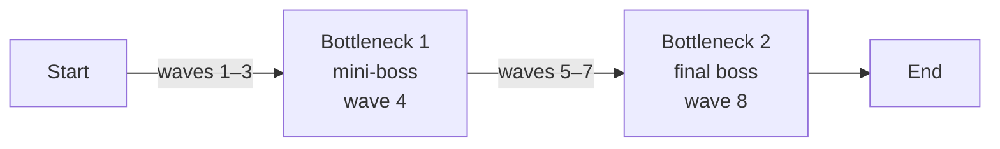

# Level Flow – Map 1 (Ngoại ô)



## 1. What is it?

This is a **level flow diagram**: a map of a level as a sequence of *beats* instead of a map of space. It doesn't show where things are; it shows **what the player goes through, in what order**, and where the intensity peaks.

This diagram uses a **linear flow with two bottlenecks**:

- **Segment** (the arrows): a stretch of waves where the player learns, builds and grows stronger. The pressure rises, but slowly.
- **Bottleneck** (the boxes in the middle): a point every player must pass through. It's a skill check: it tests whether the player learned what the segment before it taught. You can't skip it or go around it.
- **Start / End**: entry and exit. The end is the reward (in Guardian of Dawn: the cure ingredient NL1 and the story scene).

Why bottlenecks matter:

| Purpose | What it does |
|---|---|
| Checks skill | The designer knows for sure that every player who reaches wave 6 can handle what waves 1–4 taught. Content after a bottleneck can build on that. |
| Paces the level | It creates a peak, then a drop. Without peaks, 10 waves feel like one long wave. |
| Splits the level into chapters | "Before the mini-boss" and "after the mini-boss" are two halves the player remembers. |
| Gives a natural place for rewards and new content | Right after a bottleneck the player feels they earned something; that's the best time to unlock or introduce something. |

The intensity this flow produces is a **sawtooth**: it rises through the segment, peaks at the bottleneck, drops for a short rest, then rises again higher than before.

```
intensity
  ▲                             ██
  │                         ██  ██
  │             ██      ██  ██  ██
  │         ██  ██  ██  ██  ██  ██
  │     ██  ██  ██  ██  ██  ██  ██
  │ ██  ██  ██  ██  ██  ██  ██  ██
  └───────────────────────────────▶ wave
     1   2   3   4   5   6   7   8
                 ▲ B1            ▲ B2
```

Wave 5 drops below wave 4 on purpose: that's the rest after the bottleneck.

## 2. How can we apply it?

### Rules for designing each part

1. **Give each segment one job.** Waves 1–3 teach the basics; waves 5–7 add something new and make it harder. If a segment tries to teach three things at once, the bottleneck can't tell which one the player failed.
2. **A bottleneck only tests what was taught before it.** Never put a new mechanic *first* at the bottleneck. If the mini-boss needs AoE damage, the player must have had a reason to build AoE in waves 1–3.
3. **Give a rest after every bottleneck.** The wave after a boss should be easier than the boss. The player needs time to rebuild and spend what they earned.
4. **Introduce new things right after a bottleneck, not right before.** The player is calm and has new resources, so they're ready to learn.
5. **The final bottleneck tests everything.** The final boss should require what segment 1 *and* segment 2 taught.
6. **Telegraph bottlenecks.** Players should know a boss is coming (a warning at dawn, a UI marker on the day counter) so they can prepare. A surprise boss feels unfair; a known boss feels like a goal.

### How to use it during production

- **As a spec**: turn each arrow and box into rows of a wave table (see section 3). Each row needs a goal, not just a list of enemies.
- **As a playtest checklist**: watch where testers fail. Failing at a bottleneck is intended. Failing in the middle of a segment means that segment's difficulty is too steep.
- **As a template**: once map 1 works, the other 4 maps can reuse the same shape and change only the content (longer segments, more bottlenecks on larger maps).

## 3. Examples

### 3.1 Applied to Guardian of Dawn – Map 1

This follows GDD v2: map 1 is **8 days** (one wave per day), the tutorial sun storm is on **day 6**, the final boss is on the last day, and there is **no checkpoint**. The wave-by-wave placement of everything else is my suggestion.

| Wave | Part | Content | What it teaches / tests | Intensity |
|---|---|---|---|---|
| 1 | Segment 1 | Few tier-1 wax, single path | Place towers, the day/night loop | Very low |
| 2 | Segment 1 | More tier-1 wax; R03 (soldiers) becomes affordable | Upgrades, research, first squad (Lính trấn thủ) | Low |
| 3 | Segment 1 | Bigger groups; the first Sáp vụn appear in small numbers | Tower + soldier together; AoE becomes useful | Medium |
| **4** | **Bottleneck 1** | **First big Sáp vụn swarm (10–20 tiny wax), led by an oversized tier-1 wax** | **Did the player build AoE (flamethrower, mortar)?** | **High** |
| 5 | Segment 2 (rest) | Light wave; Tháp điện chuỗi research becomes affordable | Spend the mini-boss reward | Medium–low |
| 6 | Segment 2 | **Tutorial sun storm** (destroys 1 tower, marked 10 s ahead) + a normal wave | Rebuilding, not stacking everything in one tower | Medium |
| 7 | Segment 2 | Largest normal wave: swarms + normal wax together | Full build check before the boss | High |
| **8** | **Bottleneck 2** | **Sáp Nguyên Thủy** (giant tier-1 wax) + Sáp vụn escorts | **Single-target damage (boss) and AoE (escorts) at once** | **Highest** |
| End | – | NL1 Sáp nguyên sơ, chapter 1 story scene | – | – |

Notes:

- **Storm placement**: day 6 is the first wave after the rest, so the storm lands in segment 2 as rule 4 asks, with no change to the GDD.
- **No checkpoint**: a loss restarts the map from wave 1, so losing to the final boss costs 7 waves of replay. That's why map 1 stays short and why bottleneck 1 should be fair rather than brutal: it's a lesson, not a gate that makes players replay three waves over and over.

### 3.2 Examples from other games

| Game | Structure | What to take from it |
|---|---|---|
| **Plants vs. Zombies** | Many levels have a "huge wave" flag halfway through and a final huge wave at the end, shown on the progress bar | Almost exactly this diagram. The progress bar telegraphs both bottlenecks, so the player always knows when the pressure peaks. |
| **The Legend of Zelda** (dungeons) | Mini-boss in the middle guards a new item; the second half of the dungeon and the boss require that item | Bottleneck 1 gives a reward that segment 2 is built around. For map 1: the mini-boss could lead straight into the Tháp điện chuỗi research. |
| **Bloons TD 6** | The first MOAB-class balloon arrives at round 40 as a hard check | A bottleneck that tests one specific answer (here: damage against high-HP targets). If the player doesn't have it, they lose there, not randomly. |
| **Super Mario Bros.** (levels) | A midway checkpoint splits the level; the flagpole ends it | A contrast: Mario lowers the cost of failure with a checkpoint. Guardian of Dawn has none, so it keeps the cost down with short maps and fair bottlenecks instead. |

## 4. Common mistakes to avoid

- **The wall**: a bottleneck far harder than the segment before it. Players stop instead of learning. Fix: the last wave of a segment should be about 70–80% as hard as the bottleneck.
- **The surprise test**: the boss needs something the level never encouraged. Fix: check rule 2 for every boss.
- **No rest**: wave 5 as hard as wave 4. The player can't recover, and the mini-boss win feels like nothing.
- **Same peak twice**: if the mini-boss and final boss test the same thing, the second half teaches nothing new.
