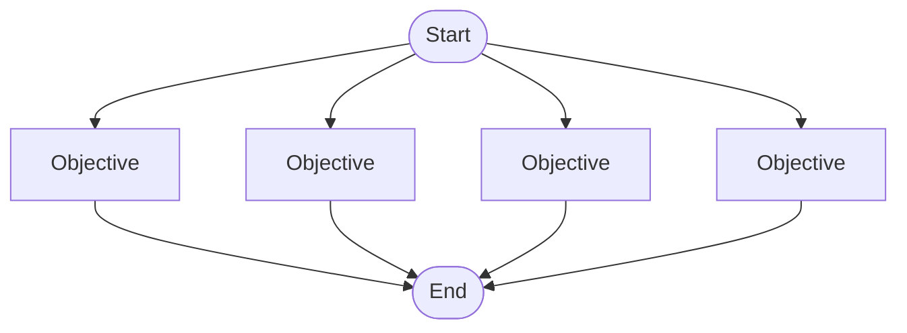
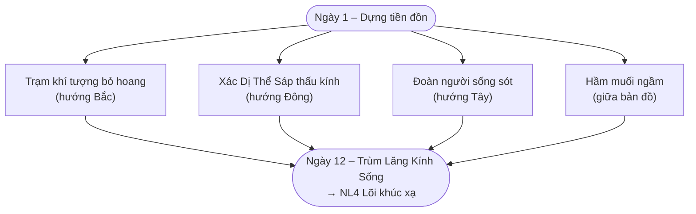
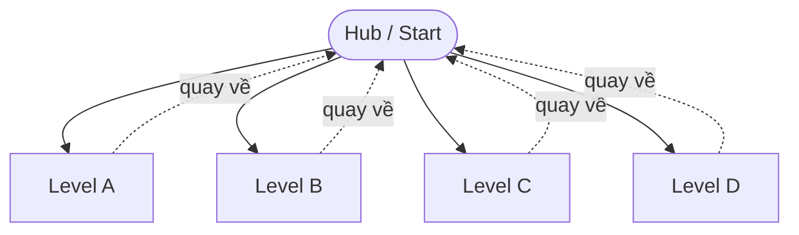
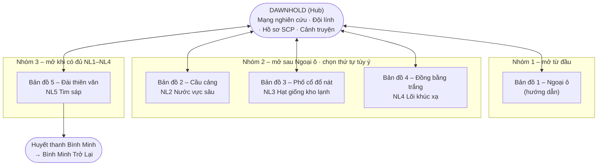

# Level Flow Models – Open & Hubs and Spokes

*Bài tập Week 05 – Level Design (slide 17–19). Áp dụng cho dự án **Guardian of Dawn** (xem `Guardian-of-Dawn-GDD-v2.md`).*

Với mỗi mô hình: **What is it?** → **How can we apply it?** (vào Guardian of Dawn) → **Examples**.

---

## 1. Open (Mô hình mở)

### 1.1 What is it?

- Người chơi bắt đầu trong một không gian chung và phải hoàn thành **một số nhiệm vụ (objective)**, nhưng **tự chọn thứ tự và cách làm**.
- **Kết quả phụ thuộc vào những nhiệm vụ đã làm** – làm nhiều/ít, làm cái nào trước sẽ ảnh hưởng tới phần thưởng hoặc trạng thái cuối.
- Đây là **systemic level design**: designer không vẽ đường đi, mà xây dựng **một hệ thống luật** (kẻ địch, tài nguyên, công cụ); người chơi tương tác với hệ thống theo cách mình muốn. Còn gọi là **sandbox level**.

| Ưu điểm | Nhược điểm |
|---|---|
| Người chơi có cảm giác tự do, kiểm soát cao | Khó kiểm soát độ khó và nhịp độ (pacing) – không biết người chơi sẽ gặp gì trước |
| Replay value cao: mỗi lần chơi một cách khác | Người chơi dễ bị lạc / không biết làm gì tiếp nếu thiếu hướng dẫn |
| Khuyến khích sáng tạo, nhiều lời giải cho cùng một vấn đề | Tốn công test: số tổ hợp thứ tự objective tăng rất nhanh |

### 1.2 How can we apply it?

**Nguyên tắc chung khi thiết kế level Open:**

1. Mỗi objective phải **độc lập** (không objective nào bắt buộc phải xong trước objective khác), hoặc chỉ phụ thuộc nhẹ.
2. Độ khó của từng objective nên **gần nhau**, hoặc tự co giãn (scale) theo số objective đã xong.
3. Luôn hiển thị rõ **danh sách objective và tiến độ** để người chơi không bị lạc.
4. Phần thưởng của mỗi objective phải **khác nhau về loại**, để thứ tự chọn là một quyết định chiến lược thật sự.
5. Có **điều kiện kết thúc rõ ràng** (ví dụ: xong X/Y objective, hoặc hết thời gian).

**Áp dụng vào Guardian of Dawn – Bản đồ 4 “Đồng bằng trắng” theo mô hình Open**

Bản đồ 4 là cánh đồng muối trắng, không chỗ che, có **3 hướng tấn công** – rất hợp để biến thành một level mở. Thay vì chỉ “sống sót 12 ngày”, người chơi có **4 objective phụ** rải quanh tiền đồn, tự chọn ngày nào làm cái nào (mỗi ngày chỉ nên làm 1 objective vì phòng tuyến bị chia mỏng):

| Objective | Cách hoàn thành | Phần thưởng | Đánh đổi |
|---|---|---|---|
| **Trạm khí tượng** (Bắc) | Giữ một Công binh đứng ở trạm hết một ngày | Biết trước xác suất bão cho các ngày còn lại (như R05 miễn phí) | Công binh không sửa tường được ngày đó |
| **Xác thấu kính** (Đông) | Thợ săn hạ 5 Dị Thể Sáp thấu kính ở hướng Đông | Thêm mẫu vật M4 → nghiên cứu Giáp phản quang (R14) sớm | Thợ săn rời tường, hướng khác yếu đi |
| **Người sống sót** (Tây) | Hộ tống đoàn người tới tường – không để Dị Thể Sáp chạm tới họ | Tài nguyên lớn + lore (hồ sơ SCP) | Phải dồn công trình sang hướng Tây |
| **Hầm muối** (giữa) | Đặt Cột thu sáng trên hầm, sống sót 1 cơn bão mặt trời | Mở rộng khu vực đặt công trình (như +1 cấp tường) | Phải chờ ngày có bão – rủi ro mất công trình |

- **Kết quả phụ thuộc task:** objective là **tùy chọn** – không làm vẫn thắng được bản đồ, nhưng trùm ngày 12 sẽ khó hơn rất nhiều. Làm đủ 4 objective → mở **thành tích bản đồ** (khớp mục 5.7 của GDD).
- **Systemic:** ta không kịch bản hóa thứ tự; chỉ đặt ra luật (3 hướng tấn công, bão ngẫu nhiên, hội tụ của thấu kính). Người chơi tự quyết định tách binh lính và công trình theo hướng nào.
- **Kiểm soát độ khó:** bể Dị Thể Sáp tăng nhẹ theo **số objective đã hoàn thành**, không theo objective cụ thể → làm theo thứ tự nào thì độ khó cũng tương đương.
- **Chống lạc:** UI ban đêm hiện bảng objective (đã xong / đang làm / chưa làm) và đánh dấu vị trí trên bản đồ.

### 1.3 Examples

| Game | Cách dùng mô hình Open |
|---|---|
| **Grand Theft Auto V** | Ví dụ kinh điển của sandbox: thành phố mở, nhiệm vụ chính/phụ làm theo thứ tự tùy ý, hệ thống cảnh sát/giao thông tự vận hành |
| **The Legend of Zelda: Breath of the Wild** | Sau Great Plateau, có thể đi thẳng tới Ganon hoặc làm 4 Divine Beast theo bất kỳ thứ tự nào – số Divine Beast đã giải ảnh hưởng tới trận cuối |
| **Hitman (2016)** | Mỗi màn là một sandbox: một mục tiêu ám sát nhưng hàng chục cách tiếp cận dựa trên hệ thống NPC, cải trang, vật dụng |
| **Far Cry 3/5** | Chiếm tiền đồn, tháp radio theo thứ tự tùy ý; mỗi cái mở thêm tài nguyên/nhiệm vụ |
| **Minecraft** | Systemic hoàn toàn: không có thứ tự, “End” (Ender Dragon) chỉ là một mục tiêu tùy chọn |
| **They Are Billions** (survival mode) | Gần gũi nhất với Guardian of Dawn: bản đồ mở, người chơi tự quyết mở rộng theo hướng nào trước khi các đợt zombie tới |

---

## 2. Hubs and Spokes (Trung tâm và nhánh)

### 2.1 What is it?

- **Hub** là một level (hoặc một phần level) đóng vai trò trung tâm; các level khác (**spokes**) tỏa ra từ hub. Xong một spoke, người chơi **quay về hub**.
- Là **cách nhóm các level lại**:
  - Cho người chơi **cảm giác kiểm soát** (tự chọn spoke nào chơi trước).
  - Nhưng vẫn **kiểm soát “level explosion”** – tránh việc người chơi bị ngợp vì quá nhiều lựa chọn.
- Bằng cách chia level thành từng spoke, designer **kiểm soát lượng nội dung có sẵn tại một thời điểm**:
  - Chỉ **mở khóa vài spoke một lúc** (gating).
  - Người chơi tập trung vào nội dung đang mở, **làm chủ nó trước khi chuyển sang thử thách mới**.
- Hub thường là nơi **nâng cấp, mua sắm, nghe cốt truyện, chọn level** – một vùng an toàn, nhịp độ thấp, xen giữa các level căng thẳng.

| Ưu điểm | Nhược điểm |
|---|---|
| Cân bằng tốt giữa tự do và kiểm soát | Phải đi lại hub nhiều lần → có thể nhàm (cần fast travel / menu nhanh) |
| Dễ gating theo tiến trình (mở khóa theo đợt) | Các spoke chơi theo thứ tự tùy ý → khó thiết kế đường cong độ khó |
| Hub tạo “ngôi nhà” và cảm giác tiến bộ (hub thay đổi theo tiến trình) | Hub cần nội dung riêng, tốn thêm tài nguyên phát triển |

### 2.2 How can we apply it?

**Nguyên tắc chung khi thiết kế Hub and Spokes:**

1. Hub phải có **chức năng thật** (nâng cấp, chuẩn bị, cốt truyện), không chỉ là menu chọn màn.
2. Chia spoke thành **các nhóm mở khóa** (tier); trong một nhóm, các spoke nên có **độ khó tương đương**.
3. Có **điều kiện mở nhóm tiếp theo** rõ ràng (ví dụ: xong 2/3 spoke, hoặc có đủ X sao/vật phẩm).
4. Hub nên **thay đổi** theo tiến trình để người chơi thấy mình đang tiến bộ.
5. Mỗi spoke nên mang về thứ gì đó **dùng được ở hub** – nối vòng lặp hub ↔ spoke.

**Áp dụng vào Guardian of Dawn – Dawnhold làm Hub, 5 vùng đất làm Spokes**

Trong GDD v2, chiến dịch đang là **Linear** (Ngoại ô → Cầu cảng → Phố cổ → Đồng bằng → Đài thiên văn). Đề xuất chuyển sang Hub and Spokes như sau:

**Hub – Dawnhold:**

- Giữa các bản đồ, người chơi trở về Dawnhold (hiện GDD chỉ dùng Dawnhold cho cảnh truyện và bản đồ chiến dịch). Tại đây:
  - **Phòng nghiên cứu:** dùng mẫu vật M1–M5 và nguyên liệu NL1–NL5 cho mạng nghiên cứu.
  - **Doanh trại:** hồi máu, bổ sung, xem cấp bậc của 3 đội lính (Lính trấn thủ, Thợ săn, Công binh).
  - **Kho hồ sơ:** đọc hồ sơ SCP đã mở khóa.
  - **Bàn chỉ huy:** bản đồ khu vực – chọn spoke tiếp theo.
- **Hub thay đổi theo tiến trình chữa trị:** sau mỗi cột mốc C1–C4, Dawnhold có thêm chi tiết (phòng thí nghiệm lớn hơn, những người đầu tiên được chữa xuất hiện quanh hub – mở rộng ý ở mục 6.7 của GDD).

**Spokes – 5 vùng đất, gating theo nhóm:**

| Nhóm | Spoke | Điều kiện mở | Lý do |
|---|---|---|---|
| 1 | Ngoại ô | Từ đầu | Bản đồ hướng dẫn – dạy lõi tower defense, nghiên cứu, cơn bão đầu tiên. Bắt buộc chơi trước |
| 2 | Cầu cảng, Phố cổ đổ nát, Đồng bằng trắng | Xong Ngoại ô | Người chơi **tự chọn thứ tự** → cảm giác kiểm soát; chỉ mở 3 spoke một lúc → không bị ngợp |
| 3 | Đài thiên văn | Có đủ NL1–NL4 | Bản đồ cuối, kiểm tra mọi kỹ năng – chỉ mở khi người chơi đã làm chủ nội dung nhóm 2 |

**Những thay đổi cần làm để GDD hỗ trợ mô hình này:**

- **Độ khó theo số bản đồ đã xong, không theo thứ tự cố định:** hiện GDD gắn “bản đồ N → bậc N”. Với spoke chơi tùy ý, mỗi bản đồ vẫn giữ **bậc đặc trưng** của nó (Cầu cảng = hổ, Phố cổ = hồi phục, Đồng bằng = thấu kính), nhưng số ngày, máu Dị Thể Sáp và xác suất bão được **scale theo số spoke đã hoàn thành** (spoke thứ 2 = 10 ngày/10%, thứ 3 = 12 ngày/12%, thứ 4 = 12 ngày/15%).
- **Mạng nghiên cứu theo nhóm thay vì theo tầng tuyến tính:** tầng 2–4 mở theo loại mẫu vật thu được (đã có sẵn cơ chế nút [REDACTED] mở khi có mẫu vật đầu tiên) → chơi spoke nào trước thì nhánh nghiên cứu tương ứng mở trước. Các nút khắc chế quan trọng (Thợ săn R04, Tháp làm lạnh R10) nên nằm ở tầng 1 hoặc cần mẫu vật M1 để không bị khóa khi chọn thứ tự “sai”.
- **Nhánh Chữa trị:** C1–C3 không còn theo chuỗi NL2→NL3 cố định, mà mỗi nguyên liệu mở một cột mốc riêng; C4 cần đủ NL1–NL4. Cốt truyện vẫn tuyến tính ở **khung** (mở đầu Ngoại ô, kết thúc Đài thiên văn), chỉ phần giữa là tùy thứ tự.
- **Replay spoke:** sau khi xong, có thể quay lại spoke cũ từ hub để farm mẫu vật hoặc thử chiến thuật khác (GDD mục 5.1 đã cho phép chơi lại bản đồ đã qua).

> **Ghi chú quyết định:** Đây là **đề xuất** cho bài tập. Nếu nhóm muốn giữ cốt truyện tuyến tính chặt chẽ như GDD v2, có thể dùng phiên bản nhẹ hơn: giữ thứ tự 5 bản đồ, nhưng vẫn biến **Dawnhold thành hub** có chức năng thật giữa các bản đồ, và thêm các **spoke phụ** (bản đồ thử thách ngắn 3–5 ngày, mở dần) để người chơi farm mẫu vật / luyện cấp bậc đội lính.

### 2.3 Examples

| Game | Hub | Spokes & cách gating |
|---|---|---|
| **Super Mario 64** | Lâu đài Peach | Mỗi bức tranh là một level; cửa mở khi có đủ số Power Star |
| **Crash Bandicoot 2/3** | Warp Room | Mỗi phòng có 5 level; xong cả 5 + boss → mở phòng tiếp theo |
| **Spyro the Dragon** | Homeworld của mỗi thế giới | Cổng tới các level; cần đủ trứng/gem để mở |
| **Mega Man (series)** | Màn hình chọn Robot Master | 8 stage chọn tùy ý; đánh bại boss nhận vũ khí khắc chế boss khác – rất gần ý “mỗi spoke mang về nguyên liệu” của Guardian of Dawn |
| **Hades** | House of Hades | Nâng cấp (Mirror of Night), nói chuyện NPC, cốt truyện tiến triển giữa các lần chạy |
| **Hollow Knight** | Dirtmouth | Thị trấn trung tâm, mua đồ/bản đồ; các vùng mở dần theo kỹ năng di chuyển |
| **Mass Effect 2** | Tàu Normandy | Chọn nhiệm vụ tuyển đồng đội theo thứ tự tùy ý; nhiệm vụ cuối mở khi đủ điều kiện |
| **Kingdom Rush** (tower defense) | Bản đồ thế giới | Mở từng màn và màn thử thách (Heroic/Iron) dần dần; nâng cấp tháp bằng sao giữa các màn |

---

## 3. So sánh nhanh

| Tiêu chí | Open | Hubs and Spokes |
|---|---|---|
| Cấu trúc | Một không gian, nhiều objective | Một trung tâm, nhiều level tách rời |
| Tự do người chơi | Rất cao | Trung bình – cao (trong nhóm đã mở) |
| Kiểm soát nội dung của designer | Thấp – dựa vào hệ thống | Cao – qua gating từng nhóm spoke |
| Rủi ro chính | Lạc hướng, khó cân bằng | Đi lại hub nhàm, khó đường cong độ khó |
| Áp dụng trong Guardian of Dawn | **Trong một bản đồ** – Bản đồ 4 Đồng bằng trắng với 4 objective tùy chọn | **Cấp chiến dịch** – Dawnhold là hub, 5 vùng đất là spoke chia 3 nhóm |

Hai mô hình **kết hợp được**: chiến dịch dùng Hub and Spokes (Dawnhold → các vùng đất), còn bên trong một số bản đồ dùng Open (objective tùy chọn) – vừa giữ được khung cốt truyện, vừa tăng lựa chọn cho người chơi.

---

## Tham khảo

- Slide *14. LevelDesign_v2* – Game Development, 30-Oct-25 (slide 12–19).
- Rollings & Morris, *Game Architecture and Design*, Chapter 5.
- Jeannie Novak, *Game Development Essentials*, 3rd ed., Chapter 7.
- `Guardian-of-Dawn-GDD-v2.md` – mục 3.6, 4.6, 4.9, 5.1, 5.3, 6.7.
